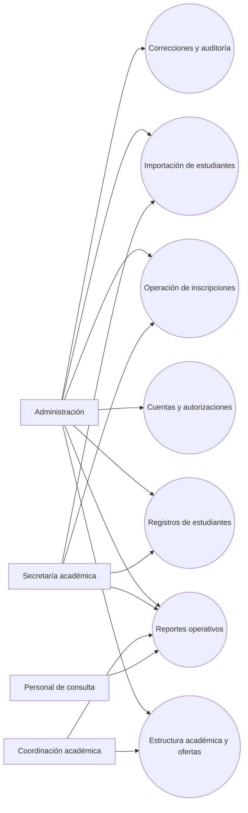

# Actores del sistema

Los actores son personas que interactúan con el sistema mediante una cuenta autorizada para cumplir objetivos operativos. Se identifican por su **responsabilidad frente al proceso de inscripción**, no por una pantalla, un módulo de software ni una entidad almacenada.

Una persona puede reunir varios roles autorizados. En ese caso conserva una única identidad de usuario, y sus operaciones efectivas corresponden a la unión de los permisos que tenga vigentes; los roles no crean cuentas independientes ni restringen por facultad el ámbito de consulta.

## 1. Actores humanos

| Actor | Objetivo principal | Responsabilidades funcionales | Límites relevantes |
| --- | --- | --- | --- |
| **Administrador del sistema** (`ADMIN`) | Mantener la operación institucional y resolver situaciones privilegiadas. | Administrar cuentas, roles y permisos; mantener registros académicos; importar estudiantes y consultar sus resultados detallados; operar inscripciones; ejecutar correcciones extraordinarias; consultar auditoría y reportes. | Debe actuar mediante permisos efectivos, conservar justificación en operaciones extraordinarias y no alterar sus propias asignaciones de roles. |
| **Secretaría académica** (`SECRETARY`) | Ejecutar el registro y mantenimiento ordinario de estudiantes e inscripciones. | Mantener personas y estudiantes; importar estudiantes y consultar sus resultados detallados; registrar, cancelar o retirar inscripciones; cambiar de sección; consultar registros y reportes. | No administra periodos, ofertas, estructura académica, cuentas, roles, permisos ni auditoría. No realiza correcciones extraordinarias. |
| **Coordinación académica** (`ACADEMIC_COORDINATOR`) | Preparar la estructura y la disponibilidad académica necesarias para inscribir. | Mantener facultades, departamentos, escuelas, asociaciones de cursos, cursos, categorías y docentes; administrar periodos y ofertas; consultar estudiantes, inscripciones y reportes. | No registra ni modifica inscripciones, no administra cuentas ni consulta auditoría. No modifica datos personales sin autorización independiente. |
| **Personal de consulta** (`REPORT_VIEWER`) | Supervisar la operación mediante reportes institucionales. | Consultar únicamente los reportes operativos autorizados. | No adquiere acceso directo a entidades, historial individual de movimientos, estados de cargas de importación, observaciones por fila, archivos originales ni auditoría por el solo hecho de consultar reportes. |

La administración de cuentas y permisos comprende las autorizaciones explícitas del usuario, incluso cuando una misma cuenta tiene varias responsabilidades. No se interpreta que `ADMIN` pueda ignorar reglas académicas ni que la coordinación académica pueda inscribir por el solo hecho de administrar ofertas.

## 2. Participantes que no son actores de acceso

| Participante | Relación con la inscripción | Motivo por el que no es actor de la primera versión |
| --- | --- | --- |
| **Estudiante** | Titular de una inscripción y destinatario de sus efectos académicos. | No existe autoservicio de inscripción, retiro ni consulta autenticada para estudiantes. Sus solicitudes son atendidas por personal autorizado fuera del sistema. |
| **Docente** | Responsable de dictar una oferta asignada, aunque pertenezca a otra facultad. | Su perfil académico no concede un portal docente ni permisos de operación sobre inscripciones. |
| **Universidad** | Institución única a la que pertenecen las unidades académicas y los registros. | Es el contexto institucional de uso; no una cuenta ni un usuario. |
| **Proceso de importación asíncrona** | Ejecuta el procesamiento aceptado de archivos de estudiantes. | Es un participante técnico interno que actúa en nombre de una operación autorizada, no un rol humano ni un acceso independiente. |

No se incorporan como actores sistemas externos de pagos, calificaciones, matrícula curricular, horarios, comunicaciones o sincronización institucional, porque no forman parte de las capacidades aprobadas.

## 3. Objetivos de interacción

Los objetivos se agrupan para mostrar **qué busca conseguir cada actor**, no para representar el diseño de permisos completo.

La coordinación también consulta información de estudiantes e inscripciones para preparar y supervisar la oferta; esa consulta no la habilita a modificar estos registros. Los reportes pueden incluir totales agregados de importaciones; el seguimiento y las observaciones de cada archivo requieren `students.imports.read`, asignado inicialmente a administración y secretaría.

## 4. Condiciones transversales de actuación

**Identidad y sesión.** Todo actor accede con credenciales propias y sesión válida. No hay registro público de cuentas. Las acciones se atribuyen a la cuenta autenticada, con independencia de los roles que reúna.

**Autorización por operación.** La presencia de un actor en un proceso no sustituye la validación del permiso concreto. Una misma operación puede ser accesible para varios actores, pero sus límites funcionales siguen siendo los mismos.

**Alcance institucional.** Los permisos aprobados son institucionales: no se presume una segmentación automática por facultad, escuela o departamento. Los filtros académicos utilizados para trabajar o consultar información no equivalen a restricciones de autorización.

**Separación de funciones.** Preparar un periodo u oferta no concede autoridad para registrar una inscripción. Consultar reportes no concede acceso directo a todos los recursos utilizados para elaborarlos. Consultar auditoría tampoco concede capacidad para modificarla.

**Responsabilidad histórica.** Las cancelaciones, retiros, cambios de sección y correcciones quedan vinculados al usuario que ejecuta la operación y al motivo obligatorio. El hecho de registrar una acción administrativa no convierte al estudiante ni al docente afectado en su ejecutor.

## 5. Límites de interpretación

Un **actor** representa una función externa frente al sistema; un **rol** es una agrupación administrable de permisos. Los cuatro actores reflejan los roles institucionales iniciales, pero los roles personalizados no constituyen automáticamente nuevas funciones externas ni cambian los objetivos de interacción.

El procesamiento interno puede continuar después de que el actor haya enviado una solicitud de importación, sin que el worker se convierta en un quinto actor de negocio. La interacción humana concluye al aceptar o rechazar la solicitud inicial y se reanuda cuando el usuario consulta el seguimiento.
