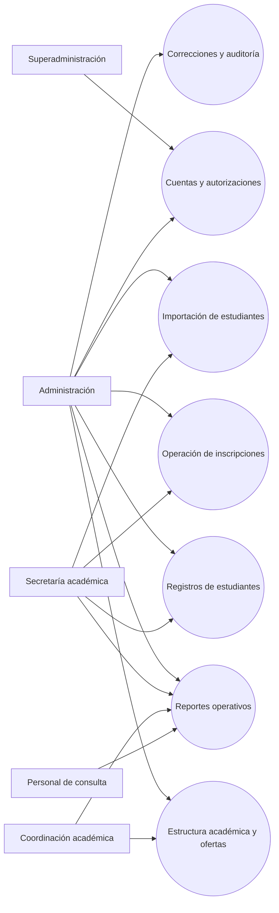

# Actores del sistema

Los actores son personas que interactúan con el sistema mediante una cuenta autorizada para cumplir objetivos operativos. Se identifican por su **responsabilidad frente al proceso de inscripción**, no por una pantalla, un módulo de software ni una entidad almacenada.

Una persona puede reunir varios roles autorizados sin crear cuentas independientes. Sus permisos efectivos son la unión de los que aportan los roles vigentes; el alcance de consulta y operación depende de las capacidades autorizadas y de sus condiciones funcionales, no de la denominación del rol.

## 1. Actores humanos

| Actor                                                 | Objetivo principal                                                                       | Responsabilidades funcionales                                                                                                                                                                                                                    | Límites relevantes                                                                                                                                                                                               |
| ----------------------------------------------------- | ---------------------------------------------------------------------------------------- | ------------------------------------------------------------------------------------------------------------------------------------------------------------------------------------------------------------------------------------------------ | ---------------------------------------------------------------------------------------------------------------------------------------------------------------------------------------------------------------- |
| **Superadministración institucional** (`SUPER_ADMIN`) | Administrar las cuentas administrativas y preservar la facultad institucional superior.  | Gestionar otras cuentas `ADMIN`, sus asignaciones permitidas y las operaciones institucionales para las que dispone de permisos efectivos.                                                                                                       | Existe una sola cuenta habilitada con este rol; no admite modificaciones administrativas de su cuenta, asignación o definición protegida.                                                                        |
| **Administración del sistema** (`ADMIN`)              | Gestionar la operación administrativa y resolver actuaciones expresamente privilegiadas. | Administrar cuentas ordinarias, asignaciones autorizadas, roles personalizados, recursos académicos, correcciones extraordinarias y auditoría conforme a sus permisos.                                                                           | No administra cuentas `ADMIN` ni `SUPER_ADMIN`, no asigna ni retira el rol `ADMIN` y no altera sus propias asignaciones.                                                                                         |
| **Secretaría académica** (`SECRETARY`)                | Ejecutar el registro y mantenimiento ordinario de estudiantes e inscripciones.           | Mantener personas y estudiantes; importar estudiantes y consultar sus resultados detallados; registrar, cancelar o retirar inscripciones; cambiar de sección; consultar registros y reportes.                                                    | No administra periodos, ofertas, estructura académica, cuentas, roles, permisos ni auditoría. No realiza correcciones extraordinarias.                                                                           |
| **Coordinación académica** (`ACADEMIC_COORDINATOR`)   | Preparar la estructura y la disponibilidad académica necesarias para inscribir.          | Mantener facultades, departamentos académicos, programas académicos, asociaciones programa–curso, cursos y docentes; consultar categorías de cursos; administrar periodos académicos y ofertas; consultar estudiantes, inscripciones y reportes. | No registra ni modifica inscripciones, no administra cuentas ni consulta auditoría. No modifica datos personales sin autorización independiente.                                                                 |
| **Personal de consulta** (`REPORT_VIEWER`)            | Supervisar la operación mediante reportes institucionales.                               | Consultar únicamente los reportes operativos autorizados.                                                                                                                                                                                        | No adquiere acceso directo a entidades, historial individual de movimientos, estados de cargas de importación, observaciones por fila, archivos originales ni auditoría por el solo hecho de consultar reportes. |

La asignación de un rol no sustituye los permisos efectivos ni las condiciones específicas de cada operación. Los perfiles académicos, las responsabilidades institucionales y las cuentas de acceso no son equivalentes: disponer de facultades sobre cursos, estudiantes, usuarios o reportes no concede automáticamente las demás. Una cuenta deshabilitada conserva sus asignaciones, pero no puede ejercerlas ni reactivar sesiones por ese motivo.

## 2. Participantes que no son actores de acceso

| Participante                         | Relación con la inscripción                                                    | Motivo por el que no es actor de la primera versión                                                                                                              |
| ------------------------------------ | ------------------------------------------------------------------------------ | ---------------------------------------------------------------------------------------------------------------------------------------------------------------- |
| **Estudiante**                       | Titular de una inscripción y destinatario de sus efectos académicos.           | No existe autoservicio de inscripción, retiro ni consulta autenticada para estudiantes. Sus solicitudes son atendidas por personal autorizado fuera del sistema. |
| **Docente**                          | Responsable de dictar una oferta asignada, aunque pertenezca a otra facultad.  | Su perfil académico no concede un portal docente ni permisos de operación sobre inscripciones.                                                                   |
| **Universidad**                      | Institución única a la que pertenecen las unidades académicas y los registros. | Es el contexto institucional de uso; no una cuenta ni un usuario.                                                                                                |
| **Proceso de importación asíncrona** | Ejecuta el procesamiento aceptado de archivos de estudiantes.                  | Es un participante técnico interno que actúa en nombre de una operación autorizada, no un rol humano ni un acceso independiente.                                 |

No se incorporan como actores sistemas externos de pagos, calificaciones, matrícula curricular, horarios, comunicaciones o sincronización institucional, porque no forman parte de las capacidades aprobadas.

## 3. Objetivos de interacción

Los objetivos identifican las responsabilidades principales de los actores. Las operaciones concretas continúan sujetas a los permisos y condiciones de cada capacidad; el diagrama no constituye una matriz de autorización ni limita las combinaciones legítimas de roles.

La coordinación también consulta información de estudiantes e inscripciones para preparar y supervisar la oferta; esa consulta no la habilita a modificar estos registros. Los reportes incluyen totales agregados de importaciones; el seguimiento y las observaciones de cada archivo requieren `students.imports.read`, asignado inicialmente a administración y secretaría.

## 4. Condiciones transversales de actuación

**Identidad y sesión.** Todo actor accede con credenciales propias y sesión válida. No hay registro público de cuentas. Las acciones se atribuyen a la cuenta autenticada, con independencia de los roles que reúna.

**Autorización por operación.** Toda operación exige los permisos efectivos correspondientes y el cumplimiento de las condiciones funcionales y de seguridad aplicables. La autorización se determina por las capacidades vigentes del actor, con independencia de cómo se distribuyan entre sus roles. Las restricciones adicionales expresamente establecidas para determinadas operaciones también son obligatorias.

**Alcance institucional.** Los permisos aprobados son institucionales: no se presume una segmentación automática por facultad, programa académico o departamento. Los filtros académicos utilizados para trabajar o consultar información no equivalen a restricciones de autorización.

**Separación de funciones.** La autorización para una capacidad no concede por sí sola otras capacidades de consulta o modificación. Cada operación conserva su alcance de acceso y sus condiciones propias, aunque se relacione con los mismos recursos o participe en un mismo proceso.

**Responsabilidad histórica.** Las cancelaciones, retiros, cambios de sección y correcciones quedan vinculados al usuario que ejecuta la operación y al motivo obligatorio. El hecho de registrar una acción administrativa no convierte al estudiante ni al docente afectado en su ejecutor.

## 5. Límites de interpretación

Un **actor** representa una función externa frente al sistema; un **rol** es una agrupación administrable de permisos. Los cinco actores reflejan responsabilidades institucionales inicialmente previstas, no un listado exhaustivo de roles autorizados para cada operación ordinaria. Los roles personalizados no constituyen automáticamente nuevas funciones externas ni cambian los objetivos de interacción. Una cuenta puede reunir varios roles, sin herencia jerárquica entre ellos.

El procesamiento interno puede continuar después de que el actor haya enviado una solicitud de importación, sin que el worker se convierta en un quinto actor de negocio. La interacción humana concluye al aceptar o rechazar la solicitud inicial y se reanuda cuando el usuario consulta el seguimiento.
