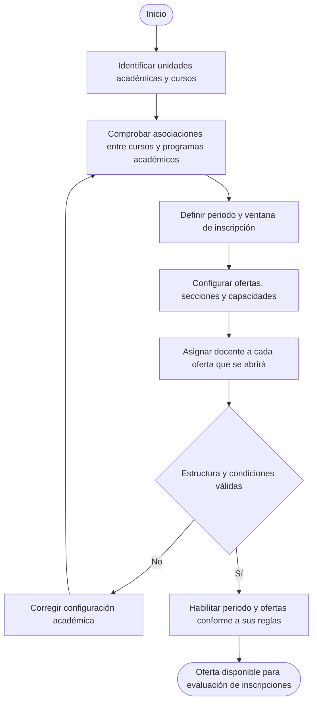
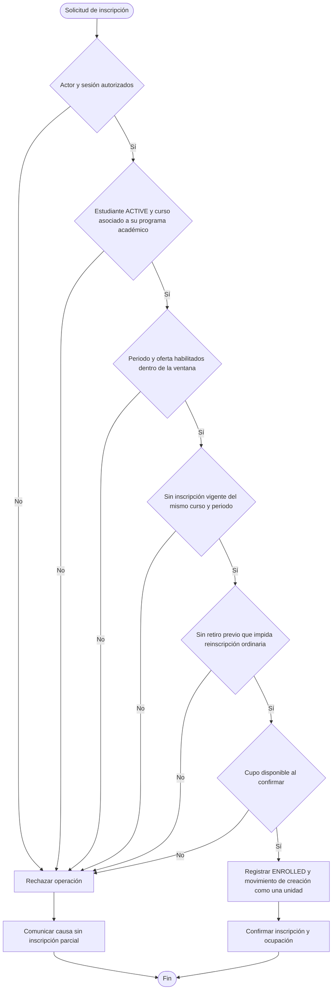
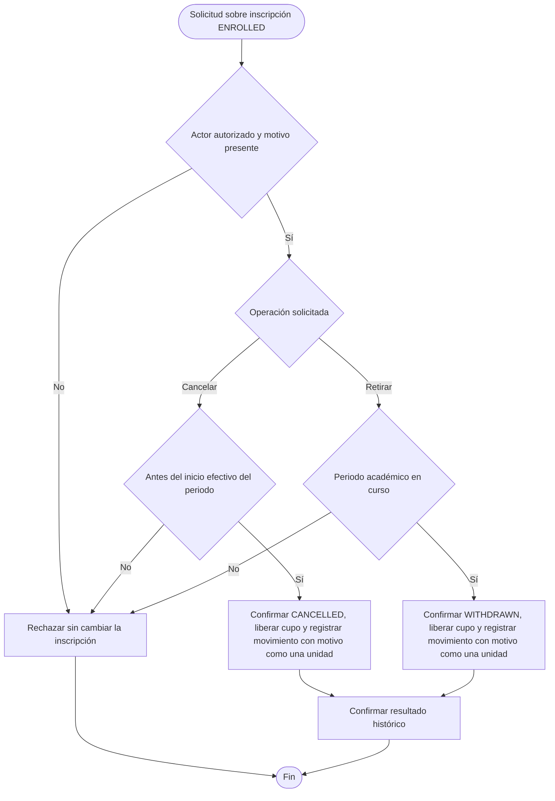
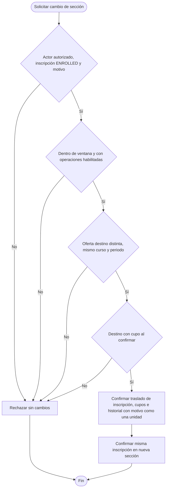
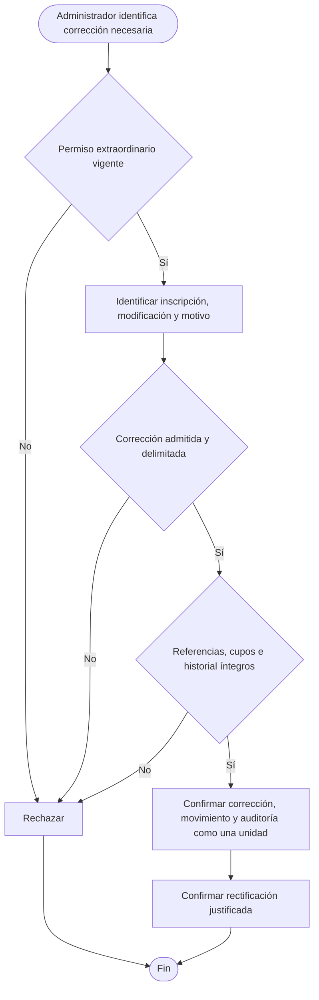
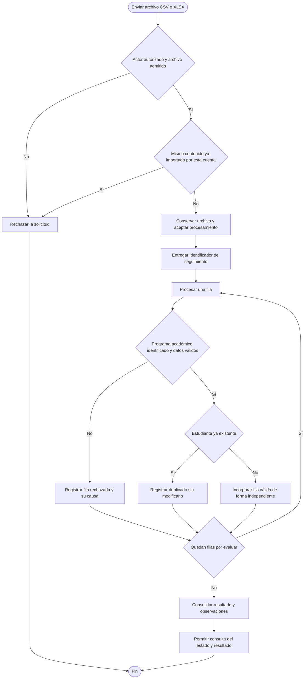
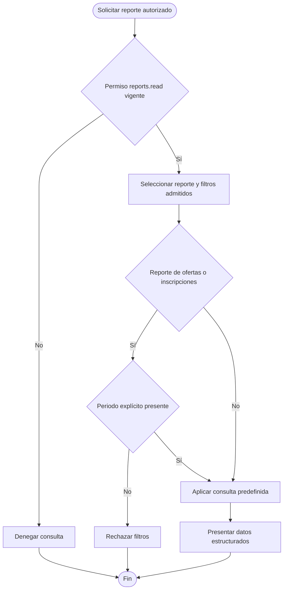

# Procesos de negocio

Los procesos describen **cómo avanza una operación funcional desde la solicitud del personal autorizado hasta su resultado**, incluidas las decisiones que determinan su aceptación o rechazo. Se representan con actividades y puntos de decisión; no especifican controladores, tablas, algoritmos de bloqueo ni mecanismos internos de despliegue.

Una operación aceptada mantiene la consistencia de los datos afectados y conserva la evidencia funcional que corresponda. Una operación rechazada no debe dejar resultados parciales que aparenten éxito.

## 1. Preparar la inscripción académica

La preparación organiza la información necesaria para que exista una oferta inscribible. No implica realizar inscripciones por anticipado ni habilitar automáticamente cualquier curso del catálogo.

**Participación.** Administración y coordinación académica mantienen estructura, periodos y ofertas. Secretaría puede consultarlos para operar inscripciones, sin modificar su configuración. La apertura efectiva exige que la oferta disponga de docente; la elegibilidad final de una inscripción depende también del estudiante, del momento y de los cupos al solicitarla.

**Condiciones de rechazo.** Una estructura incoherente, un curso no asociado al programa académico pertinente, una oferta no habilitable o una configuración incompatible con registros vigentes impiden completar el paso afectado. La falta de habilitación no se resuelve mediante una excepción implícita para secretaría.

## 2. Registrar una inscripción

El registro es inmediato: una solicitud válida produce una inscripción `ENROLLED`. No existen solicitudes pendientes de aprobación.

**Puntos críticos.** El curso se compara dentro de un periodo, no únicamente por identificador de oferta. Dos secciones distintas no justifican dos inscripciones vigentes del mismo estudiante al mismo curso. Una inscripción retirada previamente en ese curso y periodo impide una reinscripción ordinaria. Una inscripción cancelada sigue histórica; si una nueva inscripción está permitida, se registra separadamente.

**Resultado consistente.** El cupo se ocupa solo cuando la inscripción queda aceptada. Solicitudes simultáneas no pueden hacer que se supere la capacidad ni que existan duplicados vigentes. El registro del movimiento inicial acompaña la operación aceptada.

## 3. Cancelar o retirar una inscripción

Cancelar y retirar no son etiquetas intercambiables elegidas por el operador. Cada operación representa un momento académico diferente y conserva su propia historia.

**Cancelación.** Corresponde a la anulación ordinaria antes del inicio académico. Si vuelve a permitirse la inscripción, debe crearse un registro nuevo; no se revive el cancelado.

**Retiro.** Corresponde a una inscripción vigente durante el periodo en curso. Libera el cupo, pero impide la reinscripción ordinaria del mismo estudiante en ese curso y periodo.

**Después del cierre.** El cierre del periodo no convierte una inscripción retirada o cancelada en completada y tampoco habilita estas operaciones ordinarias. Las actuaciones excepcionales requieren una corrección administrativa justificada.

## 4. Cambiar de sección

El traslado no cancela ni crea otra inscripción: mantiene su identidad y modifica su oferta vigente junto con el historial correspondiente.

**Falla durante el traslado.** No se libera definitivamente el cupo de origen ni se ocupa el de destino por separado. Si no puede completarse el conjunto, la inscripción conserva su sección anterior.

**Cambio fuera de la ventana.** No se acepta como operación ordinaria, aunque el usuario tenga permiso de cambio de sección. Una rectificación extraordinaria es una actuación administrativa distinta y justificada.

## 5. Ejecutar una corrección extraordinaria

La corrección es una excepción controlada a las operaciones ordinarias, no una vía general para evitar las reglas académicas.

No se define aquí un catálogo de modificaciones arbitrarias. La facultad excepcional se limita a los cambios de inscripción autorizados, con conservación de la coherencia y de la explicación histórica. Un rechazo mantiene íntegra la situación previa.

## 6. Importar estudiantes

La recepción del archivo y su procesamiento son momentos distintos. El actor no espera a que todas las filas terminen para obtener una constancia de aceptación.

**Aislamiento.** El resultado de una fila no debe anular inserciones ya válidas de otras filas. Una fila rechazada no deja un estudiante parcialmente registrado. Los estudiantes existentes permanecen sin cambios.

**Seguimiento.** El archivo original, el actor que lo envió, el estado del procesamiento, las cantidades y los errores por fila deben poder examinarse. Si ocurre una falla general, el estado no se presenta como éxito completo y se conservan los resultados ya válidos.

## 7. Consultar reportes de operación

Los reportes son consultas predefinidas y no operaciones de mantenimiento académico.

Los reportes distinguen situaciones vigentes e históricas mediante filtros admitidos. Pueden incluir **indicadores agregados de importaciones**, pero no entregan archivos originales, observaciones por fila ni seguimiento detallado de una carga. Los datos presentados no implican facultad para modificar inscripciones, consultar auditoría o administrar usuarios.

## 8. Resultados que deben permanecer distinguibles

| Situación                 | Resultado funcional                                                                            |
| ------------------------- | ---------------------------------------------------------------------------------------------- |
| Inscripción válida        | `ENROLLED`, cupo ocupado, creación e identidad del actor registradas.                          |
| Inscripción inválida      | Rechazo sin cupo ni inscripción parcial.                                                       |
| Cancelación ordinaria     | `CANCELLED`, plaza liberada, motivo e historial preservados.                                   |
| Retiro ordinario          | `WITHDRAWN`, plaza liberada y prohibición de reinscripción ordinaria al mismo curso y periodo. |
| Cambio de sección         | Misma inscripción, nuevo destino, ocupación consistente e historial del traslado.              |
| Corrección extraordinaria | Modificación acotada y justificada, sin pérdida de integridad.                                 |
| Archivo aceptado          | Seguimiento disponible; procesamiento aún no necesariamente concluido.                         |
| Fila inválida o duplicada | Resultado registrado sin modificar datos que no corresponde modificar.                         |
| Consulta de reporte       | Datos de lectura; ninguna modificación operativa asociada.                                     |

Los diagramas representan la secuencia funcional y sus decisiones. Las verificaciones de fechas, autorización y consistencia se realizan en el momento en que la operación intenta confirmarse, no solamente cuando el usuario selecciona una opción.
