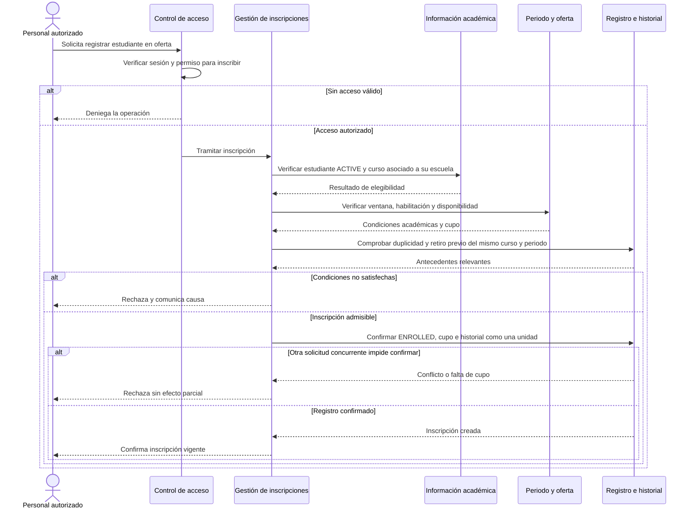
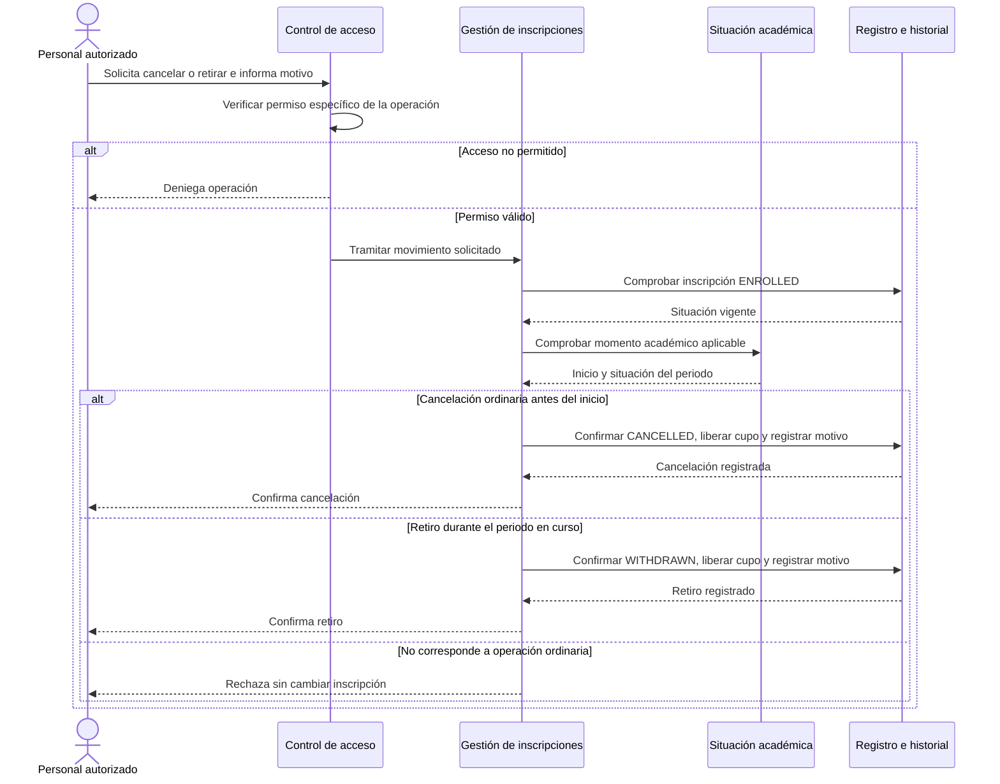
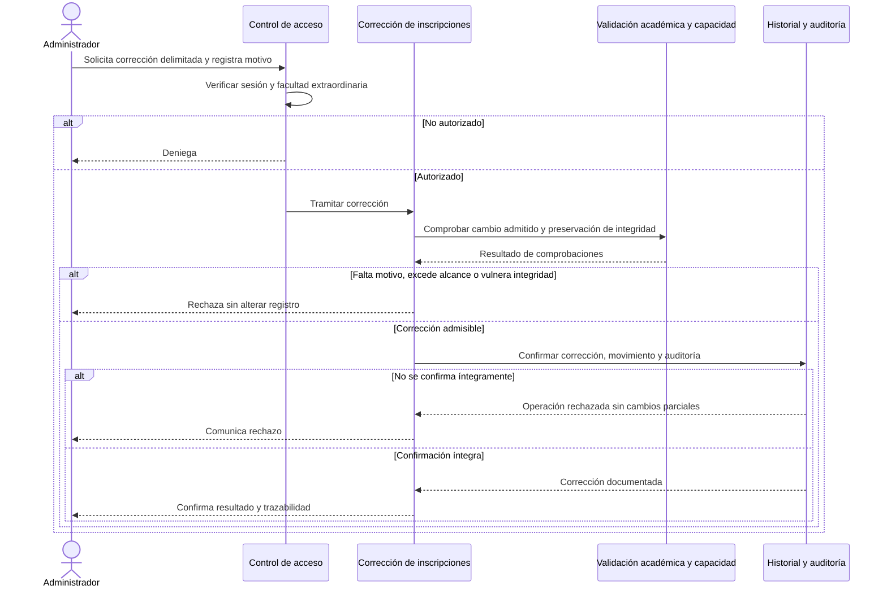
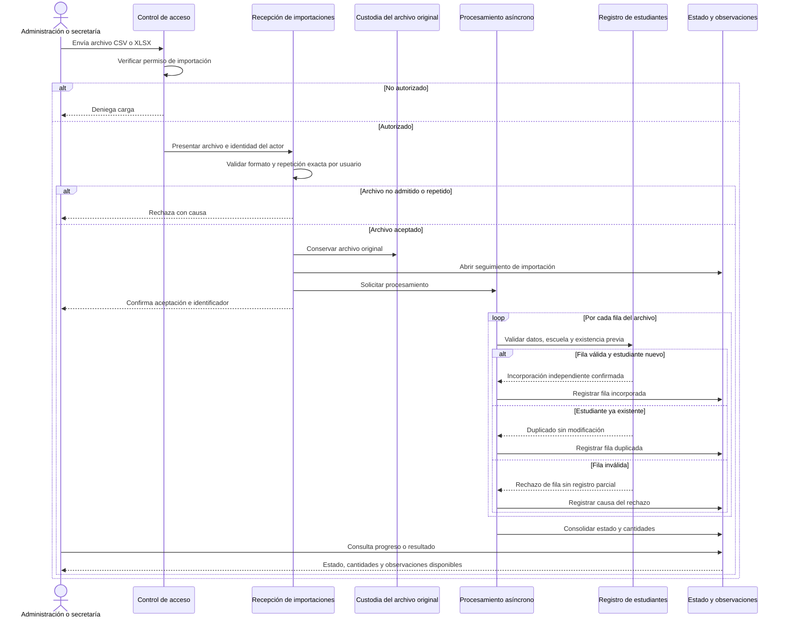
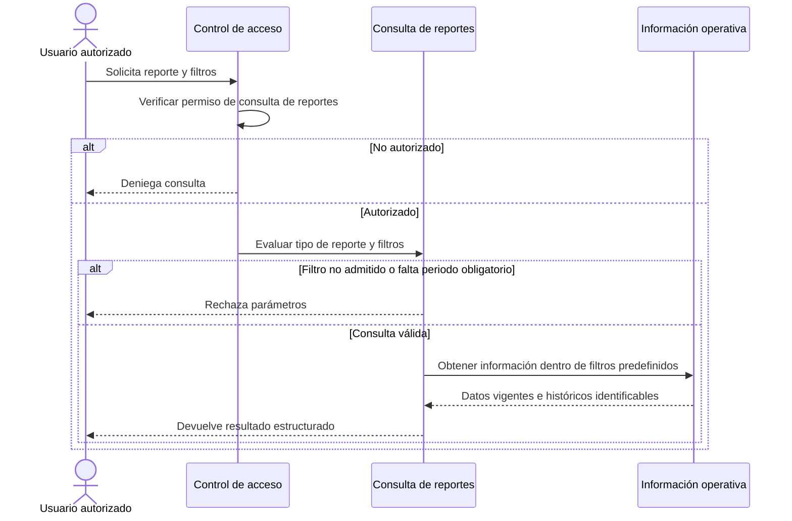
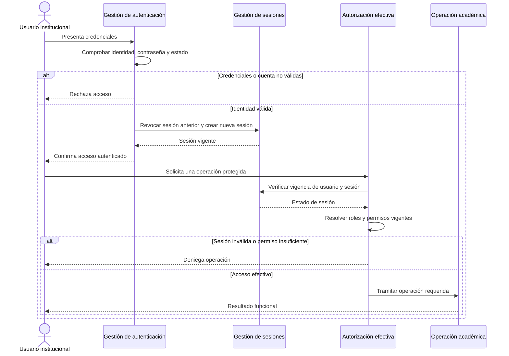

# Secuencias de interacción funcional

Las secuencias muestran **cómo colaboran el actor, la gestión de acceso y las responsabilidades funcionales** para producir resultados verificables. Cada participante designa una responsabilidad del sistema, no una clase, un servicio concreto, una ruta HTTP ni una estructura de almacenamiento.

Los rechazos se comunican al actor sin convertir una operación incompleta en un cambio válido. La conservación de movimientos y la auditoría son efectos de la acción correspondiente, no acciones que el operador deba ejecutar por separado.

## 1. Alta de inscripción



**Interpretación.** Una comprobación favorable previa no reserva indefinidamente el cupo. Al confirmar se garantiza que la oferta aún tenga capacidad y que no aparezca una segunda inscripción vigente del mismo curso y periodo. El historial de creación acompaña el registro aceptado.

## 2. Cambio de sección

```mermaid
sequenceDiagram
    actor Operador as Personal autorizado
    participant Acceso as Control de acceso
    participant Gestion as Gestión de inscripciones
    participant Oferta as Periodo y ofertas
    participant Registro as Registro e historial

    Operador->>Acceso: Solicita traslado con destino y motivo
    Acceso->>Acceso: Verificar sesión y permiso de cambio de sección
    alt Sin autorización
        Acceso-->>Operador: Deniega la operación
    else Autorizado
        Acceso->>Gestion: Tramitar cambio
        Gestion->>Registro: Consultar inscripción vigente y oferta origen
        Registro-->>Gestion: Inscripción ENROLLED y origen
        Gestion->>Oferta: Verificar ventana, habilitación, mismo curso y periodo
        Oferta-->>Gestion: Compatibilidad y disponibilidad del destino
        alt Motivo ausente o traslado no admitido
            Gestion-->>Operador: Rechaza, conserva origen
        else Traslado admisible
            Gestion->>Registro: Confirmar traslado de cupo, nueva oferta y movimiento
            alt Conflicto de capacidad o fallo
                Registro-->>Gestion: Traslado no confirmado
                Gestion-->>Operador: Rechaza; mantiene inscripción y cupo de origen
            else Traslado confirmado
                Registro-->>Gestion: Misma inscripción en nueva oferta
                Gestion-->>Operador: Confirma sección nueva
            end
        end
    end
```

**Interpretación.** Se conserva el identificador de inscripción. El movimiento informa origen, destino, responsable, momento y justificación; no se transforma el cambio en una cancelación seguida de inscripción independiente.

## 3. Cancelación y retiro: efectos diferenciados



**Interpretación.** La solicitud indica qué operación pretende realizar el actor. El sistema **no transforma automáticamente** una solicitud de cancelación en retiro cuando las fechas ya no admiten cancelar. El retiro conserva su prohibición de reinscripción ordinaria del mismo curso y periodo; la cancelación permanece histórica y permite un nuevo registro únicamente si vuelven a satisfacerse las condiciones ordinarias.

## 4. Corrección administrativa extraordinaria



**Interpretación.** Las condiciones extraordinarias habilitan una intervención especializada, pero no autorizan alterar libremente la inscripción ni sus referencias. La justificación, el movimiento funcional y la atribución administrativa forman parte del resultado.

## 5. Importación asíncrona de estudiantes



**Interpretación.** La respuesta de aceptación no declara terminada la carga. Cada fila queda tratada de manera independiente, y una falla global se expresa como resultado no completado; el archivo y los avances ya confirmados conservan su evidencia. El trabajador asíncrono es una responsabilidad interna, no una cuenta con un rol académico adicional.

## 6. Consulta de reportes



**Interpretación.** Los reportes sobre ofertas e inscripciones requieren seleccionar un periodo. Los indicadores agregados de importaciones no exponen seguimiento individual de cargas, archivos originales ni observaciones por fila. El permiso de reportes no se transforma en permiso de lectura general de entidades, consulta detallada de importaciones ni acceso a la auditoría.

## 7. Acceso y responsabilidad por operación



**Interpretación.** La identidad autenticada y la autorización de cada operación son comprobaciones diferentes. Tener sesión no concede acceso a todas las capacidades, y una sesión revocada no mantiene los permisos que tuvo anteriormente. La gestión concreta de credenciales de sesión y sus protecciones técnicas no altera estos resultados funcionales.

## 8. Principios de lectura de las secuencias

- **El rechazo no es una transición de negocio.** Una acción denegada no cambia el estado de una inscripción ni registra un movimiento funcional como si hubiera ocurrido.
- **La operación crítica se confirma como una unidad.** Registro, cambio de sección, cancelación, retiro y corrección preservan sus efectos e historia de manera coherente; la descomposición interna no forma parte de esta representación funcional.
- **El actor solicita; el sistema comprueba.** La selección de una oferta o de un movimiento no garantiza su aceptación, aunque el actor disponga del permiso general.
- **La importación separa aceptación y ejecución.** El seguimiento refleja resultados parciales y finales sin ocultar filas rechazadas o duplicadas.
- **La consulta no altera.** Reportes y auditoría son capacidades de lectura con permisos propios y resultados diferenciados.
