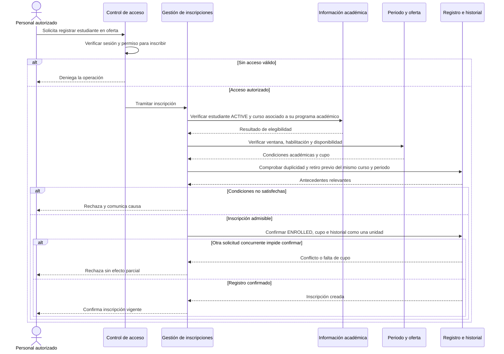
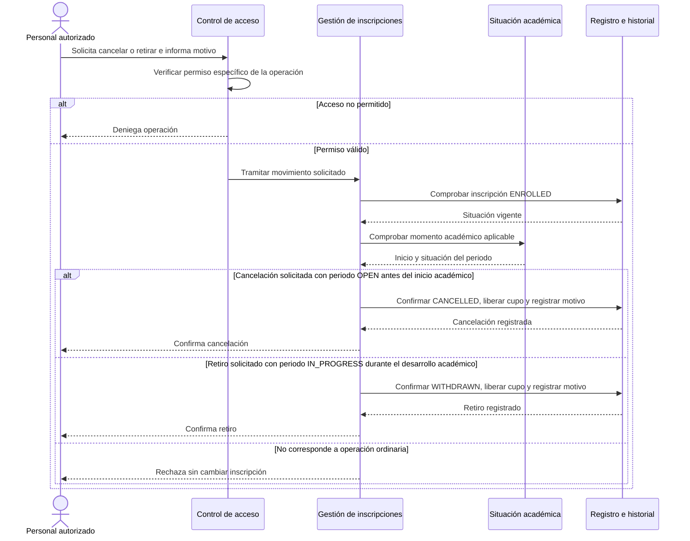
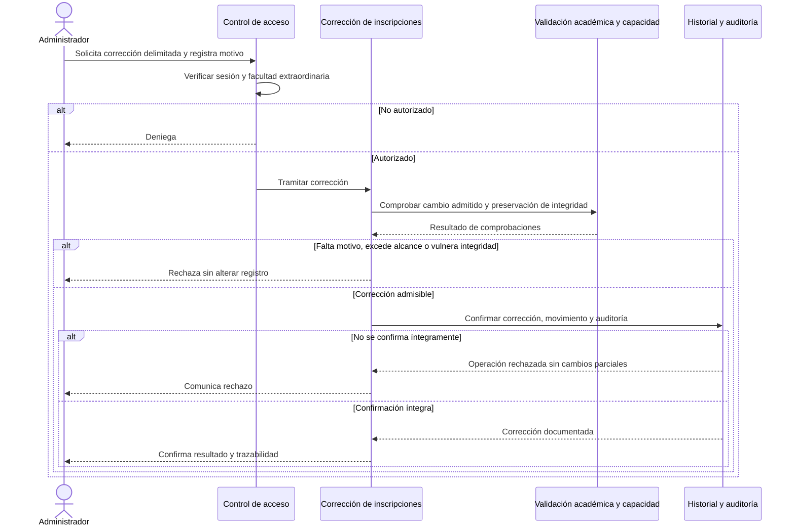
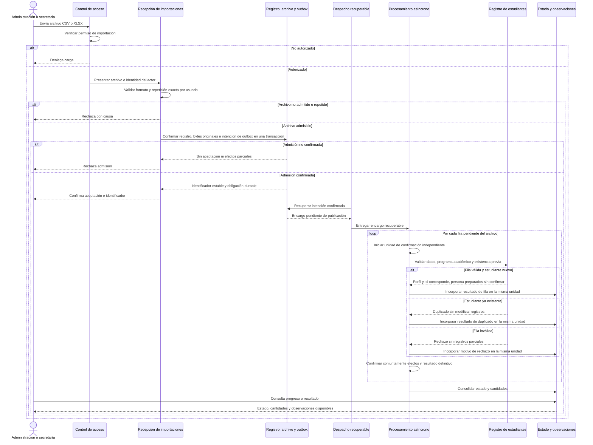
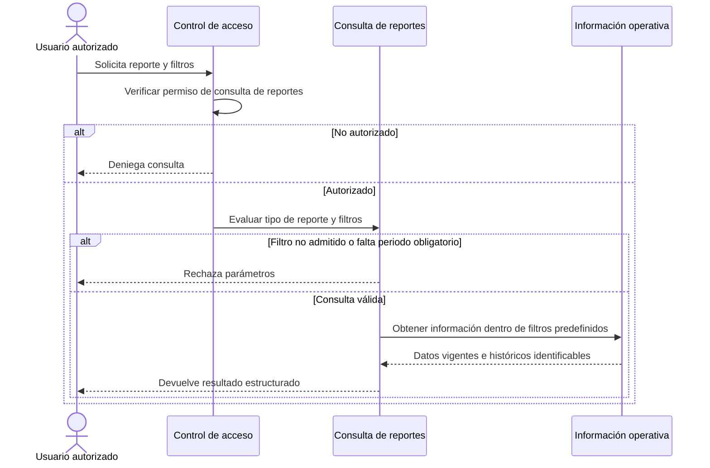
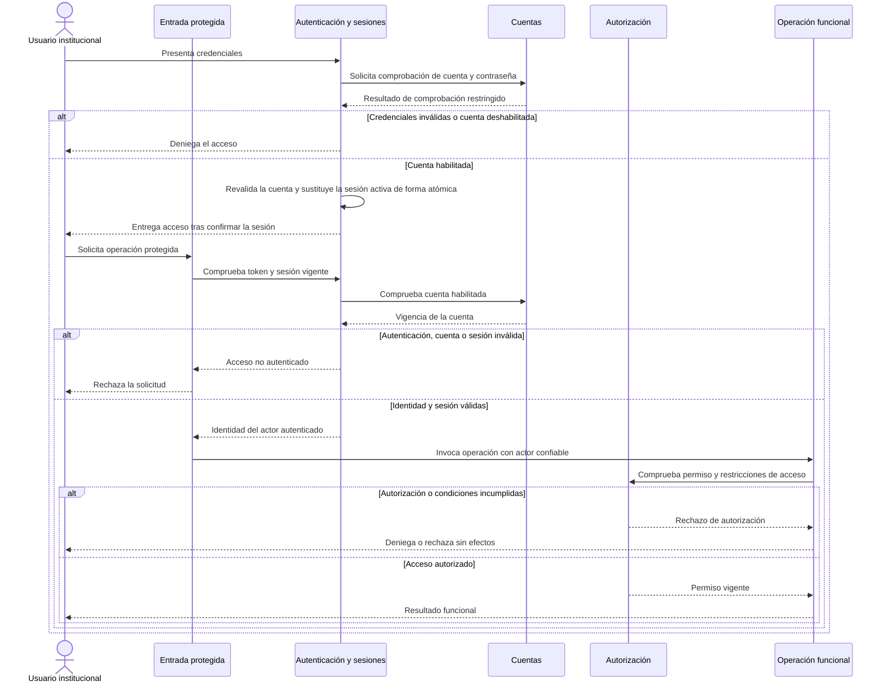

# Secuencias de interacción funcional

Las secuencias muestran **cómo colaboran el actor, la gestión de acceso y las responsabilidades funcionales** para producir resultados verificables. Cada participante designa una responsabilidad del sistema, no una clase, un servicio concreto, una ruta HTTP ni una estructura de almacenamiento.

Los rechazos se comunican al actor sin convertir una operación incompleta en un cambio válido. La conservación de movimientos y la auditoría son efectos de la acción correspondiente, no acciones que el operador deba ejecutar por separado.

## 1. Alta de inscripción



**Interpretación.** Una comprobación favorable previa no reserva indefinidamente el cupo. Al confirmar se garantiza que la oferta aún tenga capacidad y que no aparezca una segunda inscripción vigente del mismo curso y periodo. El historial de creación acompaña el registro aceptado.

## 2. Cambio de sección

```mermaid
sequenceDiagram
    actor Operador as Personal autorizado
    participant Acceso as Control de acceso
    participant Gestion as Gestión de inscripciones
    participant Oferta as Periodo y ofertas
    participant Registro as Registro e historial

    Operador->>Acceso: Solicita traslado con destino y motivo
    Acceso->>Acceso: Verificar sesión y permiso de cambio de sección
    alt Sin autorización
        Acceso-->>Operador: Deniega la operación
    else Autorizado
        Acceso->>Gestion: Tramitar cambio
        Gestion->>Registro: Consultar inscripción vigente y oferta origen
        Registro-->>Gestion: Inscripción ENROLLED y origen
        Gestion->>Oferta: Verificar ventana, habilitación, mismo curso y periodo
        Oferta-->>Gestion: Compatibilidad y disponibilidad del destino
        alt Motivo ausente o traslado no admitido
            Gestion-->>Operador: Rechaza, conserva origen
        else Traslado admisible
            Gestion->>Registro: Confirmar traslado de cupo, nueva oferta y movimiento
            alt Conflicto de capacidad o fallo
                Registro-->>Gestion: Traslado no confirmado
                Gestion-->>Operador: Rechaza; mantiene inscripción y cupo de origen
            else Traslado confirmado
                Registro-->>Gestion: Misma inscripción en nueva oferta
                Gestion-->>Operador: Confirma sección nueva
            end
        end
    end
```

**Interpretación.** Se conserva el identificador de inscripción. El movimiento informa origen, destino, responsable, momento y justificación; no se transforma el cambio en una cancelación seguida de inscripción independiente.

## 3. Cancelación y retiro: efectos diferenciados



**Interpretación.** La solicitud indica qué operación pretende realizar el actor. El sistema **no transforma automáticamente** una solicitud de cancelación en retiro cuando las fechas ya no admiten cancelar. El retiro conserva su prohibición de reinscripción ordinaria del mismo curso y periodo; la cancelación permanece histórica y permite un nuevo registro únicamente si vuelven a satisfacerse las condiciones ordinarias.

## 4. Corrección administrativa extraordinaria



**Interpretación.** Las condiciones extraordinarias habilitan una intervención especializada, pero no autorizan alterar libremente la inscripción ni sus referencias. La justificación, el movimiento funcional y la atribución administrativa forman parte del resultado.

## 5. Importación asíncrona de estudiantes



**Interpretación.** La aceptación exige confirmar en una sola transacción de PostgreSQL el registro de importación, los bytes originales del archivo y la intención de ejecución en el outbox. Solo después de esa confirmación se comunica la aceptación; el despacho y la entrega al procesamiento ocurren posteriormente y pueden repetirse sin duplicar efectos funcionales. La respuesta de aceptación no declara terminada la carga. Cada fila se confirma independientemente: si corresponde registrar una persona y un perfil estudiantil, ambos registros y el resultado definitivo de la fila pertenecen a la misma unidad; los duplicados y rechazos confirman únicamente su resultado, sin modificar registros académicos. Si la unidad falla, no queda una incorporación sin resultado ni un resultado de incorporación sin sus registros; el tratamiento se reintenta o recupera sin repetir efectos ya confirmados. Una falla global se expresa como resultado no completado y conserva el archivo original y los avances confirmados. El trabajador asíncrono es una responsabilidad interna, no una cuenta con un rol académico adicional.

## 6. Consulta de reportes



**Interpretación.** Los reportes sobre ofertas e inscripciones requieren seleccionar un periodo. Los indicadores agregados de importaciones no exponen seguimiento individual de cargas, archivos originales ni observaciones por fila. El permiso de reportes no se transforma en permiso de lectura general de entidades, consulta detallada de importaciones ni acceso a la auditoría.

## 7. Acceso y responsabilidad por operación



**Interpretación.** La comprobación de la cuenta y sus credenciales se obtiene de `users` mediante una capacidad restringida, sin trasladar la propiedad del verificador de contraseña. `authentication` administra las sesiones persistidas y confirma la sustitución de una sesión activa antes de entregar las nuevas credenciales. La autorización resuelve los permisos vigentes sin administrar sesiones. Conservar un token no evita el efecto de una revocación, una cuenta deshabilitada o un permiso retirado.

Las operaciones administrativas que deshabilitan o bloquean cuentas, así como los cambios y restablecimientos de contraseña, se coordinan desde `users` con la revocación realizada por `authentication`. El estado de la cuenta, la revocación y la evidencia obligatoria forman un solo resultado transaccional. La colaboración no concede a `users` facultad de escritura directa sobre las sesiones.

## 8. Registro y vinculación de cuentas

El registro de una cuenta admite una vinculación personal opcional. Cuando se proporciona una persona existente, se comprueban su vigencia y la ausencia de otra cuenta asociada. Cuando se solicita crear también la persona, `users` coordina el alta con `persons`, que conserva la validación y el registro de su identidad. Las asignaciones iniciales de roles, si se solicitan, se realizan por `authorization`. Cada capacidad aplica sus permisos y la protección institucional correspondiente. La creación conjunta, las asignaciones iniciales y su evidencia forman una única confirmación, sin altas parciales.

La vinculación posterior parte de una cuenta existente que aún no tiene persona asociada y de una persona vigente y libre de vinculación. El actor requiere `users.person.link` y autoridad sobre la cuenta destinataria. Se confirma la asociación con su auditoría sin modificar el correo de acceso, las credenciales, los roles, el estado administrativo ni las sesiones. Una vinculación previa no se reasigna ni se retira; cualquier conflicto de cardinalidad, vigencia o autorización impide confirmar la operación.

## 9. Principios de lectura de las secuencias

- **El rechazo no es una transición de negocio.** Una acción denegada no cambia el estado de una inscripción ni registra un movimiento funcional como si hubiera ocurrido.
- **La operación crítica se confirma como una unidad.** Registro, cambio de sección, cancelación, retiro y corrección preservan sus efectos e historia de manera coherente; la descomposición interna no forma parte de esta representación funcional.
- **El actor solicita; el sistema comprueba.** La selección de una oferta o de un movimiento no garantiza su aceptación, aunque el actor disponga del permiso general.
- **La importación separa aceptación y ejecución.** El seguimiento refleja resultados parciales y finales sin ocultar filas rechazadas o duplicadas.
- **La consulta no altera.** Reportes y auditoría son capacidades de lectura con permisos propios y resultados diferenciados.
