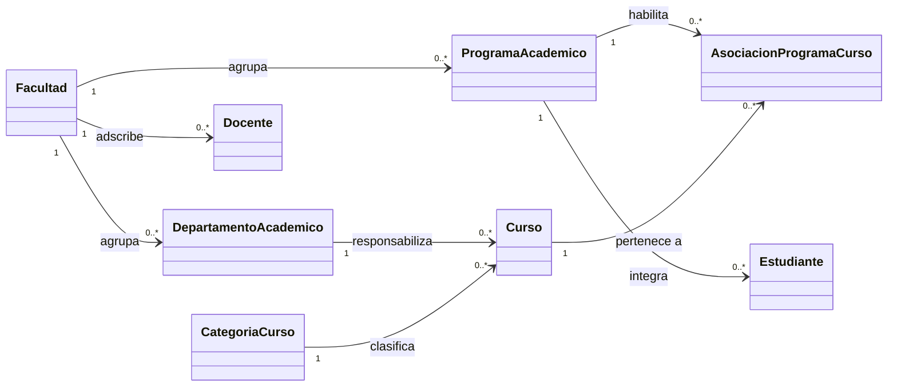
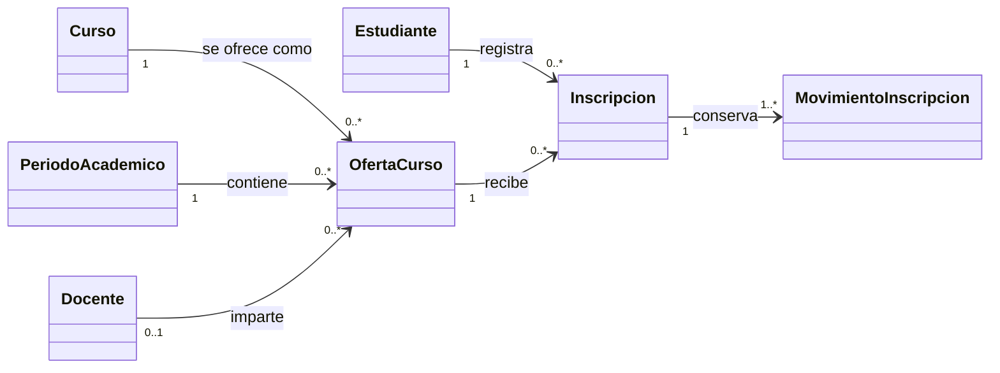

# Modelo del dominio

El modelo distingue **identidad**, **estructura académica**, **oferta**, **inscripción** y **evidencia operativa**. Estas responsabilidades tienen relaciones explícitas, pero no son equivalentes: una persona no es una cuenta, un curso no es una sección y una inscripción no es un resultado académico.

## 1. Identidad y perfiles

| Concepto       | Significado en el dominio                                                         | Relación esencial                                                                                                       |
| -------------- | --------------------------------------------------------------------------------- | ----------------------------------------------------------------------------------------------------------------------- |
| **Persona**    | Identidad humana común a perfiles académicos y, cuando corresponda, a una cuenta. | Se identifica por un tipo y número de documento; puede participar en varios perfiles sin duplicar sus datos personales. |
| **Estudiante** | Perfil mediante el cual una persona se incorpora al registro de inscripciones.    | Corresponde a una persona y pertenece a un programa académico vigente.                                                  |
| **Docente**    | Perfil de una persona habilitada para responsabilizarse de ofertas académicas.    | Corresponde a una persona y está adscrito a una facultad.                                                               |
| **Usuario**    | Cuenta que permite actuar dentro del sistema con autorizaciones verificables.     | Puede estar vinculada a una persona; no concede por sí misma condición de estudiante o docente.                         |

Una persona puede poseer perfiles de estudiante y docente simultáneamente: las relaciones representan responsabilidades diferentes. En cambio, cada perfil de estudiante o docente identifica una sola persona y una persona tiene como máximo un perfil de cada tipo. La identificación del personal que opera el sistema se resuelve mediante su cuenta, no mediante la pertenencia a un perfil académico.

Las operaciones realizadas en nombre de un estudiante son **operaciones administrativas**: el estudiante no es un actor autenticado de autoservicio en el alcance aprobado.

## 2. Estructura académica

El ámbito institucional comprende **una única universidad**. No existe una entidad de universidad ni una partición de datos por institución.

| Concepto                      | Responsabilidad                                                                                                       | Relación                                                                                                                                |
| ----------------------------- | --------------------------------------------------------------------------------------------------------------------- | --------------------------------------------------------------------------------------------------------------------------------------- |
| **Facultad**                  | Unidad académica organizativa de primer nivel, identificada por una sigla institucional y un nombre.                  | Agrupa departamentos académicos, programas académicos y docentes; conserva una identidad permanente independiente de su sigla y nombre. |
| **Departamento académico**    | Unidad responsable de la adscripción y mantenimiento académico de cursos.                                             | Pertenece a una facultad y es propietario académico de múltiples cursos.                                                                |
| **Programa académico**        | Unidad a la que pertenece un estudiante y que determina qué cursos puede inscribir.                                   | Pertenece a una facultad; se vincula a cursos mediante asociaciones explícitas.                                                         |
| **Curso**                     | Unidad académica identificable en el catálogo institucional, independiente del momento y la sección en que se ofrece. | Pertenece a un departamento y puede corresponder a varios programas académicos.                                                         |
| **Asociación programa–curso** | Episodio de vigencia que habilita a los estudiantes de un programa a inscribirse en ofertas del curso.                | Resuelve la relación muchos a muchos, preservando desasociaciones y asociaciones posteriores sin duplicar el curso.                     |
| **Categoría de curso**        | Clasificación académica de una sola dimensión para organizar el catálogo.                                             | Clasifica un curso, sin sustituir su pertenencia a un departamento.                                                                     |

Para los recursos que admiten baja lógica, los identificadores y nombres sujetos a unicidad se reservan únicamente mientras el registro permanece vigente. Su reutilización posterior no crea continuidad ni equivalencia histórica entre registros distintos: las relaciones se conservan por identidad permanente.

El programa académico no es propietario exclusivo del curso. El **departamento académico** mantiene la adscripción del curso, mientras que la asociación programa–curso establece su elegibilidad para estudiantes de distintos programas académicos, incluso cuando pertenezcan a facultades diferentes.

La adscripción del docente a una facultad no limita a esa facultad las ofertas que puede impartir: puede ser asignado a un curso de otro departamento o facultad. No se introduce una relación de pertenencia obligatoria entre docente y departamento.

### Relaciones conceptuales

Cada episodio de asociación programa–curso posee un inicio y un final opcional de vigencia; una desasociación lo concluye sin borrarlo y una nueva habilitación constituye un episodio distinto. La relación muchos a muchos entre programas académicos y cursos **no** significa que todos los programas académicos tengan acceso a todas las ofertas. Significa que una oferta de ese curso puede recibir inscripciones de estudiantes de cualquiera de los programas académicos que mantengan una asociación válida.

## 3. Curso, periodo, oferta e inscripción

| Concepto                                | Identidad y significado                                                                                                          | Diferencia determinante                                                                         |
| --------------------------------------- | -------------------------------------------------------------------------------------------------------------------------------- | ----------------------------------------------------------------------------------------------- |
| **Periodo académico**                   | Intervalo institucional de desarrollo académico, con ventana propia de inscripción y situación operativa.                        | Su ventana de inscripción no equivale necesariamente a sus fechas de desarrollo académico.      |
| **Oferta de curso** (`course offering`) | Dictado de un curso en un periodo y una sección determinados, con capacidad y asignación docente obligatoria al abrir la oferta. | No constituye un curso nuevo del catálogo ni se vincula exclusivamente a un programa académico. |
| **Inscripción**                         | Registro de la participación administrativa de un estudiante en una oferta concreta.                                             | No representa solicitud, calificación, asistencia ni aprobación de curso.                       |
| **Movimiento de inscripción**           | Hecho histórico que explica una creación, cancelación, retiro, traslado de sección o corrección.                                 | No sustituye el estado vigente de la inscripción ni el registro general de auditoría.           |

Una misma oferta puede reunir estudiantes de **distintos programas académicos** siempre que cada uno esté asociado al curso. Todos comparten **una única capacidad máxima de esa oferta**; no se crean cupos separados por programa académico.

La elegibilidad de una inscripción se determina por el programa académico vigente del estudiante, la asociación vigente con el curso, la disponibilidad del periodo y de la oferta, la situación del estudiante y las reglas de duplicidad y capacidad.

Cada inscripción conserva una sola **oferta actual**. Un cambio de sección actualiza esa referencia, sin cambiar la identidad de la inscripción ni crear una inscripción adicional. El movimiento asociado conserva cuál era la oferta anterior y cuál pasó a ser la actual.

El **contexto académico con el que se aceptó una inscripción** debe conservarse históricamente: el programa académico que habilitó la inscripción y la identidad del curso y periodo no pueden reinterpretarse retroactivamente por cambios posteriores del catálogo o del perfil del estudiante. Las referencias históricas sobreviven incluso si la asociación programa–curso deja de admitir nuevas inscripciones.

### Relación funcional de las inscripciones

La asignación docente puede estar pendiente mientras la oferta está en preparación. En una oferta **abierta**, el docente debe estar asignado y habilitado; por tanto, la multiplicidad conceptual del docente en una oferta es opcional durante la preparación y obligatoria durante la apertura.

## 4. Estados como propiedades de entidades diferentes

Los estados no forman un catálogo intercambiable entre entidades:

- **Estudiante:** expresa su habilitación académica para nuevas inscripciones. Solo `ACTIVE` es elegible.
- **Periodo:** determina su preparación, apertura, desarrollo, cierre o cancelación.
- **Oferta:** determina si una sección está en preparación, abierta, cerrada, finalizada o cancelada.
- **Inscripción:** conserva exclusivamente `ENROLLED`, `CANCELLED` o `WITHDRAWN`.

En particular, `WITHDRAWN` aplicado a una **inscripción** significa retiro de un curso en un periodo concreto, no retiro global de la universidad. Cerrar un periodo u oferta no cambia automáticamente el estado de las inscripciones vinculadas. `FINISHED` corresponde a una **oferta**, nunca a una inscripción o a un resultado académico.

## 5. Historial funcional, auditoría y procesos auxiliares

La información histórica se separa según qué hecho representa:

| Concepto                       | Hechos que conserva                                                                              | Identidad del responsable                                                  |
| ------------------------------ | ------------------------------------------------------------------------------------------------ | -------------------------------------------------------------------------- |
| **Movimiento de inscripción**  | Trayectoria de una inscripción, incluidos cambios de oferta y estado, motivos y rectificaciones. | Usuario que realizó el movimiento.                                         |
| **Auditoría**                  | Operaciones administrativas y de seguridad relevantes sobre recursos y autorizaciones.           | Actor, operación, momento y resultado conforme a la política de auditoría. |
| **Importación de estudiantes** | Archivo original admitido, responsable, progreso y resultado de la incorporación por filas.      | Usuario que presentó el archivo.                                           |
| **Sesión**                     | Acceso autenticado verificable y revocable de un usuario.                                        | Cuenta autenticada.                                                        |

No se considera un movimiento de inscripción el simple acceso a un reporte. No se considera una importación el registro manual de un estudiante. Ninguno de estos conceptos justifica incorporar al dominio calificaciones, pagos, currículos completos o seguimiento de asistencia.

## 6. Fronteras conceptuales

- **Persona ≠ usuario:** compartir identidad humana no obliga a disponer de credenciales.
- **Facultad ≠ departamento ≠ programa académico:** representan adscripción institucional, responsabilidad sobre cursos y pertenencia del estudiante, respectivamente.
- **Curso ≠ oferta:** el primero es catálogo; la segunda tiene sección, periodo, docente y cupos.
- **Asociación programa–curso ≠ oferta:** la elegibilidad del curso no crea ni reserva secciones.
- **Inscripción ≠ historial:** la inscripción expresa su referencia y estado actuales; los movimientos explican cómo llegó a ellos.
- **Retiro ≠ cancelación:** cada uno representa un hecho académico distinto y tiene condiciones temporales distintas.
- **Estado final ≠ aprobación:** el sistema no registra calificaciones ni certifica cursos aprobados.
