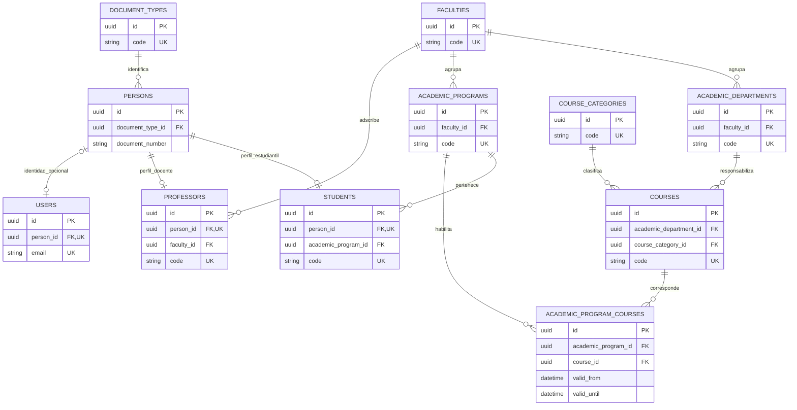
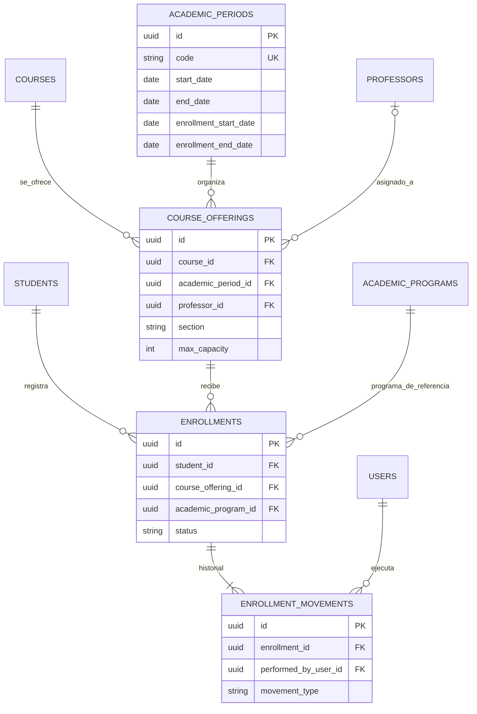
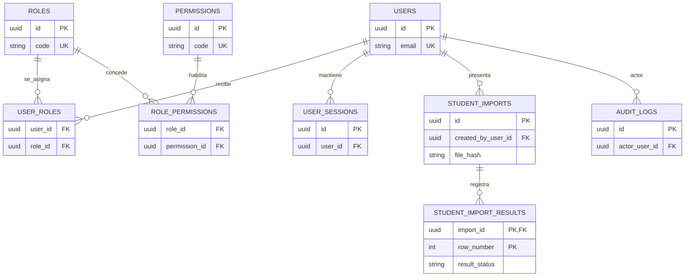

# Modelo lógico de datos

El modelo lógico expresa **identidad de registros, relaciones persistentes, claves de referencia, cardinalidades y restricciones estructurales**. Sus entidades se representan por nombres institucionales estables; los atributos mostrados en los diagramas son solo las claves y los datos indispensables para explicar integridad, no una lista de columnas del schema físico.

El sistema corresponde a una universidad; no requiere una entidad `universities` ni una clave de institución en cada registro.

## 1. Identidad, estructura y catálogo académico

**Cardinalidad interpretativa:** la relación `PERSONS`–`USERS` es opcional en ambos sentidos. Una cuenta puede estar vinculada como máximo a una persona y una persona a como máximo una cuenta; las cuentas administrativas sin persona asociada son válidas. Cada perfil estudiantil o docente sí requiere su propia persona. Una persona puede tener ambos perfiles.

### Claves y asociaciones determinantes

| Estructura | Identidad o referencia | Restricción lógica |
| --- | --- | --- |
| Persona | Tipo de documento + número | Esa combinación identifica una única persona. El mismo número con un tipo diferente no se confunde automáticamente. |
| Estudiante | Código institucional; persona | El código identifica un estudiante y una persona no posee perfiles estudiantiles duplicados. |
| Docente | Código institucional; persona | El código identifica un docente y una persona no posee perfiles docentes duplicados. |
| Facultad, departamento y programa académico | Código institucional propio | No se reutiliza un código para representar otra unidad histórica. |
| Curso | Código institucional | Único en toda la universidad, no solo dentro de un departamento o programa académico. |
| Asociación programa–curso | Identidad propia por episodio de vigencia | Se admiten episodios sucesivos del mismo par, nunca intervalos superpuestos. La desasociación cierra el episodio sin destruirlo. |
| Cuenta | Correo de acceso y persona opcional | Una identidad de acceso no se duplica; la vinculación con persona no es obligatoria. |

Cada episodio de asociación usa el intervalo **[inicio, fin)**, con fin opcional para representar vigencia abierta. Los límites son instantes inequívocos: un programa y un curso no pueden poseer dos episodios temporalmente solapados. La inscripción se valida frente al episodio vigente en el instante de su admisión, sin duplicar su identificador en la inscripción.

Los registros académicos con historial no pueden reutilizar identidades o códigos para atribuirles un significado distinto. La baja lógica y la desasociación impiden nuevas relaciones ordinarias sin destruir referencias existentes. El modelo de consultas distingue la vigencia de los registros de su existencia histórica.

### Catálogos

`document_types` es el catálogo fijo de documentos de identidad. `course_categories` clasifica cursos mediante una dimensión homogénea: formación general (`GENERAL`), formación disciplinaria (`DISCIPLINARY`) y formación especializada (`SPECIALIZED`). Laboratorio o carácter electivo no son categorías equivalentes de esa dimensión y no se mezclan en el mismo catálogo.

Cada curso se clasifica con una categoría de esa dimensión; las modificaciones de la clasificación no cambian su identidad. La administración de categorías sigue las autorizaciones de mantenimiento académico; la de tipos de documento no tiene operaciones ordinarias de modificación.

## 2. Periodos, ofertas e inscripciones

La referencia al docente puede ser nula durante la preparación de la oferta y debe estar presente para abrirla. `ENROLLMENTS.academic_program_id` conserva el **programa académico de admisión**, que no se deriva necesariamente del programa actual del estudiante. No se duplica la referencia al episodio programa–curso: la elegibilidad histórica se determina por programa, curso e instante confirmado de admisión frente a los episodios conservados.

### Identidad lógica y consistencia entre referencias

| Elemento | Restricción estructural o referencial |
| --- | --- |
| Periodo | Código único y fechas académicas válidas; las fechas de la ventana de inscripción también son obligatorias y ordenadas. |
| Oferta | Identidad única por combinación **curso + periodo + sección**, conservada en la historia, incluso tras su cancelación. Capacidad máxima estrictamente positiva. |
| Inscripción | Cada registro conserva una identidad propia aunque haya sido cancelado. Se vincula exactamente a un estudiante, a una oferta y al programa académico con el que se aceptó. |
| Unicidad de inscripción | No pueden coexistir dos inscripciones `ENROLLED` del mismo estudiante al **mismo curso y periodo**, aunque correspondan a ofertas distintas. |
| Antecedente de retiro | Un retiro auténtico de efectos vigentes impide la reinscripción ordinaria al mismo curso y periodo; un retiro registrado por error y rectificado conserva su historia, pero no su efecto impeditivo. |
| Nueva inscripción tras cancelación | Es otro registro con otra identidad; nunca reabre o reemplaza el registro `CANCELLED`. |
| Movimiento | Pertenece a una sola inscripción, conserva el actor y el momento y registra los valores anteriores y posteriores relevantes para su tipo. No admite edición o eliminación ordinaria. |

La unicidad por estudiante, curso y periodo **no equivale** a una unicidad limitada al par estudiante–oferta. El curso y el periodo se obtienen de la oferta, pero deben permanecer consistentes en cualquier mecanismo de almacenamiento elegido; no se autoriza una inscripción activa duplicada mediante una sección diferente.

**Una inscripción puede cambiar su oferta actual** únicamente hacia otra sección del mismo curso y periodo. Su programa académico de referencia, curso y periodo históricos permanecen interpretables. El movimiento de cambio conserva las ofertas anterior y nueva; no se crea otra inscripción.

### Cupos

La capacidad disponible de una oferta es un valor **derivado**:

\[
\text{cupos disponibles} = \text{capacidad máxima} - \text{inscripciones ENROLLED vigentes en la oferta}
\]

No existe una columna persistida de `available_capacity` que compita con el cálculo anterior. `CANCELLED` y `WITHDRAWN` no ocupan plazas. La capacidad no puede reducirse por debajo de las inscripciones `ENROLLED` existentes. Los movimientos de alta, cancelación, retiro, cambio y corrección deben preservar estas restricciones bajo concurrencia.

## 3. Identidad de acceso, permisos y evidencia

| Entidad o asociación | Integridad relevante |
| --- | --- |
| `user_roles` | Una relación usuario–rol aparece una sola vez; cada cuenta puede recibir varios roles. |
| `role_permissions` | Una relación rol–permiso aparece una sola vez; los permisos provienen de un catálogo controlado. |
| `user_sessions` | Pueden existir sesiones históricas revocadas, pero como máximo una permanece activa por usuario. |
| `student_imports` | Conserva los bytes originales, su huella SHA-256 y el usuario responsable; **usuario + hash** identifica de forma única una admisión. |
| `student_import_results` | Cada fila resuelta tiene identidad **importación + posición de fila**, resultado y observaciones; una misma fila no produce resultados definitivos duplicados. |
| `audit_logs` | Guarda evidencia de operaciones sensibles sin operaciones ordinarias de edición o eliminación. |

Los resultados por fila se conservan en una relación técnica propia de la importación, **no como nuevas entidades académicas**. Las filas admitidas pueden concluir como incorporadas, duplicadas o rechazadas; las todavía no procesadas carecen de resultado definitivo. Las cantidades agregadas se derivan de las unidades confirmadas y no constituyen otra fuente independiente de verdad. Una fila válida incorpora solo los registros permitidos, sin sobrescribir estudiantes existentes; una fila rechazada no altera el catálogo académico.

Las identidades de los usuarios, docentes y estudiantes se conservan aunque sus perfiles se deshabiliten, para mantener la atribución de inscripciones, movimientos, cargas y auditorías anteriores.

## 4. Conservación y vigencia de referencias

1. **Deshabilitar no significa borrar:** el registro histórico sigue identificable; no se sustituye su clave primaria por la de otro registro.
2. **Relaciones históricas:** los episodios programa–curso permanecen identificables con sus límites temporales, de modo que una admisión anterior no cambia de significado tras cerrar o volver a abrir la asociación.
3. **Cambios de programa académico del estudiante:** los datos actuales pueden evolucionar sin alterar el programa académico de referencia de inscripciones anteriores; el cambio no debe invalidar inscripciones `ENROLLED` de periodos operativos.
4. **Cambios de estructura o docentes:** las ofertas y sus inscripciones históricas conservan referencias, aunque el recurso de catálogo ya no se utilice para nuevas operaciones.
5. **Movimientos inmutables:** las rectificaciones se agregan como nuevos hechos y no reescriben o destruyen movimientos previos.
6. **Baja lógica:** se aplica a recursos administrativos que se pueden deshabilitar; no se utiliza para ocultar una inscripción, movimiento, importación o auditoría que deba permanecer como evidencia.

Las **restricciones lógicas exigidas** se mantienen independientes de las decisiones físicas de índices, claves, control de concurrencia, migraciones y tipos concretos, que se materializan mediante los mecanismos ejecutables de persistencia.
