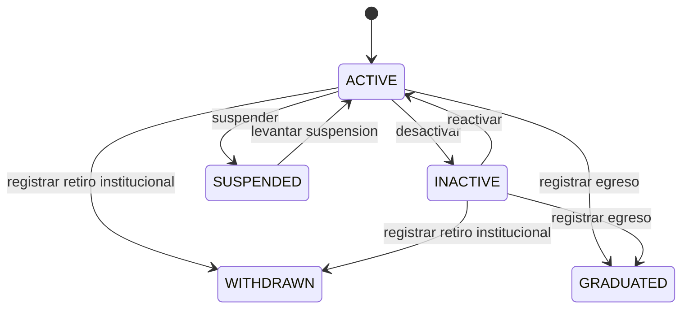
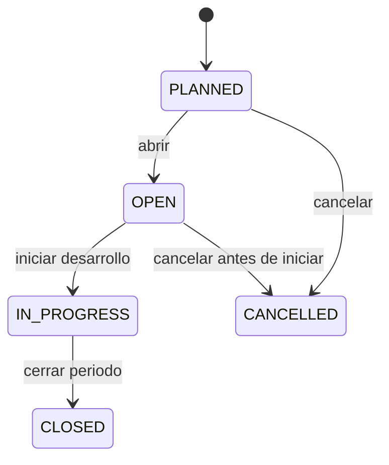
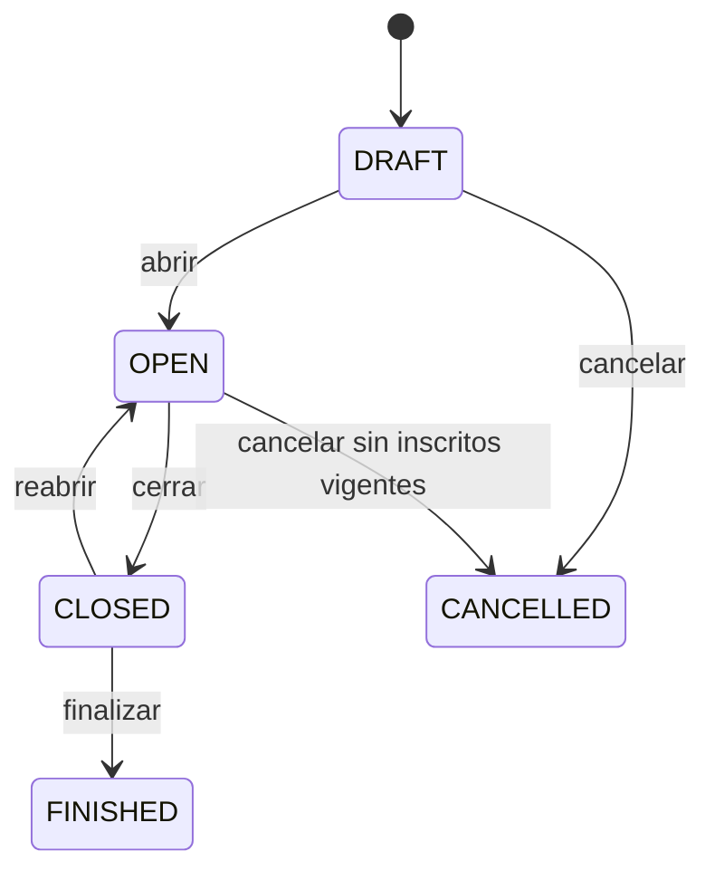
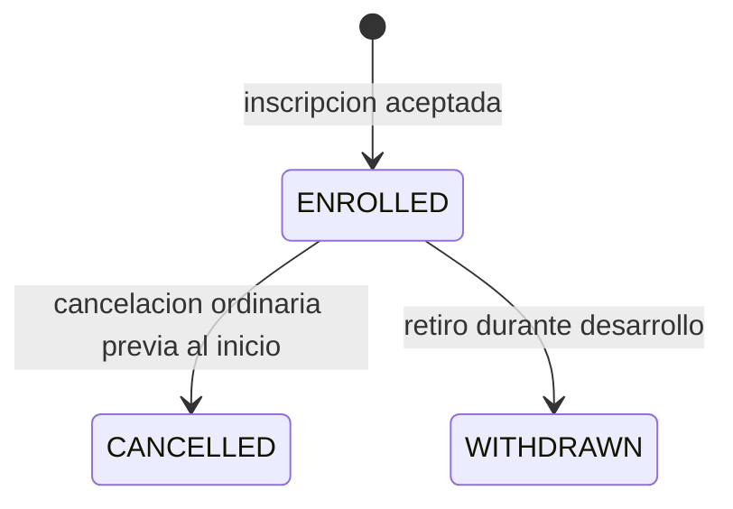

# Estados y transiciones

Los estados representan situaciones de entidades **distintas**. Una transición solo es válida si se cumplen conjuntamente las condiciones de estado, fecha, integridad y autorización aplicables. Los diagramas describen el ciclo ordinario; las correcciones administrativas excepcionales quedan fuera de ese flujo y tienen reglas propias.

## 1. Estado del estudiante

El perfil estudiantil permite diferenciar la capacidad de solicitar nuevas inscripciones de otras situaciones institucionales. La creación manual o por importación de un estudiante válido establece inicialmente `ACTIVE`.

| Estado | Significado para el sistema de inscripciones | ¿Admite nueva inscripción ordinaria? |
| --- | --- | --- |
| `ACTIVE` | Estudiante habilitado para operar académicamente. | Sí, si cumple las demás condiciones. |
| `INACTIVE` | Perfil no habilitado temporalmente. | No. |
| `SUSPENDED` | Habilitación suspendida por una decisión administrativa. | No. |
| `WITHDRAWN` | Estudiante retirado de la institución, distinto de retirar una inscripción de curso. | No. |
| `GRADUATED` | Situación académica de egreso registrada administrativamente. | No. |

`WITHDRAWN` y `GRADUATED` del **estudiante** son terminales para la operación ordinaria del perfil. Su rectificación, si se registraron por error, requiere una actuación administrativa justificada y no implica restaurar inscripciones canceladas o retiradas. Estas transiciones no gestionan admisión, readmisión, certificación ni calificaciones.

Una deshabilitación del estudiante **no cambia automáticamente** sus inscripciones `ENROLLED`; impide nuevas inscripciones ordinarias. No se aceptan cambios de perfil que vuelvan incoherentes inscripciones vigentes de periodos operativos.

## 2. Periodo académico

| Estado | Significado |
| --- | --- |
| `PLANNED` | Periodo preparado, todavía no habilitado para nuevas inscripciones. |
| `OPEN` | Periodo abierto administrativamente para operar su ventana de inscripción, aun antes del inicio académico. |
| `IN_PROGRESS` | Periodo cuyo desarrollo académico ha comenzado. Puede aceptar inscripciones si su ventana continúa vigente. |
| `CLOSED` | Periodo concluido para operaciones ordinarias de inscripción. |
| `CANCELLED` | Periodo anulado antes del desarrollo académico. No se reactiva ordinariamente. |

| Origen | Evento | Destino | Condiciones determinantes |
| --- | --- | --- | --- |
| `PLANNED` | Abrir | `OPEN` | Estructura y fechas válidas; ventana de inscripción configurada. |
| `OPEN` | Iniciar desarrollo | `IN_PROGRESS` | Se alcanzó la fecha de inicio académico; el periodo no fue cancelado. |
| `IN_PROGRESS` | Cerrar | `CLOSED` | Acción autorizada de finalización del periodo; no modifica inscripciones existentes. |
| `PLANNED` | Cancelar | `CANCELLED` | No existen inscripciones `ENROLLED` vinculadas. |
| `OPEN` | Cancelar | `CANCELLED` | No comenzó la fecha académica y no existen inscripciones `ENROLLED` vinculadas. |

`CLOSED` y `CANCELLED` son terminales. El cierre del periodo no exige transformar `ENROLLED` a otro estado y no ejecuta automáticamente cierre o cancelación de ofertas.

### Momento y ventana de inscripción

El derecho a registrar una nueva inscripción ordinaria resulta de una **conjunción**:

1. Periodo en `OPEN` o `IN_PROGRESS`.
2. Fecha actual comprendida entre el inicio y el fin de la ventana de inscripción, ambos inclusive.
3. Oferta en `OPEN` y con cupo.
4. Elegibilidad y ausencia de bloqueos históricos del estudiante y curso.

El estado `OPEN` **no** sustituye la validación de fechas. Un periodo que sigue `OPEN` cuando ya empezó su fecha académica no convierte una cancelación tardía en válida; debe regularizarse su situación antes de operar movimientos propios de `IN_PROGRESS`.

## 3. Oferta de curso

| Estado | Significado |
| --- | --- |
| `DRAFT` | Sección configurada, aún no abierta para inscribir. |
| `OPEN` | Oferta habilitada administrativamente para evaluar inscripciones. |
| `CLOSED` | Oferta cerrada para nuevas inscripciones, susceptible de reapertura condicionada. |
| `FINISHED` | Oferta finalizada operativamente, sin efectos sobre calificaciones o estados de inscripciones. |
| `CANCELLED` | Oferta anulada sin inscripciones vigentes que conservar. |

| Origen | Evento | Destino | Condiciones determinantes |
| --- | --- | --- | --- |
| `DRAFT` | Abrir | `OPEN` | Curso, periodo, capacidad y docente activo válidos; periodo compatible con operar inscripciones. |
| `OPEN` | Cerrar | `CLOSED` | Actor autorizado; inscripciones existentes conservadas. |
| `CLOSED` | Reabrir | `OPEN` | Periodo `OPEN` o `IN_PROGRESS` dentro de ventana de inscripción; docente habilitado y capacidad consistente. |
| `CLOSED` | Finalizar | `FINISHED` | Periodo concluido; no implica resultado individual de aprobación. |
| `DRAFT` | Cancelar | `CANCELLED` | Sin inscripciones `ENROLLED`. |
| `OPEN` | Cancelar | `CANCELLED` | Sin inscripciones `ENROLLED`; se conserva su historia. |

`FINISHED` y `CANCELLED` son terminales. Una oferta en `OPEN` puede estar completamente ocupada: **cupo agotado no es una transición automática a `CLOSED`**. Una oferta abierta dentro de un periodo `CLOSED` o `CANCELLED` no acepta inscripciones, aunque su estado individual no se haya modificado.

La baja de un docente o un curso no debe dejar ofertas abiertas sin referencias académicas habilitadas. La reasignación de docente, cuando sea necesaria, debe respetar la existencia y el historial de las ofertas.

## 4. Inscripción

Esta entidad posee exactamente tres estados:

| Estado | Interpretación | ¿Ocupa cupo? | Nueva inscripción ordinaria al mismo curso y periodo |
| --- | --- | --- | --- |
| `ENROLLED` | Inscripción vigente aceptada. | Sí. | No, porque ya existe una inscripción vigente. |
| `CANCELLED` | Inscripción anulada antes del inicio académico o por rectificación excepcional. | No. | Solo como **nuevo registro**, si todas las condiciones ordinarias se cumplen y no existe bloqueo adicional. |
| `WITHDRAWN` | Inscripción retirada durante el desarrollo académico. | No. | No si el retiro es auténtico; una rectificación extraordinaria de un error elimina su efecto impeditivo sin borrar el movimiento. |

| Origen | Evento ordinario | Destino | Condiciones | Efectos |
| --- | --- | --- | --- | --- |
| Sin registro | Inscribir | `ENROLLED` | Estudiante activo; programa académico asociado al curso; periodo y oferta habilitados; ventana válida; cupo; sin duplicidad ni retiro previo impeditivo. | Nueva inscripción, plaza ocupada y movimiento inicial. |
| `ENROLLED` | Cancelar | `CANCELLED` | Periodo `OPEN`, antes de la fecha académica de inicio, permiso y motivo. | Plaza liberada, identidad e historial preservados. |
| `ENROLLED` | Retirar | `WITHDRAWN` | Periodo `IN_PROGRESS`, fecha de desarrollo vigente, permiso y motivo. | Plaza liberada, bloqueo de reinscripción ordinaria e historial preservado. |

**El cambio de sección no cambia el estado**: `ENROLLED` permanece `ENROLLED`. Modifica únicamente la oferta actual hacia otra sección del mismo curso y periodo, dentro de las condiciones permitidas, y añade un movimiento de traslado. No existe estado de inscripción `PENDING`, `REJECTED` o `FINISHED`.

El cierre del periodo deja cada inscripción con su último estado registrado. Ni la finalización de una oferta ni el cierre del periodo acreditan que se aprobó el curso.

### Rectificaciones extraordinarias

No forman parte de las flechas ordinarias del diagrama. Una corrección autorizada exclusivamente para administración permite, con motivo y evidencia, rectificar una anulación fuera del plazo ordinario, efectuar un traslado extemporáneo compatible o enmendar un error comprobado en el estado o movimiento de una inscripción.

Si un estado `CANCELLED` o `WITHDRAWN` se registró erróneamente, su rectificación **no equivale a una reinscripción ordinaria**. Debe conservar el estado/movimiento erróneo como antecedente, añadir un movimiento correctivo y verificar todas las referencias, la unicidad de inscripciones vigentes y la capacidad real. Nunca se elimina un retiro auténtico para eludir la prohibición de reinscripción. La rectificación de un retiro erróneo conserva su registro y lo identifica expresamente como corregido, sin mantener un bloqueo funcional injustificado.

## 5. Movimientos y estados actuales

Un movimiento histórico no tiene un estado de ciclo de vida editable: es un hecho **de solo inserción**. Los hechos posibles que modifican una inscripción son:

| Movimiento | Qué deja registrado |
| --- | --- |
| Creación | Inscripción inicial, oferta, programa académico de referencia, responsable y momento. |
| Cancelación | Estado anterior y nuevo, motivo y responsable. |
| Retiro | Estado anterior y nuevo, motivo y responsable. |
| Cambio de sección | Oferta anterior y nueva del mismo curso y periodo, motivo y responsable; estado de inscripción sin cambio. |
| Corrección | Hecho corregido, valores originales y rectificados, justificación y actor administrativo. |

La escritura del movimiento y el efecto sobre la inscripción forman **una única operación coherente**. El historial de una inscripción permite reconstruir sus cambios sin reescribir eventos anteriores.

## 6. Comprobaciones comunes a las transiciones

- **Estado de origen válido:** ningún actor puede aplicar una operación ordinaria a un estado incompatible.
- **Fechas reales:** la fecha institucional, obtenida de un reloj confiable e interpretada en `America/Lima`, gobierna las ventanas; el permiso del usuario no la sustituye.
- **Referencias vigentes:** las entidades utilizadas para crear o trasladar una inscripción deben cumplir sus condiciones académicas.
- **Capacidad y unicidad:** una transición no puede provocar cupos negativos ni inscripciones vigentes duplicadas.
- **Trazabilidad:** las transiciones aceptadas conservan el usuario responsable, el momento y la causa cuando corresponda.
- **Ausencia de mutaciones implícitas:** una transición de periodo u oferta no reescribe silenciosamente estados de estudiantes o inscripciones.

Los mecanismos concretos de almacenamiento que garantizan estas propiedades no alteran el significado de los estados ni sus transiciones.
