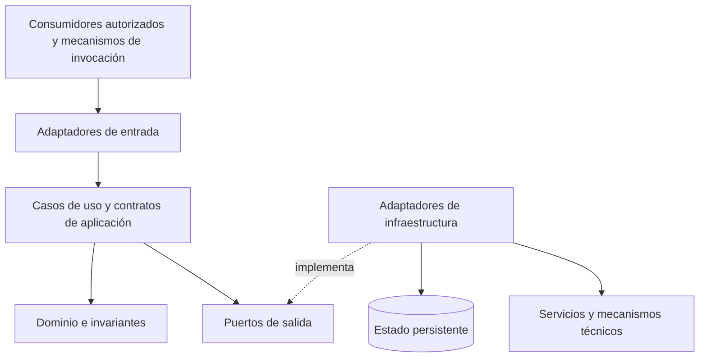
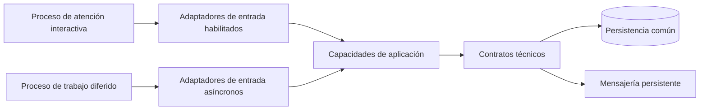

# Arquitectura del sistema

El backend adopta un **monolito modular** organizado por capacidades funcionales y contratos explícitos. Sus módulos comparten una base de código y un almacenamiento transaccional, pero mantienen autoridad propia sobre sus reglas y datos. La composición reúne las capacidades necesarias para cada proceso de ejecución sin transformar los módulos en servicios distribuidos ni permitir acoplamiento interno libre.

## 1. Estilo y componentes arquitectónicos

La arquitectura diferencia cinco responsabilidades:

| Responsabilidad | Función | Restricción |
| --- | --- | --- |
| Dominio | Preserva significado, estados e invariantes académicos. | No depende de protocolos, frameworks, ORM ni brokers. |
| Aplicación | Ejecuta y coordina casos de uso, autorización funcional y unidades de consistencia. | No delega reglas de negocio a adaptadores. |
| Adaptadores de entrada | Traducen mecanismos de invocación a contratos de aplicación. | No son propietarios de los estados académicos. |
| Adaptadores de salida | Materializan persistencia, criptografía, mensajería, lectura de archivos y otras capacidades técnicas. | No sustituyen a los módulos que deciden las reglas. |
| Composición | Ensambla módulos, adaptadores y recursos para un proceso concreto. | No contiene lógica académica. |

La distinción anterior es **funcional**, no una lista cerrada de tecnologías o directorios. Los mecanismos de entrada pertenecen a una frontera extensible: incorporar otro transporte o protocolo requiere un adaptador, no una segunda implementación de los casos de uso. La misma regla rige las salidas técnicas y los mecanismos de ejecución.

Las flechas continuas representan invocación; la flecha discontinua indica implementación de un contrato. El dominio no invoca la infraestructura y los consumidores no acceden directamente a los repositorios.

## 2. Módulos y límites funcionales

Cada módulo posee una capacidad reconocible, el estado que gobierna y los contratos que expone. Las fronteras se trazan por responsabilidad de negocio, no por tabla, tecnología, volumen de código ni mecanismo de transporte. Una agrupación organizativa de módulos afines no fusiona sus reglas ni concede acceso privilegiado a sus estructuras internas.

El módulo que coordina una operación intermodular solicita verificaciones a los propietarios de la información que necesita. Coordinar no significa apropiarse de los estados ajenos: el registro de una inscripción pertenece a su capacidad funcional, mientras que la vigencia del estudiante, las condiciones de la oferta, las fechas del periodo y la habilitación académica siguen bajo sus respectivos propietarios.

Las consultas transversales producen lecturas autorizadas; no adquieren por ello autoridad de modificación sobre las fuentes consultadas. Los servicios de soporte compartidos tampoco sustituyen las responsabilidades funcionales.

## 3. Procesos de ejecución y composición

Un **proceso** es una instancia de ejecución compuesta para atender un conjunto de entradas y responsabilidades. Un **módulo** es una unidad funcional que puede participar en varios procesos. Ambos conceptos permanecen separados.

La aplicación expone solicitudes interactivas mediante una API y ejecuta trabajo diferido mediante procesos consumidores. Cada proceso crea su propio contenedor de dependencias y sus propias conexiones; comparte definiciones de código, contratos y datos persistentes, **no instancias en memoria**. Los puntos de entrada de cada proceso cargan únicamente los adaptadores y recursos que necesitan.

El marco de composición resuelve dependencias declaradas y administra su ciclo de vida. Una capacidad no instancia directamente otra capacidad ni reconstruye sus dependencias privadas. Agregar mecanismos de entrada o procesos especializados no cambia la titularidad de una regla académica.

## 4. Consistencia como obligación arquitectónica

Las operaciones interactivas de inscripción, cancelación, retiro, cambio de sección y corrección administrativa confirman de manera conjunta el estado funcional, su movimiento histórico y la auditoría exigida. Una respuesta exitosa presupone que la unidad transaccional pertinente se confirmó. No se delega a la cola la decisión de si una inscripción existe, ocupa plaza o ha cambiado de estado.

El cupo se deriva de la capacidad máxima de cada oferta y de sus inscripciones `ENROLLED`. La consulta preliminar no constituye una reserva: la consistencia concurrente se garantiza en la confirmación, incluso cuando se modifican inscripciones desde varias solicitudes simultáneas.

El procesamiento diferido conserva una **admisión duradera** antes de responder aceptación. Los mensajes tienen entrega recuperable e idempotencia de efectos; no se presupone ejecución exactamente una vez. Los eventos comunican hechos ya confirmados y no realizan correcciones retroactivas sobre las operaciones de origen.

## 5. Separación de dependencias

Las reglas del dominio no conocen NestJS, Prisma, PgBoss, protocolos de transporte, cookies ni herramientas de validación externa. La aplicación consume contratos; los adaptadores materializan esos contratos. La selección tecnológica pertenece al diseño de infraestructura y composición, sin propagarse a las entidades académicas.

En un mismo proceso se comparten capacidades técnicas sin abrir acceso indiscriminado a la información de otros módulos. El almacenamiento compartido facilita transacciones, pero **no convierte la base de datos en una interfaz pública entre módulos**.

Se rechazan dependencias circulares como solución ordinaria de integración. Cuando dos capacidades necesitan mutuamente internals ajenos, se redefinen la propiedad funcional, los contratos y la dirección de colaboración. La estructura de carpetas nunca es una autorización implícita de dependencia.

## 6. Invariantes arquitectónicos

- Una regla académica tiene un propietario funcional identificable.
- Las entradas, cualquiera que sea su mecanismo, invocan capacidades de aplicación; no reimplementan reglas.
- Los contratos públicos entre módulos no exponen repositorios privados ni detalles del ORM.
- La composición ensambla dependencias y administra procesos, sin ejecutar operaciones del negocio en constructores o módulos raíz.
- El éxito de una operación crítica implica persistencia íntegra de estado, historia y auditoría exigible.
- Los procesos son independientes en memoria y comparten únicamente los recursos externos y datos para los que existe un contrato.
- Cambiar un adaptador no modifica la semántica del dominio ni las autorizaciones exigidas.
