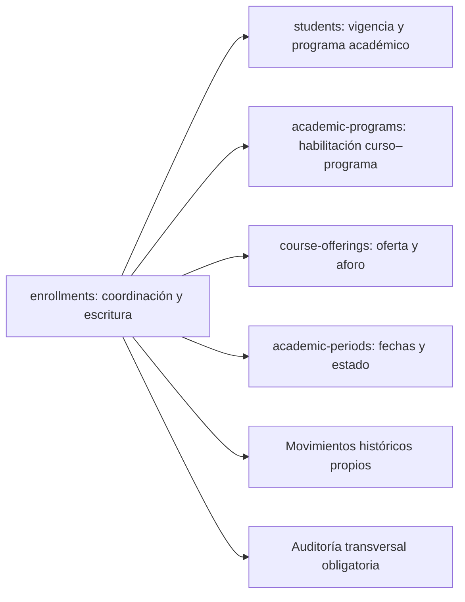

# Fronteras de módulos

Los módulos se delimitan por **capacidad del negocio, reglas propias y autoridad para modificar un estado**, no por tablas, técnicas ni frecuencia de colaboración. Una agrupación organizativa no concede acceso privilegiado entre módulos: reunir capacidades en una carpeta de dominio no equivale a fusionarlas.

## 1. Capacidades y responsables

| Módulo                 | Responsabilidad funcional                                                                   | Frontera de escritura                                                              |
| ---------------------- | ------------------------------------------------------------------------------------------- | ---------------------------------------------------------------------------------- |
| `identity`             | Identidad común de personas y tipos de documento.                                           | Mantiene personas; no crea perfiles ni cuentas por efecto implícito.               |
| `faculties`            | Facultades y su vigencia institucional.                                                     | No modifica perfiles ni cursos adscritos.                                          |
| `academic-departments` | Departamentos dependientes de facultades.                                                   | No modifica directamente la adscripción de cursos.                                 |
| `academic-programs`    | Programas académicos y asociaciones programa–curso.                                         | Gobierna habilitación de cursos por programa académico, no el contenido del curso. |
| `courses`              | Catálogo de cursos, categorías y adscripción departamental.                                 | No administra ofertas ni inscripciones.                                            |
| `professors`           | Perfiles docentes y adscripción a una facultad.                                             | No modifica una oferta al cambiar información del docente.                         |
| `students`             | Perfil estudiantil, programa académico vigente e importaciones administrativas.             | No inscribe al estudiante ni modifica ofertas.                                     |
| `academic-periods`     | Periodos, ventanas de inscripción y transiciones de periodo.                                | No altera automáticamente los estados de inscripciones.                            |
| `course-offerings`     | Ofertas, secciones, docente asignado, aforo máximo y ciclo de vida.                         | No crea ni cancela inscripciones.                                                  |
| `enrollments`          | Inscripción, cancelación, retiro, cambio de sección, corrección e historial de movimientos. | Autoridad sobre el estado de la inscripción y sus movimientos.                     |
| `users`                | Cuentas, contraseñas, credenciales y sesiones revocables.                                   | No define el catálogo de permisos ni el perfil académico.                          |
| `authorization`        | Roles, permisos, asignaciones y resolución de autorización efectiva.                        | No administra contraseñas ni sesiones.                                             |
| `audit`                | Consulta administrativa de evidencia de auditoría transversal.                              | No decide ni revierte operaciones ajenas.                                          |
| `reports`              | Reportes operativos predefinidos y lecturas combinadas autorizadas.                         | No modifica entidades consultadas.                                                 |

Los tipos de documento permanecen bajo `identity`; las categorías de curso bajo `courses`. La importación de estudiantes permanece bajo `students`, aun cuando se ejecute en otro proceso. Se evita crear módulos de catálogos, procesamiento o reportes genéricos cuando ello no representa una propiedad funcional adicional.

## 2. Organización por dominio

Los módulos son unidades funcionales con composición y superficie pública controladas mediante NestJS. Un **dominio** es una agrupación organizativa de capacidades afines: puede orientar navegación y composición, pero no adquiere automáticamente entidades, repositorios o reglas de los módulos internos.

| Afinidad de negocio                | Capacidades relacionadas                                                           |
| ---------------------------------- | ---------------------------------------------------------------------------------- |
| Identidad institucional y acceso   | `identity`, `users`, `authorization`.                                              |
| Estructura académica               | `faculties`, `academic-departments`, `academic-programs`, `courses`, `professors`. |
| Operación de inscripciones         | `students`, `academic-periods`, `course-offerings`, `enrollments`.                 |
| Consulta y evidencia transversales | `reports`, `audit`.                                                                |

La tabla es una **clasificación conceptual**, no la imposición de cuatro carpetas físicas o cuatro nuevos módulos agregadores. El proyecto conserva módulos funcionales identificables; solo incorpora agrupadores cuando exista afinidad inequívoca y simplifiquen la comprensión del conjunto.

Son criterios obligatorios para cualquier agrupación:

- Se agrupa por significado de negocio; no por Prisma, colas, HTTP, carga de trabajo ni necesidad de coordinar.
- Cada módulo mantiene su propio contrato de entrada y sus datos; dos módulos del mismo dominio siguen relacionándose mediante superficies públicas.
- Un agregador, si existe, solo compone o reexporta selectivamente módulos o contratos. No incorpora reglas, consultas ajenas ni una base de datos compartida como API.
- Los niveles organizativos responden a una afinidad real y a necesidades de composición, no a categorías técnicas ni umbrales automáticos.
- La cantidad de módulos es una señal para revisar la organización, no un umbral automático que obligue a cambiarla.

## 3. Patrón de colaboración entre capacidades

Cuando un caso de uso necesita información o efectos de otras capacidades, **un módulo coordinador conserva la decisión y escritura que le pertenecen** y solicita a cada proveedor únicamente sus contratos públicos. El módulo proveedor mantiene la autoridad sobre sus invariantes y sobre los datos que gobierna. Para comprobar la mera existencia o vigencia de dependientes que impiden una baja lógica, el adaptador de persistencia del propietario puede efectuar lecturas referenciales directas de tablas ajenas, sin crear una dependencia funcional entre módulos.

La colaboración respeta estas condiciones:

- La coordinación de una operación no convierte al coordinador en propietario de los estados ajenos.
- La lectura referencial directa de infraestructura está limitada a predicados de integridad para operaciones propias; no comprende escrituras ajenas, recuperación indiscriminada de información ni decisiones funcionales que correspondan a otro propietario.
- Una consulta para presentar información puede utilizar proyecciones de solo lectura; una consulta utilizada para decidir una escritura debe preservar su validez hasta la confirmación.
- Las restricciones concurrentes y los efectos que deben ser atómicos se garantizan en una unidad de consistencia adecuada; la secuencia de llamadas, por sí sola, no aporta atomicidad.
- El historial propio y la evidencia transversal se registran según su distinta titularidad, sin que la auditoría decida el resultado funcional.

El registro de una inscripción constituye una aplicación concreta de estas reglas:

`course-offerings` posee el **aforo máximo configurado**; `enrollments` posee las inscripciones cuya condición `ENROLLED` ocupa plazas. La capacidad restante se deriva de ambos datos. Consultar plazas libres antes de escribir no reserva cupo: la confirmación debe impedir sobrecapacidad frente a solicitudes simultáneas.

El historial funcional pertenece a `enrollments` y la evidencia transversal conserva la atribución de las operaciones sensibles. La confirmación mantiene ambos efectos necesarios sin trasladar la decisión académica a auditoría.

## 4. Cambios que cruzan capacidades

| Situación                                             | Responsabilidad del propietario                            | Colaboración requerida                                                                                                                                                                                                   |
| ----------------------------------------------------- | ---------------------------------------------------------- | ------------------------------------------------------------------------------------------------------------------------------------------------------------------------------------------------------------------------ |
| Cambiar el programa académico vigente del estudiante. | `students` decide la actualización del perfil.             | Consultar restricciones sobre inscripciones vigentes sin reinterpretar su programa académico histórico.                                                                                                                  |
| Desasociar un curso de un programa académico.         | `academic-programs` decide la asociación.                  | Impedir invalidar inscripciones vigentes en periodos operativos.                                                                                                                                                         |
| Abrir una oferta o asignarle docente.                 | `course-offerings` decide el estado y su asignación.       | Comprobar vigencia del profesor, curso y periodo correspondiente.                                                                                                                                                        |
| Cerrar un periodo académico.                          | `academic-periods` decide su ciclo de vida.                | Aplicar condiciones de cierre sin transiciones implícitas de inscripciones.                                                                                                                                              |
| Consultar datos de varias capacidades.                | `reports` define la proyección y los filtros autorizados.  | Acceso de lectura controlado, sin escribir las fuentes.                                                                                                                                                                  |
| Dar de baja lógicamente un recurso con dependencias.  | El módulo propietario decide la baja y conserva sus datos. | Su infraestructura puede comprobar si existen dependientes vigentes en otras tablas; debe rechazar la baja mientras esas relaciones exijan vigencia del padre, sin modificar dependientes ni crear ciclos entre módulos. |

Una modificación intermodular no autoriza escrituras directas sobre tablas de otro dueño. Se permite la lectura técnica y acotada de relaciones ajenas por adaptadores de persistencia para verificar integridad referencial de una operación propia; la validación funcional y la decisión de escritura permanecen en el módulo propietario. Si se requiere consistencia conjunta, los participantes deben operar en una unidad transaccional protegida sin saltarse sus reglas.

## 5. Identidad, autorizaciones y capacidades transversales

`users` gobierna cuentas y sesiones. `authorization` gobierna roles y permisos; los casos de uso solicitan comprobaciones autorizadas, no inferencias basadas en nombres de roles repartidas por módulos.

La auditoría de mutaciones utiliza un mecanismo transversal de escritura y una capacidad administrativa separada para consultar los eventos. La colaboración transversal no crea una dependencia circular: el módulo funcional declara la evidencia exigible y un mecanismo de composición la registra dentro de la confirmación pertinente.

Los reportes pueden leer información combinada mediante contratos públicos de consulta o proyecciones read-only controladas. Esa posibilidad no concede propiedad sobre la información y no debe utilizarse como atajo para modificarla.

## 6. Criterio para crear o modificar fronteras

La separación de un módulo se justifica cuando posee una capacidad reconocible, reglas o estado coherente que pueda evolucionar sin convertirse en apéndice técnico de otro. Antes de separarlo, debe identificarse quién acepta comandos, quién valida invariantes, quién persiste sus cambios y qué contratos expone.

Una frontera está mal definida cuando dos módulos escriben directamente el mismo estado funcional, existe lectura privilegiada por vecindad de carpetas o se necesita una referencia circular permanente para ejecutar operaciones habituales. El remedio consiste en rediseñar responsabilidades y contratos; no en mover reglas al código compartido ni en utilizar `forwardRef` como norma.
