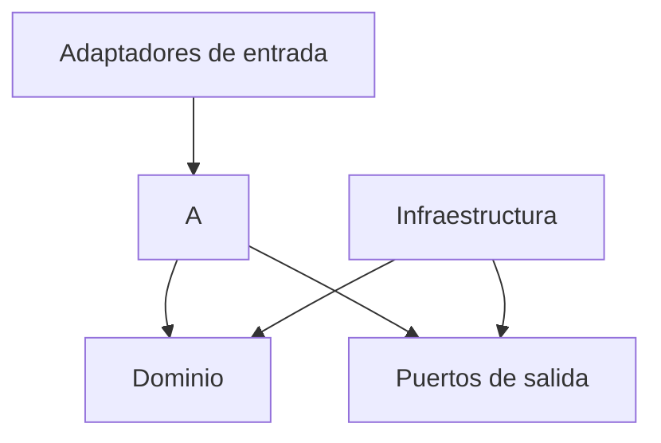
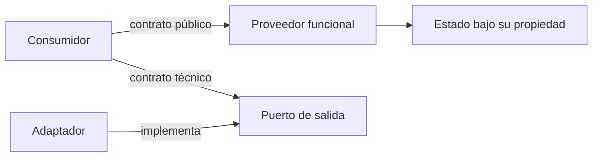

# Reglas de dependencia

La dependencia se define por **quién conoce el contrato de quién**, no por quién invoca a quién en tiempo de ejecución. La aplicación puede solicitar una operación que terminará en PostgreSQL sin que su lógica dependa de Prisma. Las fronteras del monolito deben preservarse tanto en las importaciones del código como en la composición de NestJS.

## 1. Dirección dentro de un módulo

El diagrama señala dependencias de código permitidas. En ejecución, la aplicación invoca un puerto y el contenedor entrega su implementación. La infraestructura depende de contratos internos para implementarlos, no al revés.

| Área | Puede depender de | No puede depender de |
| --- | --- | --- |
| `domain` | Conceptos propios y abstracciones puras necesarias. | NestJS, Prisma, HTTP, cola, sesiones o adaptadores. |
| `application` | Dominio propio, puertos de salida, contratos públicos de capacidades proveedoras. | Controladores, DTOs de transporte, repositorios concretos y framework como fuente de reglas. |
| `infrastructure` | Contratos que implementa y herramientas de persistencia o integración. | Controladores ajenos y reglas cuya propiedad pertenece a otro módulo. |
| `entrypoints` | Capacidades de entrada de aplicación y validaciones del mecanismo respectivo. | Escrituras directas del negocio por medio de repositorios concretos. |
| Composición NestJS | Declaraciones de providers, módulos y adaptadores necesarios. | Algoritmos de negocio, escrituras al construir módulos y acceso funcional no autorizado. |

Las reglas del dominio se comprueban por la capacidad propietaria aunque una entrada ya haya validado sintaxis, formato y autenticación.

## 2. Tres categorías de dependencias entre módulos

| Categoría | Necesidad del consumidor | Forma de contrato |
| --- | --- | --- |
| Comportamiento | Solicita validar o ejecutar una operación de otro propietario. | Puerto de entrada público e inyectable, que aplica las reglas del proveedor. |
| Tipo compartido | Necesita expresar un identificador, enum o contrato puro común. | Tipo estable compartido; no implica crear ni inyectar un provider. |
| Lectura | Necesita datos ajenos para presentar o agregar información. | Contrato de consulta o read model controlado, sin acceso de escritura. |

La distinción depende de lo que hace el consumidor, no del número de tablas consultadas. Una lectura utilizada para **tomar una decisión de negocio** requiere garantizar que esa decisión permanezca válida en la confirmación; no basta con tratarla como proyección informativa.

Los módulos consumidores importan mediante NestJS el módulo proveedor necesario para obtener un puerto exportado. **Conocen su dependencia de módulo declarada y su contrato público**, pero no la implementación interna. No se intenta ocultar artificialmente el grafo real de NestJS.

Para puertos de comportamiento inyectados se utilizan contratos con identidad en tiempo de ejecución; las clases abstractas constituyen el mecanismo habitual del proyecto. Los tipos TypeScript puros pueden compartirse sin inyección. La composición hace la asociación de contrato e implementación; el consumidor no construye providers ajenos.

## 3. Superficies públicas y encapsulación

El contrato público interno de un módulo se limita a las operaciones que otros módulos realmente necesitan. Su exportación mediante `exports` de NestJS habilita la inyección; no autoriza a exponer entidades mutables, repositorios, adaptadores o casos de uso internos indiscriminadamente.

La reexportación mediante `index.ts` organiza importaciones de TypeScript, pero **no equivale** a `exports` de NestJS. Ambos mecanismos deben respetar la misma intención de encapsulación, aunque cumplan funciones distintas.

Los puertos de entrada representan capacidades que un módulo ofrece. Los puertos de salida representan necesidades de aplicación que adaptadores satisfacen. No todo puerto de salida debe convertirse en contrato público para otras capacidades.

Los adaptadores de ejecución que necesita un proceso pueden tener una exposición **técnica y acotada** a su composición. Así ocurre con los processors que se registran para consumir trabajos. Esta exposición no los convierte en operaciones funcionales públicas disponibles para otros módulos de negocio.

## 4. Dependencias de áreas compartidas

| Área | Propósito | Restricción |
| --- | --- | --- |
| `core` | Abstracciones transversales puras, contratos técnicos estables, errores base. | No conoce módulos funcionales ni implementaciones NestJS/Prisma. |
| `platform` | Adaptadores técnicos comunes de persistencia, mensajería, archivos, seguridad técnica y observabilidad. | No se atribuye decisiones de un dominio académico. |
| `shared` | Tipos auxiliares y utilidades pequeñas sin propiedad funcional. | No aloja servicios que deciden elegibilidad, permisos o cupos. |
| `app` | Composición de procesos que exponen interfaces de interacción y de sus adaptadores habilitados. | No es una capa de casos de uso académicos ni impone HTTP como única forma de entrada. |
| `workers` | Composición de procesos consumidores de trabajo diferido y conexión técnica de sus adaptadores de entrega. | No contiene las reglas funcionales ni sustituye los casos de uso de los módulos. |
| `modules` | Capacidades con dominio, aplicación y adaptadores propios. | No atraviesan superficies privadas de otros módulos. |

Un tipo general compartido no implica dependencia funcional. En cambio, el nombre, estado y reglas de una inscripción siguen perteneciendo a `enrollments` y no se trasladan a `core` para resolver dificultades de importación.

La distinción entre `app` y `workers` expresa responsabilidades de composición y ejecución, no una división de los casos de uso por protocolo. La API REST utiliza composición HTTP y los trabajos diferidos utilizan consumidores de PgBoss; ambos invocan contratos de aplicación del módulo propietario. La inclusión de otros adaptadores no modifica estas reglas de dependencia.

Los módulos de plataforma pueden estar disponibles mediante módulos NestJS de infraestructura, pero se importan explícitamente donde su provider es necesario. `@Global()` no se usa para eludir una frontera ni evitar declarar dependencias funcionales.

## 5. Prevención de ciclos y dependencias indebidas

Se prohíben ciclos entre módulos funcionales y dependencias de capas externas hacia internas invertidas de manera incorrecta. La existencia de `forwardRef` no constituye autorización para diseñar módulos mutuamente dependientes.

Si A requiere una operación de B y B requiere una operación de A, se identifica la responsabilidad que realmente coordina el flujo, se divide la colaboración o se extrae un contrato con dueño adecuado. No se solucionan ciclos introduciendo un módulo `shared` que acumula decisiones de ambos.

Los agregadores de dominio son componentes de composición, no nuevos propietarios. Sus exportaciones son selectivas y no deben habilitar dependencias privilegiadas entre módulos agrupados.

## 6. Colaboración transaccional

El caso de uso coordinador define la unidad que debe confirmarse junta. La infraestructura suministra un **contexto transaccional** accesible por contratos adecuados sin exponer Prisma al dominio. Las capacidades involucradas participan sin ejecutar commits independientes que permitan resultados parciales.

- La comprobación definitiva de aforo y unicidad pertenece a la misma unidad de consistencia que el cambio de inscripción.
- El movimiento histórico y la auditoría obligatoria acompañan la modificación que documentan.
- Los contratos de consulta usados para decisiones susceptibles de carrera deben revalidarse o protegerse en la transacción.
- El acceso compartido a PostgreSQL no habilita modificaciones directas sobre datos privados de otra capacidad.
- Un evento o job no puede confirmar retroactivamente una operación que ya se declaró exitosa.

La transacción une cambios persistentes **sin unir las responsabilidades**. Si un contrato intermodular no puede preservar la atomicidad necesaria, se corrige el diseño del contrato antes de implementar un flujo de escrituras parciales.

## 7. Incumplimientos comprobables

| Síntoma | Incumplimiento |
| --- | --- |
| Un adaptador de entrada calcula la validez académica. | Regla colocada en un adaptador de entrada. |
| El dominio importa NestJS o Prisma. | Dependencia del núcleo hacia infraestructura. |
| Un módulo manipula un repositorio privado ajeno. | Encapsulación funcional vulnerada. |
| Un agregador ejecuta reglas de inscripciones. | Composición convertida en negocio. |
| El módulo raíz instancia manualmente otros módulos o inicia trabajos en su constructor. | Composición no declarativa. |
| La verificación de cupos ocurre fuera de cualquier garantía concurrente. | Dependencia temporal insegura. |
| Un adaptador de ejecución o processor reemplaza al caso de uso del módulo propietario. | Duplicación funcional en un mecanismo técnico de entrada. |

Estas condiciones deben poder analizarse mediante dependencias del código y pruebas de integración; no dependen de un árbol rígido de carpetas.
