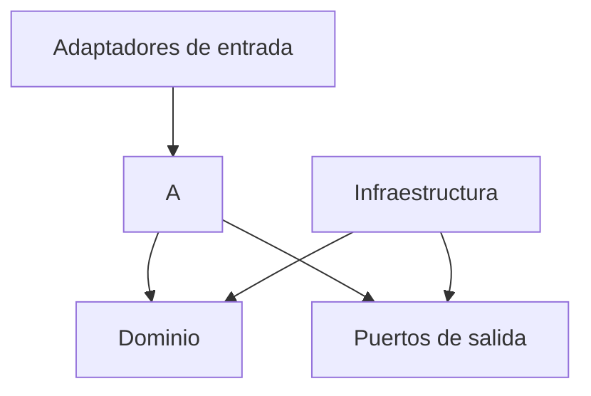
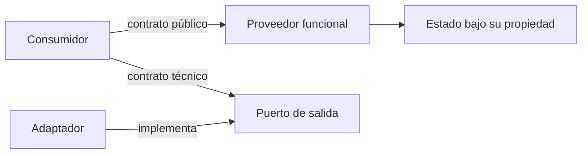

# Reglas de dependencia

La dependencia se define por **quién conoce el contrato de quién**, no por quién invoca a quién en tiempo de ejecución. La aplicación puede solicitar una operación que terminará en PostgreSQL sin que su lógica dependa de Prisma. Las fronteras del monolito deben preservarse tanto en las importaciones del código como en la composición de NestJS.

## 1. Dirección dentro de un módulo

El diagrama señala dependencias de código permitidas. En ejecución, la aplicación invoca un puerto y el contenedor entrega su implementación. La infraestructura depende de contratos internos para implementarlos, no al revés.

| Área               | Puede depender de                                                                                                                                                                  | No puede depender de                                                                                                                   |
| ------------------ | ---------------------------------------------------------------------------------------------------------------------------------------------------------------------------------- | -------------------------------------------------------------------------------------------------------------------------------------- |
| `domain`           | Conceptos propios y abstracciones puras necesarias.                                                                                                                                | NestJS, Prisma, HTTP, cola, sesiones o adaptadores.                                                                                    |
| `application`      | Dominio propio, puertos de salida, contratos públicos de capacidades proveedoras.                                                                                                  | Controladores, DTOs de transporte, repositorios concretos y framework como fuente de reglas.                                           |
| `infrastructure`   | Contratos que implementa y herramientas de persistencia o integración; puede leer relaciones persistidas de otras capacidades para comprobaciones técnicas acotadas de integridad. | Controladores ajenos, escrituras directas sobre datos de otro propietario y reglas funcionales cuya propiedad pertenece a otro módulo. |
| `entrypoints`      | Capacidades de entrada de aplicación y validaciones del mecanismo respectivo.                                                                                                      | Escrituras directas del negocio por medio de repositorios concretos.                                                                   |
| Composición NestJS | Declaraciones de providers, módulos y adaptadores necesarios.                                                                                                                      | Algoritmos de negocio, escrituras al construir módulos y acceso funcional no autorizado.                                               |

Las reglas del dominio se comprueban por la capacidad propietaria aunque una entrada ya haya validado sintaxis, formato y autenticación.

## 2. Tres categorías de dependencias entre módulos

| Categoría       | Necesidad del consumidor                                        | Forma de contrato                                                            |
| --------------- | --------------------------------------------------------------- | ---------------------------------------------------------------------------- |
| Comportamiento  | Solicita validar o ejecutar una operación de otro propietario.  | Puerto de entrada público e inyectable, que aplica las reglas del proveedor. |
| Tipo compartido | Necesita expresar un identificador, enum o contrato puro común. | Tipo estable compartido; no implica crear ni inyectar un provider.           |
| Lectura         | Necesita datos ajenos para presentar o agregar información.     | Contrato de consulta o read model controlado, sin acceso de escritura.       |

Las lecturas referenciales que los adaptadores de persistencia realizan directamente sobre tablas ajenas no constituyen una cuarta categoría de contrato funcional: son una excepción técnica limitada a comprobar dependencias y vigencia para una escritura propia. No generan una dependencia de importación entre módulos NestJS, no permiten escribir datos de otro propietario ni reemplazan los contratos públicos para cualquier comportamiento ajeno.

La distinción depende de lo que hace el consumidor, no del número de tablas consultadas. Una lectura utilizada para **tomar una decisión de negocio** requiere garantizar que esa decisión permanezca válida en la confirmación; no basta con tratarla como proyección informativa.

Las capacidades consumidoras declaran las dependencias necesarias para obtener los contratos públicos de sus proveedores. **La composición hace explícito qué capacidades se necesitan**, sin exponer implementaciones internas ni ocultar el grafo real de dependencias.

Los contratos inyectables deben poder identificarse durante la ejecución, mientras que los tipos usados solo para expresar datos no requieren inyección. La composición vincula contratos e implementaciones; el consumidor no construye dependencias ajenas.

## 3. Superficies públicas y encapsulación

La superficie pública de una capacidad se limita a las operaciones que otras capacidades necesitan. Su exposición para consumo no autoriza a publicar indiscriminadamente entidades mutables, repositorios, adaptadores o casos de uso internos.

La organización de importaciones de código y la exposición de dependencias en el contenedor cumplen funciones distintas. Ambas deben respetar la misma superficie pública y las restricciones de encapsulación.

Los puertos de entrada representan capacidades que un módulo ofrece. Los puertos de salida representan necesidades de aplicación que adaptadores satisfacen. No todo puerto de salida debe convertirse en contrato público para otras capacidades.

Los adaptadores de ejecución que necesita un proceso pueden tener una exposición **técnica y acotada** a su composición. Así ocurre con los processors que se registran para consumir trabajos. Esta exposición no los convierte en operaciones funcionales públicas disponibles para otros módulos de negocio.

## 4. Dependencias de áreas compartidas

| Área                            | Propósito                                                                                | Restricción                                                            |
| ------------------------------- | ---------------------------------------------------------------------------------------- | ---------------------------------------------------------------------- |
| Abstracciones transversales     | Contratos técnicos puros, tipos base y errores compartidos.                              | No conocen capacidades funcionales ni detalles de infraestructura.     |
| Infraestructura común           | Integraciones de persistencia, mensajería, archivos, seguridad técnica y observabilidad. | No asume decisiones del dominio académico.                             |
| Utilidades compartidas          | Funciones y tipos auxiliares sin propiedad funcional.                                    | No decide elegibilidad, permisos ni cupos.                             |
| Composición de entradas         | Integra los adaptadores y capacidades necesarios para atender solicitudes.               | No contiene reglas de negocio ni obliga a utilizar un único protocolo. |
| Composición de trabajo diferido | Integra consumidores y sus dependencias de ejecución.                                    | No reemplaza los casos de uso ni contiene decisiones funcionales.      |
| Capacidades funcionales         | Dominio, aplicación y adaptadores bajo una responsabilidad definida.                     | No atraviesan las superficies privadas de otras capacidades.           |

Un tipo general compartido no implica dependencia funcional. Las reglas y el estado de una inscripción permanecen bajo la capacidad que los gobierna; no se trasladan a un área compartida para resolver dificultades de importación.

La composición de entradas y la de trabajo diferido expresan responsabilidades de ejecución distintas, no una división de las reglas funcionales por protocolo. Ambas utilizan los contratos de aplicación de la capacidad propietaria, aunque cambien los adaptadores o sus tecnologías.

Las dependencias técnicas se declaran explícitamente cuando aportan capacidades que un consumidor utiliza, como acceso a persistencia o generación de identificadores. La configuración general del proceso puede estar disponible de forma global si permanece transversal y no introduce dependencias funcionales ocultas. La disponibilidad global de infraestructura no concede acceso funcional general a datos privados. La única excepción de acceso relacional directo entre tablas de distintos propietarios corresponde a consultas técnicas de existencia y vigencia indispensables para integridad, ejecutadas por adaptadores de persistencia y sin facultad de escritura ajena.

## 5. Prevención de ciclos y dependencias indebidas

Se prohíben ciclos entre capacidades funcionales y dependencias que inviertan indebidamente la dirección de las capas. Los mecanismos del framework para resolver referencias circulares no justifican diseñar componentes mutuamente dependientes.

Si dos capacidades se requieren mutuamente, se identifica la responsabilidad que coordina el flujo, se divide la colaboración o se define un contrato con propietario claro. No se solucionan ciclos creando un área compartida que acumula decisiones de ambas.

Los agregadores de dominio son componentes de composición, no nuevos propietarios. Sus exportaciones son selectivas y no deben habilitar dependencias privilegiadas entre módulos agrupados.

## 6. Colaboración transaccional

El caso de uso coordinador define la unidad que debe confirmarse junta. La infraestructura suministra un **contexto transaccional** accesible por contratos adecuados sin exponer Prisma al dominio. Las capacidades involucradas participan sin ejecutar commits independientes que permitan resultados parciales.

- La comprobación definitiva de aforo y unicidad pertenece a la misma unidad de consistencia que el cambio de inscripción.
- El movimiento histórico y la auditoría obligatoria acompañan la modificación que documentan.
- Los contratos de consulta usados para decisiones susceptibles de carrera deben revalidarse o protegerse en la transacción.
- El acceso compartido a PostgreSQL no habilita modificaciones directas sobre datos privados de otra capacidad.
- La consulta referencial entre tablas para autorizar una baja lógica debe mantenerse válida hasta la confirmación; también las altas de dependientes deben impedir referencias operativas a un padre ya dado de baja.
- Un evento o job no puede confirmar retroactivamente una operación que ya se declaró exitosa.

La transacción une cambios persistentes **sin unir las responsabilidades**. Si un contrato intermodular no puede preservar la atomicidad necesaria, se corrige el diseño del contrato antes de implementar un flujo de escrituras parciales.

## 7. Incumplimientos comprobables

| Síntoma                                                                                                                             | Incumplimiento                                            |
| ----------------------------------------------------------------------------------------------------------------------------------- | --------------------------------------------------------- |
| Un adaptador de entrada calcula la validez académica.                                                                               | Regla colocada en un adaptador de entrada.                |
| El dominio importa NestJS o Prisma.                                                                                                 | Dependencia del núcleo hacia infraestructura.             |
| Un módulo manipula un repositorio privado ajeno.                                                                                    | Encapsulación funcional vulnerada.                        |
| Un adaptador escribe en tablas ajenas o utiliza lecturas referenciales técnicas para ejecutar reglas funcionales de otra capacidad. | Excepción de integridad referencial excedida.             |
| Un agregador ejecuta reglas de inscripciones.                                                                                       | Composición convertida en negocio.                        |
| El módulo raíz instancia manualmente otros módulos o inicia trabajos en su constructor.                                             | Composición no declarativa.                               |
| La verificación de cupos ocurre fuera de cualquier garantía concurrente.                                                            | Dependencia temporal insegura.                            |
| Un adaptador de ejecución o processor reemplaza al caso de uso del módulo propietario.                                              | Duplicación funcional en un mecanismo técnico de entrada. |

Estas condiciones deben poder analizarse mediante dependencias del código y pruebas de integración; no dependen de un árbol rígido de carpetas.
