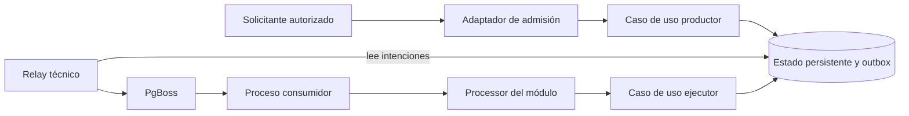
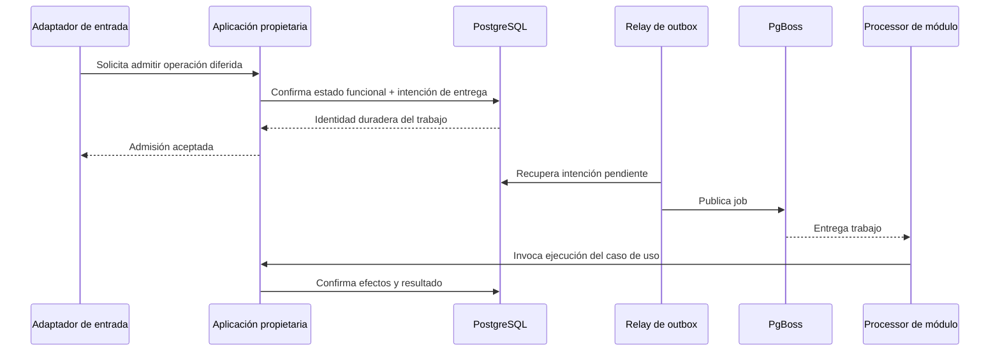

# Procesamiento asíncrono

El procesamiento asíncrono permite **admitir, entregar y ejecutar trabajo diferible de forma recuperable**, sin crear una segunda capa de negocio. La mensajería y los procesos consumidores son mecanismos técnicos; el significado del trabajo, sus condiciones de aceptación y sus efectos pertenecen al módulo funcional responsable.

La arquitectura distingue las garantías comunes de ejecución de las reglas particulares de cada operación. La importación administrativa de estudiantes es la capacidad que utiliza el procesamiento diferido en el sistema; no define la responsabilidad general de los workers ni del mecanismo de mensajería. La inscripción, la cancelación, el retiro, el cambio de sección y las correcciones administrativas conservan confirmación sincrónica y transaccional.

## 1. Trabajos, eventos y propiedad

| Concepto | Significado | Responsabilidad |
| --- | --- | --- |
| **Job** | Encargo persistente de una operación diferible. | El módulo dueño define su contrato, aceptación, identidad funcional y resultado; la infraestructura entrega el trabajo. |
| **Evento** | Comunicación de un hecho funcional ya confirmado. | El módulo dueño define el hecho; la infraestructura lo publica a consumidores autorizados. |
| **Processor** | Adaptador que recibe una entrega y activa un caso de uso. | Pertenece a la capacidad funcional que ejecuta; no reemplaza su lógica de aplicación. |
| **Worker** | Proceso que registra consumidores y gestiona su ejecución. | Compone recursos y adaptadores; no decide reglas académicas. |
| **Outbox y relay** | Persisten y despachan intenciones de publicación recuperables. | Implementan una garantía técnica compartida sin adquirir propiedad del hecho o trabajo. |

No toda operación requiere trabajo diferido ni genera eventos. Los contratos se crean para consecuencias funcionales definidas, no para transformar toda llamada entre módulos en mensajería. Un evento no sustituye el historial ni la auditoría obligatoria de su hecho de origen.

## 2. Separación de ejecución y composición

Los procesos de atención interactiva y de trabajo diferido utilizan **contenedores NestJS independientes**. Comparten definiciones, contratos y almacenamiento persistente, pero no instancias de providers, conexiones ni memoria de ejecución.

El worker utiliza un contexto de aplicación NestJS sin servidor HTTP, registra sus consumers y gestiona la recepción mediante PgBoss. No inicia controladores ni recursos de transporte que no necesita. Los processors de módulos se incorporan a esta composición mediante una exposición técnica acotada; no se publican como capacidades funcionales para otros módulos.

El diagrama representa un trabajo cuya admisión necesita entrega recuperable. La frontera de entrada no se limita a HTTP ni la de salida a un broker particular: la composición actual utiliza HTTP para admitir solicitudes y PgBoss para entregar trabajos, manteniendo los contratos de aplicación independientes de esos mecanismos.

## 3. Contratos y recorrido de un trabajo

El módulo propietario declara el **identificador funcional**, los datos mínimos requeridos para ejecutar la operación y el estado consultable de su resultado. Los datos del job no transportan secretos, entidades mutables ni objetos internos del broker.

1. **Admisión:** un caso de uso autorizado valida las condiciones para aceptar el encargo y registra su identidad duradera.
2. **Intención de entrega:** cuando la aceptación y el despacho deben confirmarse conjuntamente, se registra una intención en el outbox dentro de la misma transacción.
3. **Publicación:** un relay técnico entrega la intención al broker y reintenta las entregas no reconocidas, sin decidir la semántica del trabajo.
4. **Recepción:** el worker resuelve el processor del módulo, que valida el contrato de entrega y delega la ejecución al caso de uso correspondiente.
5. **Ejecución:** la aplicación confirma los efectos persistentes bajo las reglas y unidades transaccionales del propietario.
6. **Resultado:** la capacidad propietaria conserva el progreso y la conclusión funcional de manera independiente del identificador interno de PgBoss.

La aceptación de un trabajo **no equivale a su finalización**. La admisión duradera y la ejecución efectiva son transiciones distintas; una respuesta de aceptación solo garantiza las obligaciones de registro y recuperación que corresponden a ese punto.

## 4. Outbox y publicación confiable

Cuando una operación confirma estado de negocio y además necesita publicar un job o evento sin riesgo de perder la intención de entrega, ambas escrituras participan en **la misma transacción de PostgreSQL**. El relay publica después de esa confirmación y conserva capacidad de reintentar si falla la entrega o el reconocimiento.

Un registro de outbox no significa que el broker haya procesado el trabajo. Tampoco proporciona ejecución exactamente una vez: un fallo puede provocar publicaciones o entregas repetidas. Por ello, la **idempotencia de los efectos** es una obligación del módulo consumidor y no una suposición sobre PgBoss.

Para eventos, el hecho publicado ya existe y permanece confirmado antes de ser entregado. Su consumidor solo ejecuta consecuencias secundarias autorizadas; no valida retroactivamente la operación de origen ni altera una decisión académica que ya se respondió como exitosa.

## 5. Reintentos, idempotencia y recuperación

La infraestructura controla la recepción, la concurrencia técnica, los reintentos y el reconocimiento de entregas. El módulo propietario define qué operaciones pueden repetirse, cuáles son sus claves de idempotencia y cómo se conserva el resultado funcional.

| Situación | Garantía requerida |
| --- | --- |
| Fallo antes de confirmar la admisión. | No existe encargo aceptado ni intención parcial de publicación. |
| Caída tras confirmar la admisión, antes de publicar. | La intención persistida permanece disponible para el relay. |
| Caída tras publicar, antes de reconocer. | La entrega puede repetirse sin duplicar efectos. |
| Fallo durante la ejecución. | Los cambios confirmados se distinguen de los no confirmados; la recuperación no repite efectos persistentes. |
| Error permanente. | El propietario registra un resultado de fallo y el estado funcional alcanzado, sin presentar éxito inexistente. |
| Apagado del consumidor. | Se detienen nuevas recepciones, se resuelven o liberan entregas en curso y se cierran recursos mediante el ciclo de vida técnico. |

No se presume orden absoluto de entrega ni procesamiento exactamente una vez. Cuando el orden modifica el resultado, el módulo responsable establece identidad, versión o condiciones de transición capaces de rechazar una entrega obsoleta. Los eventos y trabajos incluyen el contexto de trazabilidad imprescindible, sin confiar permisos a valores del payload no autorizados.

## 6. Consistencia, autorización y límites

La autorización para solicitar un trabajo se comprueba **en su admisión**. Durante la ejecución se mantienen las restricciones de integridad de la operación y la identidad del actor requerida para evidencia. El worker no abre una vía de ejecución que eluda los contratos funcionales o la autorización de origen.

La cola no determina la verdad de los datos académicos ni sustituye PostgreSQL como almacenamiento de estados y resultados. La consistencia de una operación crítica se confirma dentro de su transacción; publicar un evento posteriormente no repara una escritura incompleta. Los registros funcionales e históricos son propiedad de los módulos, mientras que la auditoría conserva su responsabilidad transversal.

La independencia entre procesos reduce la competencia directa con la atención interactiva, pero no elimina la contención de recursos compartidos ni garantiza capacidad ilimitada. La configuración de recepción, los tiempos y la observabilidad operativa no se confunden con las reglas del negocio.

## 7. Aplicación al sistema: importación de estudiantes

La importación administrativa de estudiantes utiliza la admisión duradera, el outbox, la entrega recuperable y la ejecución mediante un processor del módulo `students`. La API confirma la aceptación y devuelve un **identificador funcional de importación**; el estado y los resultados se consultan desde esa capacidad, no desde el broker.

La lectura del archivo original, la validación y el resultado de cada registro, la detección de duplicados, la recuperación de trabajo parcialmente confirmado y la consolidación del resultado pertenecen al **caso de uso de importación**. Son reglas específicas de `students`, no responsabilidades del worker genérico, de PgBoss ni del relay. La ejecución diferida conserva esas decisiones bajo las mismas fronteras de aplicación y persistencia que cualquier otra entrada.
