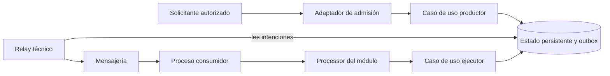

# Procesamiento asíncrono

El procesamiento asíncrono permite **admitir, entregar y ejecutar trabajo diferible de forma recuperable**, sin crear una segunda capa de negocio. La mensajería y los procesos consumidores son mecanismos técnicos; el significado del trabajo, sus condiciones de aceptación y sus efectos pertenecen al módulo funcional responsable.

La arquitectura distingue las garantías comunes de ejecución de las reglas particulares de cada operación. La importación administrativa de estudiantes es la capacidad que utiliza el procesamiento diferido en el sistema; no define la responsabilidad general de los workers ni del mecanismo de mensajería. La inscripción, la cancelación, el retiro, el cambio de sección y las correcciones administrativas conservan confirmación sincrónica y transaccional.

## 1. Trabajos, eventos y propiedad

| Concepto | Significado | Responsabilidad |
| --- | --- | --- |
| **Job** | Encargo persistente de una operación diferible. | El módulo dueño define su contrato, aceptación, identidad funcional y resultado; la infraestructura entrega el trabajo. |
| **Evento** | Comunicación de un hecho funcional ya confirmado. | El módulo dueño define el hecho; la infraestructura lo publica a consumidores autorizados. |
| **Processor** | Adaptador que recibe una entrega y activa un caso de uso. | Pertenece a la capacidad funcional que ejecuta; no reemplaza su lógica de aplicación. |
| **Worker** | Proceso que registra consumidores y gestiona su ejecución. | Compone recursos y adaptadores; no decide reglas académicas. |
| **Outbox y relay** | Persisten y despachan intenciones de publicación recuperables. | Implementan una garantía técnica compartida sin adquirir propiedad del hecho o trabajo. |

No toda operación requiere trabajo diferido ni genera eventos. Los contratos se crean para consecuencias funcionales definidas, no para transformar toda llamada entre módulos en mensajería. Un evento no sustituye el historial ni la auditoría obligatoria de su hecho de origen.

El **envío de trabajos** y la **publicación de eventos** tienen contratos distintos. Cada operación expresa su propio resultado de aceptación y distingue una entrega confirmada de una omisión o rechazo, sin atribuir confirmaciones ni identificadores que el mecanismo utilizado no proporciona. La aceptación del mensaje no demuestra que el consumidor haya completado su ejecución.

## 2. Separación de ejecución y composición

Los procesos de atención interactiva y de trabajo diferido utilizan **contextos de ejecución independientes**. Comparten contratos y almacenamiento persistente, pero no instancias de servicios, conexiones ni memoria de ejecución.

El proceso consumidor incorpora únicamente los recursos necesarios para recibir y ejecutar trabajos, sin iniciar interfaces de atención interactiva. Los adaptadores de ejecución se integran mediante una exposición técnica acotada y delegan las reglas funcionales a los casos de uso de su capacidad propietaria.

El diagrama representa un trabajo cuya admisión requiere entrega recuperable. Los contratos de aplicación no dependen del protocolo de entrada ni de la tecnología utilizada para entregar trabajos.

Cada proceso posee sus propias instancias de infraestructura. **Cada instancia compartida del servicio de mensajería tiene un único responsable de su inicio y detención**; los adaptadores de trabajos y eventos gestionan sus operaciones sin cerrar recursos compartidos que no les pertenecen. La independencia entre procesos no implica compartir instancias en memoria.

## 3. Contratos y recorrido de un trabajo

La capacidad propietaria define el **identificador funcional**, los datos mínimos de ejecución y el estado consultable del resultado. Los mensajes no transportan secretos, entidades mutables ni objetos internos del mecanismo de entrega.

1. **Admisión:** un caso de uso autorizado valida las condiciones para aceptar el encargo y registra su identidad duradera.
2. **Intención de entrega:** cuando la aceptación y el despacho deben confirmarse conjuntamente, se registra una intención en el outbox dentro de la misma transacción.
3. **Publicación:** un relay técnico entrega la intención al broker y reintenta las entregas no reconocidas, sin decidir la semántica del trabajo.
4. **Recepción:** el consumidor valida el contrato del mensaje y delega la ejecución al caso de uso correspondiente.
5. **Ejecución:** la aplicación confirma los efectos persistentes bajo las reglas y unidades transaccionales del propietario.
6. **Resultado:** la capacidad propietaria conserva el progreso y la conclusión funcional independientemente de los identificadores del mecanismo de entrega.

La aceptación de un trabajo **no equivale a su finalización**. La admisión duradera y la ejecución efectiva son transiciones distintas; una respuesta de aceptación solo garantiza las obligaciones de registro y recuperación que corresponden a ese punto.

## 4. Outbox y publicación confiable

Cuando una operación confirma un cambio de negocio y requiere la publicación recuperable de un trabajo o evento, el cambio y su intención de entrega se registran **en la misma transacción**. La publicación ocurre después de confirmar esa unidad y se reintenta mientras no exista una aceptación válida. Una omisión por deduplicación u otra causa no se presenta como una nueva entrega confirmada: su resultado se resuelve de acuerdo con la identidad e idempotencia de la operación. El outbox se aplica a publicaciones duraderas vinculadas con cambios de negocio, no a todo trabajo asíncrono.

Registrar o despachar una intención no significa que el consumidor haya terminado el trabajo. La recuperación puede repetir publicaciones o entregas; por eso la **idempotencia de los efectos** corresponde a la capacidad ejecutora, sin presumir ejecución exactamente una vez.

Para eventos, el hecho publicado ya existe y permanece confirmado antes de ser entregado. Su consumidor solo ejecuta consecuencias secundarias autorizadas; no valida retroactivamente la operación de origen ni altera una decisión académica que ya se respondió como exitosa.

## 5. Reintentos, idempotencia y recuperación

La infraestructura controla la recepción, la concurrencia técnica, los reintentos y el reconocimiento de entregas. El módulo propietario define qué operaciones pueden repetirse, cuáles son sus claves de idempotencia y cómo se conserva el resultado funcional.

| Situación | Garantía requerida |
| --- | --- |
| Fallo antes de confirmar la admisión. | No existe encargo aceptado ni intención parcial de publicación. |
| Caída tras confirmar la admisión, antes de publicar. | La intención persistida permanece disponible para el relay. |
| Caída tras publicar, antes de reconocer. | La entrega puede repetirse sin duplicar efectos. |
| Fallo durante la ejecución. | Los cambios confirmados se distinguen de los no confirmados; la recuperación no repite efectos persistentes. |
| Error permanente. | El propietario registra un resultado de fallo y el estado funcional alcanzado, sin presentar éxito inexistente. |
| Apagado del consumidor. | Cada instancia compartida se detiene una sola vez bajo su responsable técnico, después de interrumpir nuevas recepciones y finalizar o liberar de forma controlada las entregas en curso. |

No se presume orden absoluto de entrega ni procesamiento exactamente una vez. Cuando el orden modifica el resultado, el módulo responsable establece identidad, versión o condiciones de transición capaces de rechazar una entrega obsoleta. Los eventos y trabajos incluyen el contexto de trazabilidad imprescindible, sin confiar permisos a valores del payload no autorizados.

## 6. Consistencia, autorización y límites

La autorización para solicitar un trabajo se comprueba **en su admisión**. Durante la ejecución se mantienen las restricciones de integridad de la operación y la identidad del actor requerida para evidencia. El worker no abre una vía de ejecución que eluda los contratos funcionales o la autorización de origen.

La cola no determina la verdad de los datos académicos ni sustituye la persistencia funcional de estados y resultados. La consistencia de una operación crítica se confirma dentro de su transacción; publicar un evento posteriormente no repara una escritura incompleta. Los registros funcionales e históricos pertenecen a las capacidades correspondientes, mientras que la auditoría conserva su responsabilidad transversal.

La independencia entre procesos reduce la competencia directa con la atención interactiva, pero no elimina la contención de recursos compartidos ni garantiza capacidad ilimitada. La configuración de recepción, los tiempos y la observabilidad operativa no se confunden con las reglas del negocio.

## 7. Aplicación al sistema: importación de estudiantes

La importación administrativa de estudiantes utiliza admisión duradera, outbox y entrega recuperable. La aceptación devuelve un **identificador funcional de importación**; el progreso y los resultados se consultan mediante la capacidad responsable, no a través de la cola.

La lectura del archivo original, la validación de cada registro, la detección de duplicados, la recuperación de procesos parciales y la consolidación del resultado pertenecen al **caso de uso de importación**. No son responsabilidades de la infraestructura de mensajería ni del proceso consumidor. La ejecución diferida respeta las mismas fronteras funcionales y transaccionales que cualquier otra entrada.
