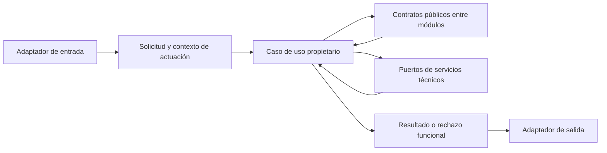

# Diseño de aplicación

La capa de aplicación **interpreta intenciones funcionales autorizadas, coordina capacidades propietarias y produce resultados independientes del mecanismo de entrada**. Expresa los casos de uso en términos del negocio y usa contratos públicos y puertos para colaborar con otros módulos y servicios técnicos. No contiene controladores, estructuras de Prisma, lógica propia de brokers ni una copia de las reglas que corresponden al dominio.

## 1. Responsabilidades y propiedad

| Tipo de operación             | Responsabilidad de aplicación                                                                 | Límite                                                                                          |
| ----------------------------- | --------------------------------------------------------------------------------------------- | ----------------------------------------------------------------------------------------------- |
| **Comando**                   | Coordinar una modificación intencional y confirmar sus efectos obligatorios.                  | No autorizar escrituras libres sobre estados ni datos privados de otros módulos.                |
| **Consulta**                  | Recuperar recursos, relaciones e historiales visibles para el solicitante.                    | No modificar el estado funcional como consecuencia de una lectura.                              |
| **Colaboración intermodular** | Obtener comprobaciones o ejecutar capacidades ajenas a través de contratos públicos.          | No asumir la propiedad de invariantes de los colaboradores.                                     |
| **Operación diferida**        | Aceptar una intención recuperable, conservar su identidad funcional y coordinar su resultado. | No delegar el significado del trabajo a una cola o a un proceso worker.                         |
| **Proyección de lectura**     | Combinar información confirmada bajo filtros, significado y autorización definidos.           | No adquirir permisos de escritura sobre las fuentes ni exponer datos por asociación accidental. |

Cada caso de uso tiene un **módulo propietario** que determina sus condiciones y resultados. Coordinar varios módulos no concede acceso directo a sus repositorios privados ni convierte al coordinador en propietario de sus datos.

## 2. Entrada, contexto de actuación y resultados

Un adaptador interpreta el mecanismo de entrada, valida su forma y entrega al caso de uso parámetros funcionales y un contexto de actuación confiable. El caso de uso no recibe objetos HTTP ni estructuras específicas de mensajería. Los procesos interactivos y diferidos siguen esta misma separación de responsabilidades.

El contexto de actuación identifica a la cuenta autenticada, sus permisos efectivos y los datos de atribución necesarios para la operación. **La identidad del responsable no se obtiene de un campo arbitrario aportado por el cliente.** La aplicación comprueba la autorización correspondiente a la intención solicitada y las restricciones adicionales sobre los recursos involucrados; el adaptador conserva la responsabilidad de autenticar y traducir su propio protocolo.

Cada resultado tiene un significado funcional independiente de su representación externa:

- **Éxito confirmado:** el efecto exigido por el comando se ha confirmado y existe su evidencia obligatoria.
- **Aceptación diferida:** la operación tiene identidad durable y queda comprometida su ejecución recuperable, sin afirmar que terminó.
- **Consulta satisfactoria:** los datos proceden de una lectura autorizada y no causan mutaciones funcionales.
- **Rechazo tipificado:** la intención no puede completarse por entrada inválida, inexistencia dentro del ámbito visible, acceso insuficiente, regla funcional o conflicto concurrente.
- **Fallo técnico:** la aplicación no presenta como rechazo académico una indisponibilidad o error interno del mecanismo de ejecución.

Las salidas no exponen entidades mutables internas, excepciones técnicas ni detalles de almacenamiento. El adaptador externo transforma los resultados en respuestas propias del transporte.

## 3. Contratos, validación y coordinación

Un contrato de caso de uso define la intención, sus datos indispensables, el contexto exigido y los resultados reconocibles. La validación formal de los parámetros no reemplaza las comprobaciones de vigencia, pertenencia, estado y otras reglas funcionales. Estas se evalúan mediante el módulo propietario con la información vigente al confirmar la operación.

La coordinación comprende tres responsabilidades distintas:

1. **Preparación:** identificar la capacidad solicitada, los datos indispensables y los módulos que deben colaborar.
2. **Decisión:** comprobar autorización e invariantes a través de capacidades propietarias, sin confiar en condiciones vistas previamente por la interfaz.
3. **Confirmación:** exigir que los efectos que constituyen una sola operación queden registrados de manera íntegra o no se informen como realizados.

| Operación concreta                     | Confirmación que exige el caso de uso                                                   |
| -------------------------------------- | --------------------------------------------------------------------------------------- |
| Registrar una inscripción              | Inscripción válida, ocupación coherente e historial de creación.                        |
| Cancelar, retirar o cambiar de sección | Movimiento válido, efecto sobre la plaza y evidencia de actor y motivo exigible.        |
| Ejecutar corrección extraordinaria     | Modificación delimitada, preservación histórica y evidencia administrativa obligatoria. |
| Administrar identidades y permisos     | Cambio autorizado y mantenimiento de las restricciones de seguridad y atribución.       |
| Admitir una operación diferida         | Identidad funcional aceptada y obligación durable de entrega para ejecución.            |

El caso de uso determina **qué resultados deben confirmarse juntos**. Los puertos transaccionales y la persistencia implementan cómo se alcanza esa indivisibilidad; la aplicación no contiene sentencias SQL, reglas de bloqueo ni estructuras de almacenamiento. Si la confirmación falla, no se comunica un éxito parcial como si la operación hubiera concluido.

## 4. Comandos, consultas y efectos derivados

Los comandos expresan operaciones intencionales, no asignaciones arbitrarias de atributos. Registrar una inscripción, cancelarla, retirarla, cambiar su sección y corregirla extraordinariamente son intenciones diferentes aunque operen sobre un mismo recurso. Cada intención conserva su autorización, condiciones y resultado propios.

Las consultas presentan información vigente o histórica sin ejecutar transiciones. La separación entre comandos y consultas es **lógica**: no exige bases de datos separadas, proyecciones materializadas ni un bus adicional de eventos.

Los efectos derivados se clasifican por su obligación de consistencia. La escritura funcional y la evidencia exigida para confirmar un cambio académico forman parte de su misma unidad de resultado; una notificación o ejecución diferible no puede sustituirlas. Un trabajo repetido o una consulta reiterada tampoco habilita efectos funcionales duplicados.

## 5. Identidad de operación, concurrencia y errores

La **identidad del recurso** y la **identidad de una operación** no son equivalentes. La primera representa una entidad académica o administrativa; la segunda permite reconocer una intención admitida y sus reejecuciones cuando el caso de uso lo exige. La idempotencia se define para la operación correspondiente, sin imponer una clave universal a todos los comandos.

Una validación inicial no reserva cupos ni garantiza unicidad. Las operaciones concurrentes aceptadas deben preservar las mismas restricciones de inscripción, capacidad, referencias y estado que una ejecución aislada. Ante un conflicto, la aplicación comunica un rechazo funcional reconocible; no crea una inscripción intermedia ni registra un movimiento falso.

| Categoría                              | Significado para la aplicación                                                                            | Límite                                                             |
| -------------------------------------- | --------------------------------------------------------------------------------------------------------- | ------------------------------------------------------------------ |
| Entrada inválida                       | La intención carece de datos válidos para su contrato.                                                    | No se interpreta como rechazo de una regla académica ya evaluada.  |
| Acceso denegado                        | El contexto no habilita la acción o visibilidad requerida.                                                | No se revela información protegida para explicar el rechazo.       |
| Referencia no visible o inexistente    | El recurso no puede recuperarse dentro del acceso permitido.                                              | No permite inferir registros fuera del ámbito autorizado.          |
| Regla funcional incumplida             | El estado o las condiciones del dominio impiden la operación.                                             | No se convierte en escritura parcial ni en corrección automática.  |
| Conflicto de concurrencia o repetición | La operación contradice una condición confirmada por otra ejecución o una identidad previamente admitida. | No duplica efectos para satisfacer la solicitud.                   |
| Falla técnica                          | No es posible completar o confirmar la ejecución por un error técnico.                                    | No se presenta como operación exitosa ni expone detalles internos. |

La atribución, los permisos y los resultados consultables pertenecen al contrato de aplicación. Los códigos HTTP, el tratamiento de conexiones, la gestión de procesos consumidores y las garantías físicas de almacenamiento permanecen en sus respectivos adaptadores e infraestructura.
