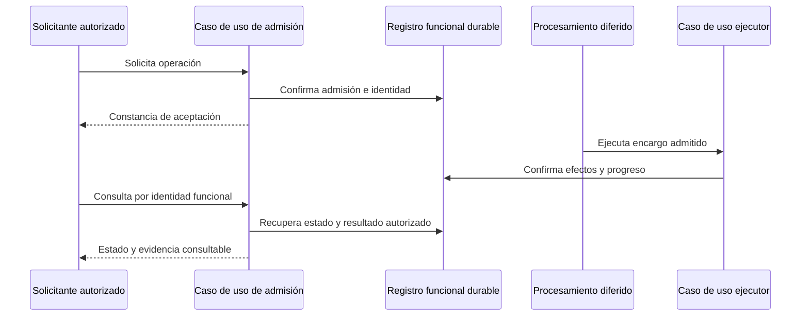

# Operaciones diferidas

Una operación diferida **se acepta como intención funcional durable y se ejecuta mediante un caso de uso propietario sin mantener abierta la interacción de origen**. La aplicación define su identidad, condiciones de admisión, progreso observable y resultado; los adaptadores, la mensajería y los workers transportan y activan el trabajo sin decidir su significado.

La **importación de estudiantes** es la operación diferida de negocio definida para el sistema. Sus reglas particulares de admisión, deduplicación y resultados por fila se aplican a esa capacidad, sin convertirse en obligaciones de todo procesamiento asíncrono.

## 1. Contrato funcional de una operación diferida

| Elemento | Responsabilidad de aplicación | Límite |
| --- | --- | --- |
| **Admisión** | Autorizar la intención y confirmar una constancia recuperable. | La aceptación no certifica que la ejecución haya concluido. |
| **Identidad funcional** | Asignar un identificador consultable que se conserva durante la ejecución. | No exponer como identificador contractual el ID interno del job. |
| **Ejecución** | Invocar el caso de uso propietario con el contexto necesario. | Un processor no sustituye reglas ni operaciones del módulo. |
| **Progreso y resultados** | Representar resultados confirmados, errores y trabajo no concluido. | No inferir éxito por la recepción o reconocimiento de un mensaje. |
| **Reanudación** | Reconocer efectos ya confirmados y continuar sin duplicarlos. | No depender de memoria de proceso ni de entrega exactamente una vez. |
| **Consulta** | Devolver estado y evidencia según los permisos aplicables. | No confundir seguimiento funcional con registros técnicos del broker. |

La aceptación exige una identidad funcional persistente y una **obligación durable de ejecución**. La aplicación expresa ese compromiso; la infraestructura lo cumple mediante sus mecanismos transaccionales, outbox, publicación y recuperación. El rechazo previo a la confirmación de admisión no genera un trabajo presentado como aceptado.

El diagrama representa obligaciones funcionales; no determina la ubicación de transacciones, componentes de mensajería ni el número de procesos ejecutores.

## 2. Progreso, idempotencia y recuperación

Los datos de seguimiento distinguen **aceptación, ejecución, efectos confirmados y conclusión**. La operación no se considera terminada por haber sido enviada a la cola; tampoco se confunden los resultados válidos parciales con la finalización del encargo.

- **Identidad estable:** cada ejecución recupera la operación admitida y su estado mediante una identidad funcional persistente.
- **Efectos verificables:** el propietario conserva evidencia suficiente para distinguir trabajo confirmado, rechazado y no procesado.
- **Idempotencia:** la repetición de una entrega no produce nuevamente los efectos de una unidad ya confirmada.
- **Interrupción:** la recuperación respeta los resultados ya persistidos y determina qué trabajo queda por realizar.
- **Fallo definitivo:** el resultado informa qué parte de la operación concluyó y cuál no, sin fabricar una confirmación global.

La granularidad de una unidad de resultado la define cada capacidad; **no todas las operaciones diferidas se procesan por filas ni admiten éxito parcial**. Estas propiedades son específicas de las operaciones que las requieran.

## 3. Aplicación concreta: admisión de importaciones de estudiantes

Una importación administrativa incorpora estudiantes desde **CSV o XLSX**. La cuenta debe poseer autorización para importar. La admisión comprueba el formato, la conservación íntegra del archivo y que su contenido binario no haya sido admitido previamente por la misma cuenta.

El contenido se identifica mediante **SHA-256 de los bytes originales** junto con el usuario responsable. Dos solicitudes concurrentes equivalentes no pueden admitir el mismo archivo dos veces. Un mismo contenido presentado por otra cuenta representa una solicitud distinta. La carga no constituye una operación de sincronización ni concede permiso para sobrescribir estudiantes ya existentes.

La aceptación confirma conjuntamente:

1. El **registro funcional de importación**, con identificador estable, responsable y huella del archivo.
2. La **conservación del archivo original**, disponible únicamente mediante acceso autorizado.
3. La **intención persistente de ejecución**, recuperable ante una interrupción del despacho.

El adaptador REST comunica **`202 Accepted`** y el identificador de importación. Ese resultado no afirma que se haya validado o incorporado alguna fila. Un archivo repetido o inadmisible recibe un rechazo y no genera una segunda importación aceptada.

## 4. Interpretación de filas y confirmación parcial

El caso de uso de `students` interpreta el archivo conservado y normaliza sus registros a una representación común. Cada fila mantiene referencia a su posición de origen. Un defecto que impide interpretar el archivo afecta a la operación completa; **una fila inválida no impide procesar las demás**.

| Comprobación de una fila | Resultado que debe preservar |
| --- | --- |
| Datos y formato | Los atributos exigidos se pueden interpretar sin asignar datos inferidos. |
| Identidad documental | Se reconoce una persona sin crear duplicados ni aceptar identidades incompatibles. |
| Programa académico | El código institucional identifica un programa académico existente y vigente. |
| Perfil estudiantil | El código de estudiante y la identidad no contradicen perfiles ya registrados. |
| Incorporación | Se confirma como una sola unidad el vínculo permitido y el perfil estudiantil nuevo. |
| Evidencia | La fila recibe un resultado estable y una observación cuando corresponda. |

Una persona que todavía no posee perfil estudiantil puede recibirlo mediante un vínculo inequívoco y válido. Si la persona ya es estudiante, su presencia en otra fila no actualiza automáticamente ese perfil. Una referencia desconocida, identidad incompatible o condición inválida provoca rechazo **solo de la fila afectada**.

El procesamiento distingue de manera explícita estos resultados:

| Resultado | Significado |
| --- | --- |
| **Incorporada** | Se creó y confirmó el perfil estudiantil permitido. |
| **Duplicada** | Ya existe el estudiante y no se alteraron sus datos. |
| **Rechazada** | La fila examinada no cumple su contrato o una condición funcional. |
| **Sin procesar** | La ejecución todavía no examinó la fila o terminó antes de hacerlo. |

Cada incorporación válida confirma sus efectos indivisiblemente. Una fila fallida no deja persona o estudiante parcialmente incorporados; los éxitos anteriores se conservan. Las cantidades se calculan sobre resultados confirmados y no clasifican como rechazadas las filas que nunca llegaron a examinarse.

## 5. Estados y recuperación de una importación

La importación conserva uno de estos estados funcionales:

| Estado | Significado |
| --- | --- |
| `PENDING` | Admisión confirmada; el procesamiento todavía no comienza. |
| `PROCESSING` | Hay ejecución activa o recuperable, con resultados por fila que pueden estar ya confirmados. |
| `COMPLETED` | Todas las filas evaluables tienen resultado definitivo y ninguna fue rechazada. |
| `COMPLETED_WITH_ERRORS` | Finalizó el recorrido de las filas evaluables, pero existen filas rechazadas. |
| `FAILED` | Un fallo definitivo impide concluir el encargo; los resultados parciales confirmados se conservan y las filas restantes siguen sin resultado definitivo. |

`PENDING` pasa a `PROCESSING` cuando comienza la ejecución; `PROCESSING` termina en uno de los tres resultados finales. Una interrupción recuperable no crea una importación nueva ni transforma filas pendientes en rechazadas. Un error que impide interpretar el archivo concluye en `FAILED`; los duplicados identificados sin modificación de datos son resultados definitivos, no fallos.

La **deduplicación de admisiones por archivo** y la **idempotencia del procesamiento** son garantías distintas. La primera evita una segunda importación del mismo contenido por el mismo usuario; la segunda evita que entregas repetidas del encargo ya admitido creen nuevamente estudiantes, alteren perfiles o inflen cantidades.

| Situación | Resultado funcional requerido |
| --- | --- |
| Fallo antes de confirmar la admisión | No se informa una importación aceptada. |
| Interrupción tras admitir, antes de ejecutar | La identidad y obligación de ejecutar permanecen recuperables. |
| Entrega repetida | Los resultados por fila confirmados se reconocen y no se repiten sus efectos. |
| Fallo al confirmar una fila | No queda una incorporación parcial de esa fila. |
| Interrupción después de varias filas | Se conservan los resultados definitivos y se identifican las filas restantes. |
| Error definitivo de ejecución | Se comunica el fallo y el resultado parcial real, sin declararlo éxito completo. |

La consulta de una importación por su identificador muestra estado, responsable, archivo de origen, cantidades y observaciones autorizadas. Las observaciones por fila identifican su ubicación y causa sin incluir secretos ni información personal innecesaria.

El permiso **`students.imports.read`** protege el seguimiento individual, el archivo original y las observaciones detalladas. **`reports.read`** solo habilita indicadores agregados de importaciones dentro de reportes autorizados; no permite acceder al archivo fuente ni a sus filas. La importación concluida comunica las cantidades definitivas; una ejecución fallida conserva sus incorporaciones válidas y expresa que el trabajo quedó incompleto.

## 6. Límites de la responsabilidad

La aplicación conoce la identidad y el resultado del encargo. **No** utiliza el ID de PgBoss como contrato público, no implementa reintentos técnicos dentro del dominio y no atribuye al proceso worker permisos funcionales propios. La conservación durable, el envío recuperable y la atomicidad física se satisfacen mediante infraestructura; el contrato de la operación determina qué hechos deben observarse y qué rechazos se exponen.

La importación es una aplicación específica del procesamiento diferido, no una definición de lo que es un job, una cola, un worker o cualquier otra operación diferible.
