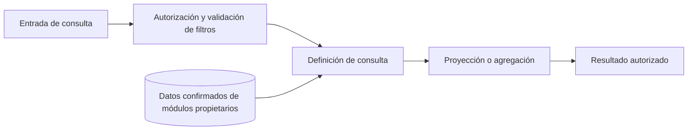

# Consultas y proyecciones de lectura

La aplicación construye **resultados de consulta autorizados y funcionalmente interpretables** a partir de recursos y asociaciones cuya autoridad permanece en sus módulos propietarios. Una proyección transforma datos confirmados para responder una pregunta; no modifica las fuentes ni otorga al consultante permisos adicionales.

Los **reportes operativos institucionales** son la capacidad de lectura consolidada del sistema. Su contrato está formado por consultas predefinidas y resultados **JSON estructurados**; no admite consultas arbitrarias, lenguaje libre de consulta, exportaciones documentales ni un generador configurable de informes.

## 1. Responsabilidades de una consulta

| Responsabilidad | Decisión de aplicación | Límite |
| --- | --- | --- |
| **Consulta de recurso** | Recuperar un recurso o su historial dentro del acceso permitido. | No conferir derechos sobre otros recursos enlazados. |
| **Proyección** | Seleccionar campos y relaciones necesarias para un resultado comprensible. | No exponer entidades internas o estructuras de persistencia. |
| **Consolidación** | Unir información de propietarios funcionales distintos conforme a una definición de consulta. | No modificar datos de origen ni asumir su titularidad. |
| **Agregación** | Calcular cantidades o distribuciones con unidad y filtros explícitos. | No sumar conceptos incompatibles ni modificar su interpretación. |
| **Visibilidad** | Aplicar el ámbito de autorización antes de representar el resultado. | No utilizar agregados o filtros para eludir restricciones de lectura detallada. |

Las consultas ordinarias y las consolidadas responden a responsabilidades distintas, pero comparten el principio de **lectura sin efecto de negocio**. Esta separación no exige mantener otra base de datos o generar modelos persistentes de lectura.

La fuente del diagrama representa información confirmada bajo propiedad funcional; no exige que todos los módulos compartan repositorios ni que se exporte acceso de escritura.

## 2. Definición, filtros y consistencia de resultados

Cada consulta posee un significado identificable: **qué unidad observa, qué población incluye, cuáles son sus filtros y qué campos se muestran**. Una colección y una métrica agregada no son intercambiables; el total de inscripciones no representa automáticamente el total de estudiantes distintos.

- Los filtros, dimensiones y criterios de orden pertenecen al contrato explícito de cada consulta.
- La consulta rechaza combinaciones inválidas en lugar de reinterpretarlas silenciosamente.
- Las colecciones utilizan paginación y orden estable; los agregados identifican su alcance y unidad de medida.
- Los datos utilizados corresponden a registros confirmados y preservan el significado histórico de las asociaciones.
- Las consultas no generan nuevas inscripciones, no reservan cupos, no reactivan referencias y no producen movimientos administrativos.

Las proyecciones pueden recuperar información de varios propietarios mediante contratos de consulta o vistas controladas de solo lectura. **Consolidar datos no permite escribir en repositorios ajenos.** El diseño de acceso físico y el control de consistencia concurrente pertenecen a persistencia; la aplicación define el significado que debe ofrecer el resultado.

## 3. Aplicación concreta: familias de reportes

El módulo `reports` gobierna las consultas institucionales predefinidas y compone información académica y administrativa autorizada.

| Familia | Resultado consultable | Delimitación funcional |
| --- | --- | --- |
| **Estudiantes** | Conteos y distribuciones por situación estudiantil y escuela profesional. | La vigencia se distingue de los antecedentes cuando el filtro lo permite. |
| **Cursos y estructura** | Distribuciones por curso, categoría, escuela, departamento o facultad. | El curso de catálogo no se confunde con su oferta en un periodo. |
| **Ofertas y docencia** | Secciones, docentes, situación, capacidad y ocupación por periodo. | El periodo se selecciona expresamente. |
| **Inscripciones** | Conteos por periodo, curso, escuela, oferta y estado de inscripción. | `ENROLLED`, `CANCELLED` y `WITHDRAWN` conservan significados distintos. |
| **Importaciones** | Cantidades agregadas de cargas, filas incorporadas, duplicadas y rechazadas. | No incluye archivos, seguimiento individual ni observaciones por fila. |

Cada familia declara las dimensiones y combinaciones admitidas; la aplicación no acepta instrucciones arbitrarias para crear otras consultas. Los reportes ofrecen observación institucional, no administración indirecta de los recursos representados.

## 4. Temporalidad, vigencia y unidades de conteo

Los reportes de **ofertas e inscripciones exigen un periodo académico explícito**. Su ausencia se rechaza; no se elige automáticamente el periodo más reciente ni se realiza una consulta indiscriminada de toda la historia.

Cuando una consulta distingue vigencia administrativa, utiliza por defecto registros activos y exige un filtro explícito para incluir antecedentes cuando esa modalidad es válida. La consulta histórica no elimina ni reescribe asociaciones pasadas para acomodarlas a la organización vigente.

En las inscripciones, el estado refleja un movimiento académico específico:

- `ENROLLED` representa una inscripción que conserva plaza.
- `CANCELLED` y `WITHDRAWN` son resultados históricos distintos y no consumen plaza.
- La ocupación de una oferta se calcula a partir de sus inscripciones `ENROLLED`, no de la suma de todos sus antecedentes.
- La disponibilidad resulta de la capacidad máxima menos la ocupación real. Una oferta `OPEN` puede no tener vacantes sin volverse automáticamente `CLOSED`.
- El cierre de un periodo no convierte inscripciones en aprobadas, completadas ni otro estado inexistente.

Los totales deben distinguir **personas, estudiantes, cursos, ofertas, inscripciones, archivos importados y filas procesadas**. Un indicador se interpreta según su unidad declarada y sus filtros; las cifras de importación no confunden duplicados con incorporaciones nuevas.

## 5. Autorización de proyecciones y reportes

Toda consulta se ejecuta dentro del ámbito de lectura autorizado. **`reports.read`** habilita las familias de reportes institucionales predefinidas, pero no otorga por sí solo acceso a recursos nominales, evidencias administrativas ni otras capacidades protegidas.

| Información | Alcance de `reports.read` |
| --- | --- |
| Indicadores institucionales y distribuciones admitidas | Acceso mediante las consultas predefinidas y sus filtros. |
| Totales agregados de importaciones | Permitidos sin identificar archivos o filas concretas. |
| Importación individual, archivo fuente y observaciones por fila | No habilitados. |
| Historial nominal detallado de una inscripción | No habilitado por ese permiso por sí solo. |
| Eventos de auditoría y seguridad | No habilitados. |
| Creación, modificación o corrección de recursos académicos | No habilitadas. |

La aplicación autoriza **la pregunta y el resultado**, no únicamente el acceso a una ruta. Componer información de módulos diferentes no permite revelar un detalle restringido mediante filtros o dimensiones que el contrato no admite. Los resultados no contienen trazas técnicas, consultas SQL ni campos internos usados para calcular el reporte.

## 6. Garantías de una lectura correcta

Una proyección correcta reúne **datos confirmados, semántica estable, filtros válidos y visibilidad autorizada**. Un reporte por periodo no incluye operaciones ajenas a él; una ocupación no cuenta plazas liberadas; un indicador de importación no expone evidencia de filas; una asociación histórica no cambia retroactivamente por una modificación posterior del catálogo.

Los reportes son consultas de supervisión, no un sistema de inteligencia de negocios configurable ni una herramienta de exportación. Su desarrollo funcional no redefine las responsabilidades generales de lectura aplicables a los demás módulos.
