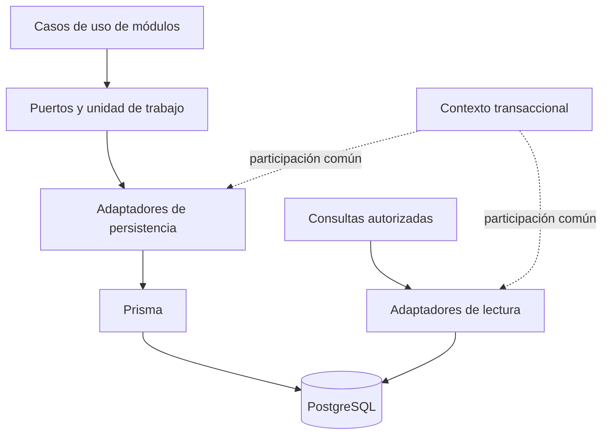

# Diseño de persistencia

PostgreSQL constituye la **fuente de verdad transaccional** de los recursos académicos, las identidades administrativas, las inscripciones y su evidencia, las importaciones y las obligaciones de entrega persistentes. Prisma materializa el acceso relacional mediante adaptadores de infraestructura; sus modelos y clientes no constituyen contratos del dominio ni de aplicación.

La base de datos es físicamente compartida por el monolito modular. Compartir almacenamiento permite transacciones entre capacidades, **no acceso indiscriminado a los datos de otros módulos**.

## 1. Propiedad de los datos y acceso

| Responsabilidad | Criterio de diseño | Límite |
| --- | --- | --- |
| **Módulo propietario** | Define el significado, las modificaciones válidas y los contratos para acceder a sus datos. | No cede sus reglas a un repositorio compartido genérico. |
| **Puerto de persistencia** | Expresa las operaciones de almacenamiento que necesita un caso de uso, con tipos funcionales. | No expone el cliente Prisma, consultas SQL ni transacciones físicas como API de negocio. |
| **Adaptador de repositorio** | Traduce entidades, condiciones de consulta y cambios válidos a persistencia relacional. | No decide estados académicos ni permisos de actuación. |
| **Unidad de trabajo** | Aporta un contexto transaccional común para los participantes de una operación indivisible. | Ningún participante confirma anticipadamente su propia fracción. |
| **Consulta controlada** | Recupera o consolida datos confirmados conforme a un contrato de lectura autorizado. | La consolidación no habilita escrituras sobre propietarios ajenos. |
| **Infraestructura compartida** | Gestiona conexiones, ejecución transaccional, adaptadores y recursos técnicos comunes. | No se convierte en módulo funcional ni introduce dependencias desde el dominio. |

Un módulo no accede al repositorio privado de otro para modificar su información. Cuando necesita comportamiento ajeno, utiliza la capacidad pública del propietario; cuando requiere lecturas consolidadas, utiliza una consulta controlada que conserva la semántica y la autorización del resultado. Las consultas de infraestructura pueden optimizar uniones relacionales sin convertirse en una vía de modificación funcional.

La figura distingue dependencias conceptuales; el contexto transaccional es una capacidad técnica inyectada, no una dependencia del dominio respecto del ORM.

## 2. Representación y conservación

La representación relacional preserva **identidades estables, relaciones explícitas y hechos históricos**. Las claves primarias mantienen la identidad de un recurso aunque cambien sus atributos o deje de estar vigente. Los códigos institucionales y combinaciones con valor de identidad disponen de restricciones propias y no sustituyen las referencias persistentes.

- Las asociaciones entre escuela profesional y curso conservan antecedentes de vigencia; desasociar no modifica retrospectivamente una inscripción admitida.
- Las inscripciones conservan el contexto académico de admisión y su identidad a través de cambios de sección; cancelar una inscripción no reutiliza su registro para una nueva admisión.
- La ocupación y los cupos disponibles se **derivan** de las inscripciones `ENROLLED` y la capacidad de la oferta. No se mantiene un segundo saldo persistente de vacantes que pueda divergir.
- Los movimientos de inscripción y los registros de auditoría preservan evidencia histórica diferenciada. Una rectificación agrega evidencia y no borra el hecho original.
- Los archivos originales de importación se conservan como contenido binario durable asociado a la importación admitida, junto a los resultados y el contexto de atribución; su existencia no depende del sistema de archivos temporal del proceso HTTP o worker.
- La deshabilitación de catálogos, perfiles o cuentas no provoca borrados en cascada de evidencia histórica. La vigencia administrativa y la existencia del registro son conceptos distintos.

El esquema físico traduce estas necesidades a claves, referencias, restricciones, índices y representaciones aptas para PostgreSQL. **El modelo físico no reinterpreta las reglas académicas**: las estructuras generadas por Prisma implementan su persistencia sin sustituir los contratos funcionales.

## 3. Tipos, tiempos y resultados de lectura

Las identidades y enumeraciones se convierten de manera explícita entre almacenamiento y contratos funcionales. Un valor persistido desconocido no se transforma silenciosamente en un estado válido por defecto.

Las **fechas académicas** se interpretan como fechas institucionales; los **instantes de creación, movimiento, procesamiento y auditoría** se almacenan y comparan como momentos inequívocos. El instante servidor y la fecha institucional correspondiente se utilizan coherentemente en las comprobaciones que dependen de ventanas y cambios de estado. Los clientes no proporcionan la autoridad temporal para confirmar una operación.

Las consultas recuperan datos confirmados y mantienen criterios deterministas de filtro, orden y desempate. Una proyección de lectura no conserva automáticamente copias persistentes de resultados ni introduce otra base de datos: obtiene la información de los registros propietarios y la presenta según el contrato de aplicación. Cuando varias lecturas forman un único resultado que requiere coherencia interna, participan de una vista transaccional consistente.

## 4. Evolución del esquema y compatibilidad

Prisma gobierna la definición relacional y las migraciones versionadas. Toda evolución del esquema conserva las invariantes y los antecedentes existentes:

1. Las modificaciones de estructura se expresan mediante migraciones reproducibles y revisables; no dependen de cambios manuales no registrados en una base de datos.
2. Una migración que transforma datos debe conservar identidades, asociaciones históricas, estados y evidencia; no utiliza valores predeterminados para ocultar inconsistencias.
3. Las nuevas restricciones se acompañan de una conversión determinista de los datos previos cuando sea necesaria; no se eliminan filas históricas para hacer que una migración termine con éxito.
4. Las modificaciones compatibles mantienen el funcionamiento de los procesos que comparten el almacenamiento durante una transición de versión. Los cambios incompatibles se coordinan entre código, esquema y procesos consumidores.
5. Las migraciones no sustituyen la validación funcional ni permiten que el ORM se convierta en la fuente normativa de reglas de negocio.

Los comandos de migración, la configuración de conectividad, las copias de seguridad y los procedimientos de despliegue pertenecen a la operación del sistema. Aquí se establecen las garantías que esos procedimientos deben preservar.
