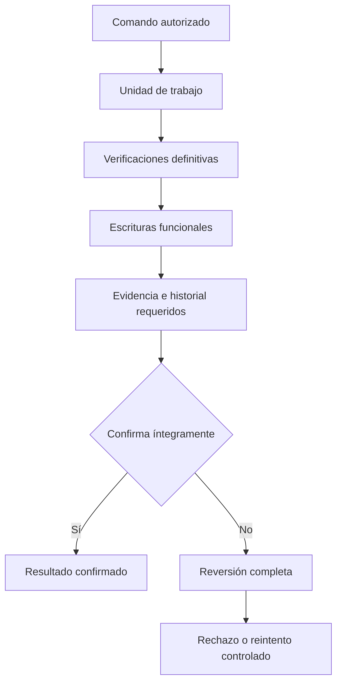

# Transacciones y control de concurrencia

Cada comando define sus **efectos obligatorios indivisibles**. La infraestructura de persistencia ejecuta las escrituras y comprobaciones vinculadas bajo una unidad transaccional común, incluso cuando intervienen módulos diferentes. Una consulta preliminar no constituye una reserva ni habilita a confirmar más tarde una decisión basada en datos obsoletos.

PostgreSQL confirma o revierte la unidad completa. Prisma proporciona el contexto transaccional; los casos de uso participan a través de contratos que no exponen al dominio detalles del cliente ORM.

## 1. Propiedad y participación en la transacción

- El **caso de uso coordinador** define qué hechos deben confirmarse juntos y qué propietarios funcionales participan.
- La **unidad de trabajo** suministra un contexto compartido a los adaptadores involucrados. Los colaboradores no abren confirmaciones independientes para un fragmento de la misma operación.
- Las **reglas y autorizaciones** se comprueban sobre el estado que puede confirmarse de manera segura. Si una referencia o condición cambia durante la operación, esta se revalida o provoca el rechazo de la transacción.
- El **historial y la auditoría obligatorios** forman parte de la confirmación del cambio que registran. Ninguna escritura de evidencia se difiere para completar retroactivamente una respuesta exitosa.
- Una **respuesta de éxito** solo se produce después del commit efectivo. Un rollback no deja un movimiento falso, una inscripción parcial ni una plaza consumida.

El diagrama muestra una operación atómica. Las operaciones que admiten resultados parciales, como la importación de estudiantes, definen unidades menores y explícitas; no rompen la atomicidad dentro de cada una de ellas.

## 2. Política de aislamiento para decisiones críticas

Las operaciones que pueden alterar **cupos, unicidad de inscripciones, antecedentes que impiden reinscribir, estados de habilitación o capacidad de ofertas** se ejecutan con aislamiento PostgreSQL **`SERIALIZABLE`**. La comprobación final y la escritura pertinente ocurren dentro de esa misma transacción.

`SERIALIZABLE` hace que las transacciones confirmadas respeten un orden equivalente a una ejecución serial. Cuando dos escrituras no pueden confirmar sus decisiones simultáneamente, PostgreSQL aborta una de ellas; el sistema **no acepta ambas suponiendo que una lectura anterior sigue siendo válida**.

Los conflictos de serialización se reintentan mediante la **repetición de la unidad transaccional completa**, con relectura de recursos, autorización y condiciones, sin reutilizar resultados de una ejecución revertida. El número de intentos es limitado: un conflicto persistente no produce bucles infinitos ni se presenta como éxito. Si al reintentar se confirma que la regla funcional ya no se cumple, se comunica el rechazo correspondiente; una indisponibilidad técnica no se disfraza de infracción académica.

Las restricciones únicas de PostgreSQL actúan además como última barrera para identidades que pueden expresarse estructuralmente. El aislamiento y las restricciones son **complementarios**: el primero protege decisiones de conjunto y las segundas impiden colisiones representables por claves.

## 3. Confirmación de operaciones académicas

| Operación | Comprobación dentro de la unidad | Efectos confirmados conjuntamente |
| --- | --- | --- |
| **Inscripción** | Estudiante habilitado, programa–curso vigente, oferta y periodo elegibles, ausencia de inscripción activa o retiro impeditivo y cupo real. | Registro `ENROLLED`, contexto académico conservado, movimiento de creación y evidencia exigida. |
| **Cancelación** | Estado `ENROLLED`, momento y periodo habilitantes, autoridad y motivo. | Estado `CANCELLED`, liberación derivada de plaza y movimiento con atribución. |
| **Retiro** | Estado `ENROLLED`, desarrollo efectivo del periodo, autoridad y motivo. | Estado `WITHDRAWN`, antecedente impeditivo para nueva inscripción ordinaria, liberación derivada de plaza y movimiento. |
| **Cambio de sección** | Misma identidad de curso y periodo, ofertas elegibles, autorización, motivo y capacidad del destino. | Actualización única de referencia a la oferta, ocupaciones derivadas coherentes y movimiento con origen y destino. |
| **Corrección extraordinaria** | Alcance administrativo permitido y mantenimiento de identidades, cupos y restricciones históricas. | Rectificación delimitada, evidencia nueva y conservación de los hechos originales. |
| **Mantenimiento de capacidad o habilitación** | La modificación no invalida ofertas abiertas, inscripciones activas ni referencias protegidas. | Nuevo estado o capacidad sin ruptura de condiciones de ocupación y trazabilidad exigible. |

La ocupación **no se incrementa ni decrementa mediante un contador paralelo**. Se observa como cantidad de inscripciones `ENROLLED`; por ello, las operaciones que pueden cambiar esa cantidad deben utilizar la misma política de consistencia concurrente, incluidas las correcciones y el mantenimiento de capacidad.

En un **cambio de sección** la inscripción conserva su identidad. No se confirma primero la liberación de origen para luego intentar adquirir destino en otra transacción; un fallo deja íntegra la relación anterior. Dos cambios o inscripciones concurrentes que compiten por el último cupo no pueden producir sobreocupación.

## 4. Repetición de solicitudes e importaciones

Una transacción fallida no se reaprovecha: todo reintento parte de una unidad nueva y vuelve a evaluar el estado persistido. Las operaciones sin clave de idempotencia propia no adquieren una garantía de *exactly once* por utilizar transacciones.

La **admisión de un archivo** confirma una sola importación por cuenta y huella de bytes, incluso si dos solicitudes llegan al mismo tiempo. La restricción de identidad persistida y su transacción impiden aceptar ambas.

Durante la **ejecución de una importación**, cada fila constituye una unidad de confirmación independiente que comprende sus altas válidas y el resultado persistente de esa fila. Si falla, no queda una persona sin su perfil estudiantil correspondiente; si ya estaba confirmada, una entrega repetida recupera el resultado sin duplicar sus efectos. La transacción de una fila no revierte las incorporaciones válidas de otras.

El estado agregado de la importación se calcula o actualiza desde resultados definitivos. Una reanudación no asume que una fila quedó confirmada por haberse procesado en memoria: consulta la evidencia persistente correspondiente.

## 5. Sesiones y lecturas consistentes

Las modificaciones concurrentes de autenticación que cambian la **única sesión activa**, su revocación o la vigencia de credenciales requieren actualizaciones condicionales atómicas. Dos solicitudes no deben reactivar una sesión revocada ni conservar dos sesiones activas para la misma cuenta. El significado del inicio de sesión y de la rotación de credenciales pertenece a seguridad; la persistencia protege su indivisibilidad.

Las consultas informativas recuperan únicamente datos confirmados. Un informe que compone múltiples lecturas dependientes y requiere una misma fotografía del estado utiliza una vista de lectura transaccional consistente; no mezcla resultados de momentos incompatibles como si representaran un único corte. Esta garantía no convierte la lectura en reserva de cupos ni bloquea por sí sola nuevas inscripciones.

## 6. Fallos y traducción del resultado

Se distingue entre **conflicto funcional confirmado**, **colisión por clave o condición persistente**, **conflicto transitorio de serialización** y **error técnico de almacenamiento**. Un reintento puede transformar un conflicto transitorio en éxito o revelar que otra operación válida agotó un cupo. Solo en este último caso corresponde comunicar una regla académica incumplida.

Los errores del ORM y los identificadores internos de tablas permanecen en infraestructura. La aplicación recibe categorías de fallo interpretables y no comunica una operación confirmada antes de obtener evidencia de su commit.
