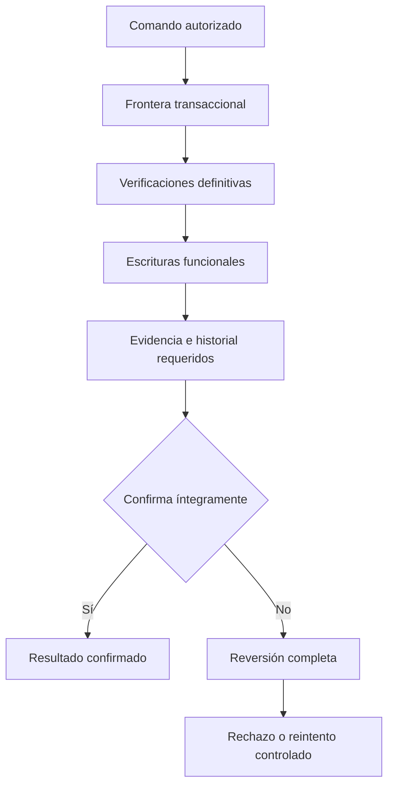

# Transacciones y control de concurrencia

Cada comando define sus **efectos obligatorios indivisibles**. La infraestructura ejecuta las escrituras y comprobaciones relacionadas dentro de una misma frontera transaccional, incluso cuando intervienen capacidades distintas. Una consulta preliminar no constituye una reserva ni habilita a confirmar más tarde una decisión basada en datos obsoletos.

PostgreSQL confirma o revierte la operación completa. El caso de uso delimita los efectos atómicos y los componentes de persistencia comparten el mismo contexto de transacción, sin imponer una clase, interfaz o patrón de coordinación específico.

## 1. Propiedad y participación en la transacción

- El **caso de uso coordinador** define qué hechos deben confirmarse juntos y qué propietarios funcionales participan.
- La **frontera transaccional compartida** permite que todos los participantes utilicen la misma transacción. Ningún colaborador confirma por separado un fragmento de los efectos indivisibles.
- Las **reglas y autorizaciones** se comprueban sobre el estado que puede confirmarse de manera segura. Cuando una decisión de autorización es parte de una operación crítica, la lectura de roles y permisos y la escritura que depende de ella deben mantener consistencia frente a cambios concurrentes de asignación o composición de roles hasta el commit. Si una referencia o condición cambia durante la operación, se revalida o provoca el rechazo de la transacción.
- El **historial, la auditoría y la intención durable de publicación** forman parte de la misma confirmación cuando son efectos obligatorios del comando. La publicación externa se realiza después del commit; ninguna evidencia requerida se agrega retroactivamente a una operación presentada como exitosa.
- Una **respuesta de éxito** solo se produce después del commit efectivo. Un rollback no deja un movimiento falso, una inscripción parcial ni una plaza consumida.

El diagrama muestra una operación atómica. Las operaciones que admiten resultados parciales, como la importación de estudiantes, definen unidades menores y explícitas; no rompen la atomicidad dentro de cada una de ellas.

## 2. Política de aislamiento para decisiones críticas

Las operaciones que pueden alterar **cupos, unicidad de inscripciones, antecedentes que impiden reinscribir, estados de habilitación, configuración de ofertas o integridad de bajas lógicas y dependencias vigentes** se ejecutan con aislamiento PostgreSQL **`SERIALIZABLE`**. La comprobación final y la escritura pertinente ocurren dentro de esa misma transacción.

`SERIALIZABLE` hace que las transacciones confirmadas respeten un orden equivalente a una ejecución serial. Cuando dos escrituras no pueden confirmar sus decisiones simultáneamente, PostgreSQL aborta una de ellas; el sistema **no acepta ambas suponiendo que una lectura anterior sigue siendo válida**.

Los conflictos recuperables de serialización se reintentan mediante la **repetición de la transacción completa**, con relectura de recursos, autorización y condiciones, sin reutilizar resultados de una ejecución revertida. Los intentos son acotados y no producen efectos externos irreversibles dentro de la operación reintentable; cuando corresponde una entrega durable, se registra su intención transaccional. Si al reintentar la regla funcional deja de cumplirse, se comunica el rechazo correspondiente. Un conflicto persistente o una indisponibilidad técnica no se presenta como éxito ni se disfraza de infracción académica.

Las altas, modificaciones y bajas de registros con atributos de negocio reutilizables deben preservar simultáneamente la unicidad entre no eliminados y la validez de las relaciones que requieran un padre vigente. La comparación de nombres, códigos, siglas y correos electrónicos sujetos a unicidad omite diferencias de mayúsculas y minúsculas y espacios exteriores, también en las restricciones confirmadas por PostgreSQL; la combinación de tipo y número de documento de cada persona conserva unicidad global con independencia de la baja lógica y no se modifica tras el registro. La reutilización de un valor de negocio dado de baja no puede atribuir referencias históricas a otra identidad. Una comprobación previa de dependientes no basta: debe ser coherente con las escrituras concurrentes que podrían crear o modificar esas dependencias hasta confirmar la baja. Las referencias exclusivamente históricas se preservan sin bloquear una baja cuando no exista un compromiso operativo protegido.

Las invariantes que atraviesan varias capacidades se comprueban sobre datos vigentes y se mantienen hasta la confirmación. Esto comprende relaciones académicas necesarias para registrar o modificar inscripciones, estados que condicionan la disponibilidad de ofertas y restricciones de acceso que condicionan cambios de cuentas o asignaciones. Las verificaciones y escrituras de una misma operación comparten contexto transaccional; no se permiten confirmaciones concurrentes basadas en decisiones incompatibles.

Las consultas ordinarias y las escrituras que no protegen invariantes concurrentes no requieren aislamiento `SERIALIZABLE` por defecto. Las restricciones únicas de PostgreSQL actúan además como última barrera para identidades que pueden expresarse estructuralmente. El aislamiento y las restricciones son **complementarios**: el primero protege decisiones de conjunto y las segundas impiden colisiones representables por claves.

## 3. Confirmación de operaciones académicas

| Operación                                    | Comprobación dentro de la unidad                                                                                                                                                                                                           | Efectos confirmados conjuntamente                                                                                                                      |
| -------------------------------------------- | ------------------------------------------------------------------------------------------------------------------------------------------------------------------------------------------------------------------------------------------ | ------------------------------------------------------------------------------------------------------------------------------------------------------ |
| **Inscripción**                              | Estudiante habilitado, programa–curso vigente, oferta y periodo elegibles, ausencia de inscripción activa o retiro impeditivo y cupo real.                                                                                                 | Registro `ENROLLED`, contexto académico conservado, movimiento de creación y evidencia exigida.                                                        |
| **Cancelación**                              | Estado `ENROLLED`, momento y periodo habilitantes, autoridad y motivo.                                                                                                                                                                     | Estado `CANCELLED`, liberación derivada de plaza y movimiento con atribución.                                                                          |
| **Retiro**                                   | Estado `ENROLLED`, desarrollo efectivo del periodo, autoridad y motivo.                                                                                                                                                                    | Estado `WITHDRAWN`, antecedente impeditivo para nueva inscripción ordinaria, liberación derivada de plaza y movimiento.                                |
| **Cambio de sección**                        | Misma identidad de curso y periodo, ofertas elegibles, autorización, motivo y capacidad del destino.                                                                                                                                       | Actualización única de referencia a la oferta, ocupaciones derivadas coherentes y movimiento con origen y destino.                                     |
| **Corrección extraordinaria**                | Alcance administrativo permitido y mantenimiento de identidades, cupos y restricciones históricas.                                                                                                                                         | Rectificación delimitada, evidencia nueva y conservación de los hechos originales.                                                                     |
| **Estado docente y configuración de oferta** | Origen y destino autorizados del docente; obligaciones docentes protegidas; identidad de curso y periodo inmutable; sección solo en `DRAFT`, capacidad y docente solo en `DRAFT`, `OPEN` o `CLOSED`; habilitación y ocupación verificadas. | Transición o configuración compatible con el estado confirmado, sin inscripciones alteradas y con historial de modificaciones y auditoría exigibles.   |
| **Estado de cuenta**                         | Estado de origen, autorización, motivo y restricciones de privilegio sobre la cuenta destinataria vigentes al confirmar.                                                                                                                   | Estado de cuenta, revocación de sesiones al abandonar `ACTIVE` y evidencia confirmados conjuntamente; la reactivación no recupera sesiones anteriores. |
| **Cambio o restablecimiento de contraseña**  | Identidad, credencial anterior cuando corresponda, autorización y restricciones de la cuenta destinataria.                                                                                                                                 | Credenciales y condición de cambio obligatorio actualizadas, sesiones anteriores revocadas y auditoría confirmadas conjuntamente.                      |
| **Roles y asignaciones**                     | Autoridad del actor, restricciones del destinatario, protección de definiciones institucionales y ausencia de autoelevación.                                                                                                               | Asignaciones o composición autorizadas y auditadas, sin modificar implícitamente el estado de las cuentas.                                             |
| **Registro conjunto de cuenta y roles**      | Cuenta válida y asignaciones admitidas, sin modificaciones a las propias asignaciones del actor.                                                                                                                                           | Cuenta y asociaciones iniciales confirmadas juntas con su evidencia; ante un fallo no queda una cuenta creada parcialmente con roles pendientes.       |
| **Mantenimiento de periodo**                 | El periodo permanece en `PLANNED`; nombre, código, fechas y ventana de inscripción mantienen las restricciones de unicidad y coherencia temporal, sin invalidar compromisos confirmados.                                                   | Datos autorizados actualizados bajo la misma identidad permanente, con auditoría exigible.                                                             |
| **Baja lógica de un recurso referenciado**   | Registro vigente; ninguna relación operativa ni compromiso académico protegido exige conservarlo, según las reglas de la relación. Las referencias exclusivamente históricas permanecen intactas.                                          | Marca de baja, historia y auditoría exigidas, sin cascada de bajas ni alteración de FK.                                                                |
| **Alta con valor de negocio reutilizado**    | Ausencia de conflicto entre registros vigentes y referencia operativa a padres vigentes.                                                                                                                                                   | Nueva identidad permanente con valor reutilizado, sin modificar ni absorber registros históricos.                                                      |

La ocupación **no se incrementa ni decrementa mediante un contador paralelo**. Se observa como cantidad de inscripciones `ENROLLED`; por ello, las operaciones que pueden cambiar esa cantidad deben utilizar la misma política de consistencia concurrente, incluidas las correcciones y el mantenimiento de capacidad.

En un **cambio de sección** la inscripción conserva su identidad. No se confirma primero la liberación de origen para luego intentar adquirir destino en otra transacción; un fallo deja íntegra la relación anterior. Dos cambios o inscripciones concurrentes que compiten por el último cupo no pueden producir sobreocupación.

## 4. Repetición de solicitudes e importaciones

Una transacción fallida no se reaprovecha: todo reintento parte de una unidad nueva y vuelve a evaluar el estado persistido. Las operaciones sin clave de idempotencia propia no adquieren una garantía de _exactly once_ por utilizar transacciones.

La **admisión de un archivo** confirma una sola importación por cuenta y huella de bytes, incluso si dos solicitudes llegan al mismo tiempo. La restricción de identidad persistida y su transacción impiden aceptar ambas.

Durante la **ejecución de una importación**, cada fila constituye una unidad de confirmación independiente que comprende sus altas válidas y el resultado persistente de esa fila. Si falla, no queda una persona sin su perfil estudiantil correspondiente; si ya estaba confirmada, una entrega repetida recupera el resultado sin duplicar sus efectos. La transacción de una fila no revierte las incorporaciones válidas de otras.

El estado agregado de la importación se calcula o actualiza desde resultados definitivos. Una reanudación no asume que una fila quedó confirmada por haberse procesado en memoria: consulta la evidencia persistente correspondiente.

## 5. Sesiones y lecturas consistentes

Las sesiones persistidas son administradas por `authentication`. El inicio de sesión, la renovación y la revocación deben revalidar la habilitación de la cuenta y las condiciones de la sesión en la unidad de consistencia correspondiente. Las modificaciones concurrentes que afectan la **única sesión activa** o la credencial de renovación se confirman atómicamente. Dos inicios de sesión no pueden mantener sesiones activas paralelas; dos renovaciones no pueden consumir con éxito la misma credencial, ni una revocación puede quedar anulada por una operación concurrente. La expiración de una sesión se evalúa por su vigencia temporal incluso cuando el estado persistido aún indique `ACTIVE`.

La deshabilitación o el bloqueo de una cuenta y la revocación de sus sesiones forman una sola transacción `SERIALIZABLE` que incluye la auditoría exigida. La misma garantía se aplica a los cambios y restablecimientos de contraseña. `users` decide las modificaciones de la cuenta y `authentication` ejecuta la revocación de las sesiones bajo la transacción común, sin confirmaciones independientes. La falla de un efecto impide confirmar los restantes. Las credenciales de una sesión nueva se entregan únicamente después de la confirmación persistente y no mantienen acceso frente a una revocación posterior.

Las consultas informativas recuperan únicamente datos confirmados. Un informe que compone múltiples lecturas dependientes y requiere una misma fotografía del estado utiliza una vista de lectura transaccional consistente; no mezcla resultados de momentos incompatibles como si representaran un único corte. Esta garantía no convierte la lectura en reserva de cupos ni bloquea por sí sola nuevas inscripciones.

## 6. Fallos y traducción del resultado

Se distingue entre **conflicto funcional confirmado**, **colisión por restricción persistente**, **conflicto transitorio de serialización** y **error técnico de almacenamiento**. Un reintento puede transformar un conflicto transitorio en éxito o revelar que otra operación válida agotó un cupo. Solo en este último caso corresponde comunicar una regla académica incumplida.

La infraestructura clasifica técnicamente los errores conocidos; la aplicación los interpreta según la operación y la restricción involucrada, sin imponer una correspondencia HTTP universal por código de error. Los detalles del motor de persistencia permanecen internos. No se comunica una operación como confirmada antes del commit efectivo.
