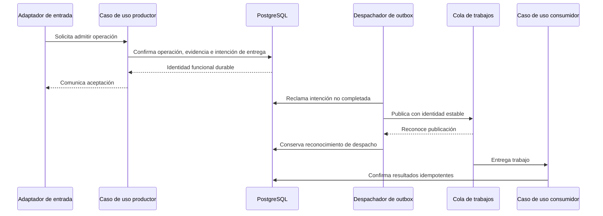

# Durabilidad y recuperación de efectos

Una operación confirmada permanece interpretable y recuperable aunque se interrumpa el proceso que la inició. La persistencia distingue **estado funcional confirmado, intención durable de trabajo, publicación técnica y resultado de ejecución**. Ninguna de estas etapas sustituye a las demás.

Las garantías se fundamentan en PostgreSQL y en la identidad persistente de los efectos; no dependen de memoria del proceso HTTP, de la continuidad del worker ni de recibir un mensaje exactamente una vez.

## 1. Admisión durable y unidad de almacenamiento

La aceptación de una operación diferida que requiere un archivo confirma en **una sola transacción de PostgreSQL**:

1. La identidad y el registro funcional de la operación, con el actor que la admitió.
2. Los bytes originales del archivo y su huella de identidad, conservados como parte de los datos durables de la importación.
3. La intención de despacho en el **outbox transaccional**, con identidad estable y contrato mínimo necesario para su entrega.

La operación se confirma mediante una frontera transaccional compartida, sin requerir un mecanismo de transacciones adicional para el outbox. Esta elección evita que una aceptación dependa de archivos temporales o rutas locales del proceso consumidor. El almacenamiento original comparte la durabilidad y las garantías de recuperación del registro de importación. No se responde aceptación si alguno de los tres elementos no queda confirmado.

La respuesta pública contiene la **identidad funcional de importación**, no identificadores técnicos de transporte o de almacenamiento del outbox. La aceptación no presupone el procesamiento de filas.

El reconocimiento de despacho **no equivale** al reconocimiento de ejecución. La recuperación puede encontrar un registro publicado todavía no ejecutado, un mensaje entregado más de una vez o un resultado funcional ya confirmado cuyo reconocimiento técnico se perdió.

## 2. Outbox, entrega y reconocimiento

La escritura de un hecho funcional y la intención de publicar un trabajo o evento forman una unidad transaccional **cuando la entrega durable está vinculada al cambio de negocio**. Solo después del commit se intenta la publicación. Los trabajos independientes que no necesitan esa garantía pueden utilizar directamente la cola, sin registrar una intención de outbox.

- Cada intención posee **identidad durable, estado de entrega y datos mínimos** suficientes para reintentar sin reconstruir una decisión funcional desde logs.
- Los procesos de relay reclaman unidades pendientes de manera concurrentemente segura, evitando que dos emisores trabajen simultáneamente sobre el mismo registro reclamado. Una reclamación interrumpida vuelve a quedar disponible para recuperación.
- La intención solo se marca como **publicada** cuando el broker confirma la aceptación correspondiente. Una respuesta ambigua o un fallo de reconocimiento conserva la posibilidad de reintento.
- Si el broker aceptó el mensaje y el relay se interrumpió antes de registrar ese hecho, una repetición es admisible. La publicación utiliza identidad estable y el consumidor controla la idempotencia de sus efectos.
- Los hechos de dominio y sus movimientos o auditorías **no dependen** de que el relay termine para estar confirmados. Un evento publicado más tarde describe un hecho ya existente, no autoriza reescribirlo.

La cola administra la entrega persistente y los intentos técnicos de ejecución; **el estado funcional consultable permanece bajo el módulo propietario**. Ni el transporte ni el outbox se usan como repositorio alternativo de estudiantes, inscripciones o resultados históricos.

## 3. Confirmación recuperable de unidades de trabajo

Un consumidor identifica primero el trabajo admitido y luego determina qué efectos funcionales permanecen pendientes. La entrega repetida **no reejecuta ciegamente modificaciones ya confirmadas**.

Para la importación de estudiantes, cada fila mantiene una posición estable dentro del archivo admitido. Su transacción confirma conjuntamente:

- Las creaciones válidas de identidad personal y perfil estudiantil que correspondan, sin sobrescribir duplicados.
- El resultado definitivo de la fila, incluida su posición y causa cuando existe rechazo o duplicidad.
- La evidencia necesaria para contabilizar esa fila de forma inequívoca en el progreso de la importación.

El par **importación + posición de fila** impide efectos duplicados cuando el worker recibe el mismo trabajo en más de una ocasión. Las filas válidas confirmadas no se revierten porque otra fila resulte inválida. Las filas sin resultado confirmado se vuelven a evaluar al recuperar el trabajo.

Una ejecución interrumpida conserva tres clases de información distinguibles: **filas resueltas**, **filas no confirmadas** y **estado global de la operación**. Solo se declara finalizada cuando la consolidación se basa en resultados definitivos y no hay trabajo pendiente conforme al contrato funcional. Un fallo terminal registra el progreso real y no transforma incorporaciones parciales en un éxito global ficticio.

La misma pauta de recuperación corresponde a cualquier trabajo diferido con efectos repetibles: identidad de trabajo, confirmación atómica de su unidad funcional, evidencia de lo confirmado y reanudación desde estado persistido. La división específica por filas pertenece únicamente a la importación.

## 4. Escenarios de interrupción

| Punto de interrupción                                           | Estado durable observable                                                  | Recuperación permitida                                                             |
| --------------------------------------------------------------- | -------------------------------------------------------------------------- | ---------------------------------------------------------------------------------- |
| Antes de confirmar admisión                                     | No hay operación aceptada ni intención de despacho válida.                 | Rechazar o volver a admitir una solicitud completa.                                |
| Tras confirmar admisión, antes de publicar                      | Registro funcional, archivo e intención permanecen juntos.                 | El relay recupera la entrega pendiente.                                            |
| Tras publicar, antes de registrar reconocimiento                | La intención puede parecer no publicada aunque el broker la haya recibido. | Reintentar publicación; la identidad y el consumidor previenen efectos duplicados. |
| Tras entregar, antes de confirmar efectos                       | Los cambios de la unidad no confirmada no son visibles como completados.   | Volver a ejecutar desde registros persistentes.                                    |
| Tras confirmar una unidad, antes de reconocer entrega           | Los efectos y su evidencia ya existen.                                     | Reconocer la repetición sin crear nuevos efectos.                                  |
| Tras confirmar varias filas y antes de concluir una importación | Las filas resueltas y las restantes son distinguibles.                     | Continuar únicamente las unidades sin resultado confirmado y consolidar el estado. |
| Fallo técnico no recuperable automáticamente                    | Se conserva el progreso real, la evidencia y la causa técnica apropiada.   | Registrar fallo funcionalmente visible sin eliminar resultados ya confirmados.     |

La recuperación no se basa en contar mensajes enviados ni en interpretar un log técnico como evidencia de éxito académico.

## 5. Conservación, restauración y reconciliación

La durabilidad comprende también **la posibilidad de interpretar los datos restaurados**. Las inscripciones, sus movimientos, los registros de auditoría, el contenido original de importaciones, sus resultados y las intenciones de entrega forman parte del mismo conjunto persistente protegido.

- La restauración de PostgreSQL preserva conjuntamente referencias, identidades y evidencia; no se considera consistente una recuperación que restaure inscripciones sin sus movimientos o archivos admitidos sin su registro funcional.
- Tras una interrupción o restauración, el sistema puede identificar intenciones no reconocidas, operaciones diferidas incompletas y resultados funcionales ya confirmados; los mecanismos de recuperación los reconcilian sin duplicar efectos.
- Los registros históricos y la evidencia de operaciones no se eliminan por el mero hecho de que un job haya concluido o una cuenta haya quedado inactiva.
- La gestión del volumen técnico del outbox y del broker diferencia **mensajes de transporte ya reconciliados** de evidencia institucional que debe conservarse. Limpiar metadatos técnicos no elimina hechos académicos ni el estado consultable de importaciones.
- Los respaldos, las pruebas de restauración, los parámetros de retención técnica y los procedimientos ante incidentes se operan de manera controlada sin introducir reglas divergentes de persistencia.

No se promete recuperación de una operación nunca confirmada. **La garantía consiste en no perder ni duplicar los efectos que ya fueron confirmados**, y en representar sin ambigüedad los trabajos admitidos cuya ejecución permanece incompleta.
