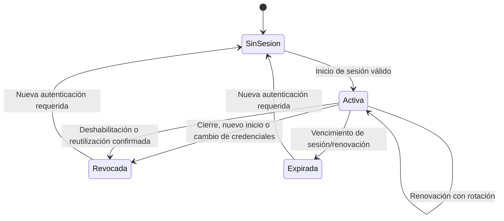

# Autenticación y sesiones

La autenticación comprueba la identidad de una **cuenta interna administrada**; la sesión representa la continuidad revocable de esa identidad. Una credencial válida no concede por sí sola permiso académico: cada operación protegida requiere además cuenta habilitada, sesión vigente y autorización efectiva.

## 1. Identidad de acceso y credenciales

- El acceso se inicia con **correo electrónico y contraseña** asociados a una cuenta administrada. No existe registro público ni autenticación de estudiantes o docentes por el mero hecho de tener un perfil académico.
- La contraseña se almacena exclusivamente como un verificador derivado mediante **Argon2id**, con sal aleatoria y parámetros de coste controlados por el servidor. Ni la contraseña ni su verificador se devuelven mediante la API o se registran en logs.
- La comparación de credenciales utiliza el mecanismo de verificación de Argon2id y presenta un rechazo externo equivalente para cuenta inexistente, contraseña incorrecta o cuenta que no permite el acceso. No revela si un correo está registrado.
- Los identificadores y credenciales recibidos del cliente son datos no confiables; la identidad utilizada por los casos de uso procede únicamente del resultado de autenticación validado por el servidor.
- El restablecimiento de contraseña lo realiza personal autorizado. Establece una **contraseña temporal** que obliga al titular a cambiarla antes de utilizar funciones académicas; no constituye una invitación al registro público.

## 2. Sesión única y credenciales de acceso

Cada cuenta mantiene **como máximo una sesión activa**. La sesión se conserva como estado revocable controlado por `users`, separado de los permisos que administra `authorization`.

| Elemento | Decisión de seguridad | Garantía |
| --- | --- | --- |
| **Sesión de cuenta** | Identidad persistente de sesión, titular, vigencia y estado de revocación. | La existencia de un token no sustituye su validación. |
| **Access token** | **JWT firmado**, de vida máxima **15 minutos**, que identifica cuenta y sesión. | Concede una credencial breve, no una autorización permanente ni una copia vinculante de roles. |
| **Refresh token** | Credencial aleatoria de renovación, de vida máxima **7 días**, **rotatoria** y vinculada a la sesión. | Solo se acepta la credencial vigente; la anterior deja de ser válida tras una rotación confirmada. |
| **Persistencia de renovación** | Se conserva un verificador no reversible de la credencial de refresh, no su valor en texto plano. | La consulta de datos persistidos no entrega una credencial reutilizable. |
| **Transporte** | Cookies separadas, `HttpOnly`; el acceso y la renovación no se serializan como tokens dentro de `data`. | El JavaScript del cliente no necesita leer las credenciales. |

El **inicio de sesión** invalida atómicamente cualquier sesión activa anterior de la misma cuenta antes de habilitar la nueva. Una carrera entre dos inicios de sesión no deja dos sesiones utilizables. La emisión de credenciales solo se considera satisfactoria cuando su sesión está confirmada.

En cada solicitud protegida se comprueban la autenticidad, tipo, integridad y expiración del access token, la correspondencia con la sesión activa, la vigencia de esa sesión y la habilitación de la cuenta. El servidor no confía en un rol incluido en el JWT como permiso definitivo: los permisos efectivos se resuelven desde el estado autorizado vigente.

## 3. Renovación, revocación y cierre

La renovación comprueba la credencial de refresh, su asociación con la sesión activa, la vigencia de la cuenta y las restricciones del flujo. Una renovación válida sustituye la credencial anterior y actualiza su verificador como **una operación atómica**; dos renovaciones simultáneas con la misma credencial no producen dos sucesoras aceptadas.

La presentación de una credencial de refresh ya consumida, fuera de su sesión, revocada o inválida se rechaza. **La reutilización comprobada de una credencial anteriormente válida** invalida la sesión afectada, para evitar que un token sustraído mantenga acceso mediante rotaciones sucesivas. La ausencia de una sesión reconocible no permite revocar o inspeccionar sesiones ajenas arbitrariamente.

- **Cerrar sesión:** revoca la sesión y elimina las cookies de acceso y renovación mediante las propiedades correspondientes; borrar cookies sin revocar el estado servidor no constituye un cierre suficiente.
- **Nuevo inicio de sesión:** revoca la sesión anterior antes de habilitar la nueva.
- **Deshabilitar una cuenta:** revoca su sesión y bloquea accesos y renovaciones posteriores.
- **Cambiar la contraseña propia:** exige identidad autenticada, comprueba el secreto vigente y revoca las sesiones emitidas antes del cambio; el usuario vuelve a autenticarse.
- **Restablecimiento administrativo:** revoca la sesión existente, registra la condición de cambio obligatorio y solo permite las operaciones indispensables para autenticar y establecer una contraseña definitiva.
- **Retirar permisos o roles:** no conserva autorizaciones antiguas dentro de una sesión vigente; su siguiente uso se decide con los permisos actualizados.

La caducidad natural de un JWT no reemplaza la revocación inmediata: incluso un token criptográficamente válido se rechaza si su sesión o su cuenta dejaron de estar habilitadas.

El diagrama representa el ciclo de una **sesión concreta**. La creación de una nueva sesión puede revocar la anterior, pero no vuelve a activar la identidad revocada.

## 4. Restricción por intentos inválidos

El acceso aplica una política de **cinco fallos de autenticación por identidad en una ventana de quince minutos**. Tras alcanzar el umbral, los intentos posteriores de esa identidad se rechazan temporalmente hasta concluir la ventana aplicable. El conteo y el rechazo se aplican tanto a cuentas existentes como a identidades no encontradas, sin informar cuál de ellas originó el bloqueo.

La limitación se evalúa del lado del servidor y no depende del navegador, de una cookie manipulable o de memoria aislada de un único proceso. No se registran contraseñas ni tokens para diagnosticar fallos. Los sucesos relevantes generan evidencia de seguridad sin convertir cada intento en un mensaje operativo ruidoso.

## 5. Atribución y límites de los procesos internos

La solicitud autenticada produce un contexto de actuación con identidad de cuenta y sesión, sujeto a comprobación de autorización antes de aceptar una operación. En ejecuciones diferidas se conserva la identidad del actor que **admitió** el trabajo: el consumidor interno no se presenta como un usuario nuevo ni obtiene permisos humanos independientes.

La autenticación inicial no permite eludir posteriormente las reglas funcionales, la integridad de datos ni la atribución histórica. Los procesos internos solo utilizan los datos mínimos para cumplir una operación previamente admitida y siguen los contratos de los módulos responsables.
