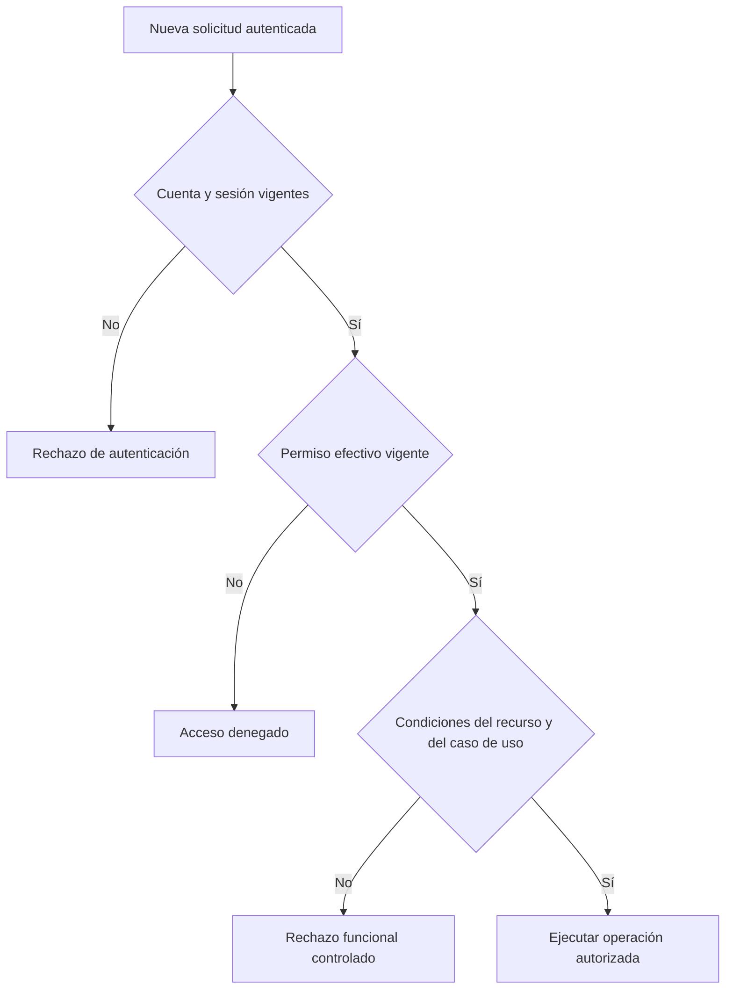

# Autorización y control de acceso

La autorización determina **qué operaciones e información puede utilizar una cuenta habilitada**. Los permisos efectivos corresponden a capacidades funcionales previstas y no crean operaciones adicionales sobre los recursos. La decisión es independiente del mecanismo de entrada y considera permisos vigentes, recursos involucrados y condiciones funcionales y de seguridad. La autenticación o autorización de una capacidad no exime de las reglas aplicables ni habilita por sí sola otras capacidades.

## 1. Modelo de roles y permisos

- Una cuenta puede tener **varios roles simultáneos**. Sus permisos efectivos son la **unión, sin duplicados, de los permisos vigentes** que aportan esos roles, no una selección excluyente de perfil. La asignación de un rol confiere sus permisos mediante la relación vigente entre rol y catálogo; no se copian permisos directamente a la cuenta. Los roles no forman una jerarquía ni heredan permisos unos de otros.
- El catálogo de permisos es **fijo y establecido por el sistema**; cada permiso representa una capacidad reconocida por los requerimientos funcionales y tiene un identificador inequívoco y estable. La definición aplicable y los registros persistentes se mantienen sincronizados mediante provisión controlada; un identificador ausente, desconocido o con significado divergente no se acepta como autorización. Los roles agrupan permisos; no crean capacidades técnicas nuevas mediante cadenas arbitrarias.
- Los roles institucionales **`ADMIN`**, **`SECRETARY`**, **`ACADEMIC_COORDINATOR`** y **`REPORT_VIEWER`** son roles base protegidos, con el conjunto inicial de permisos correspondiente a la matriz institucional. Se administran sus asignaciones conforme a autorización, pero no se reescribe arbitrariamente su definición. Pertenecer a `ADMIN` no concede automáticamente todos los permisos ni evita su comprobación.
- Se permiten **roles personalizados** compuestos exclusivamente por permisos ordinarios del catálogo existente. Las operaciones ordinarias se autorizan por los permisos efectivos correspondientes, sin exigir la denominación de un rol institucional específico. La administración de roles no permite cambiar el significado de un permiso ni otorgarlo mediante nombres especiales no reconocidos.
- Las comprobaciones se realizan al ejercer una capacidad; ni el rol declarado en un JWT ni un permiso obtenido anteriormente constituye autorización permanente.

`users` conserva cuentas y sesiones; `authorization` gobierna permisos, roles y asignaciones. Los módulos funcionales aplican sus restricciones propias a través de contratos autorizados. La distinción impide distribuir excepciones por nombres de rol entre servicios académicos.

## 2. Derechos institucionales de los roles base

| Capacidad                                                             | `ADMIN` | `SECRETARY` |       `ACADEMIC_COORDINATOR`       | `REPORT_VIEWER` |
| --------------------------------------------------------------------- | :-----: | :---------: | :--------------------------------: | :-------------: |
| Administrar cuentas y asignaciones de roles                           |   Sí    |     No      |                 No                 |       No        |
| Administrar estructura académica, docentes, periodos y ofertas        |   Sí    |     No      |                 Sí                 |       No        |
| Mantener personas y estudiantes                                       |   Sí    |     Sí      | Solo consulta académica autorizada |       No        |
| Importar estudiantes y consultar el detalle de sus importaciones      |   Sí    |     Sí      |                 No                 |       No        |
| Registrar, cancelar, retirar o cambiar sección de una inscripción     |   Sí    |     Sí      |                 No                 |       No        |
| Consultar información académica e inscripciones nominales autorizadas |   Sí    |     Sí      |                 Sí                 |       No        |
| Ejecutar correcciones extraordinarias de inscripciones                |   Sí    |     No      |                 No                 |       No        |
| Consultar reportes institucionales predefinidos                       |   Sí    |     Sí      |                 Sí                 |       Sí        |
| Consultar eventos de auditoría y seguridad                            |   Sí    |     No      |                 No                 |       No        |

La matriz describe la distribución inicial de capacidades entre roles institucionales; no constituye una restricción adicional por nombre de rol para las operaciones ordinarias. Cada operación de consulta, registro, modificación, transición o asignación exige los permisos correspondientes del catálogo, sin derivar facultades adicionales de expresiones generales como «mantener» o «administrar». Cuando una operación comprende capacidades independientes, exige conjuntamente sus permisos efectivos, aunque procedan de roles distintos. Las condiciones adicionales de las operaciones reservadas se aplican según su definición expresa.

Cada permiso de lectura conserva su ámbito definido de recursos e información; no implica autorización para modificar esos recursos ni consultar información protegida mediante otras capacidades. Una cuenta con varios roles obtiene la unión de sus permisos vigentes, sin ampliar el alcance funcional propio de cada permiso.

Las facultades exclusivas de **corrección extraordinaria de inscripciones**, **administración de cuentas y autorizaciones** y **consulta transversal de auditoría** requieren simultáneamente el rol protegido `ADMIN` y el permiso efectivo correspondiente. Los permisos que habilitan esas facultades son **reservados**: solo forman parte de la definición institucional protegida de `ADMIN` y no pueden asignarse a roles personalizados, aunque el identificador exista en el catálogo. La reserva comprende los permisos de creación, consulta y modificación administrativa de cuentas; de consulta y gestión administrativa de roles, permisos y asignaciones; de corrección extraordinaria de inscripciones; y de consulta transversal de auditoría. No convierte en reservados los permisos de mantenimiento académico ordinario ni de reportes por el hecho de que `ADMIN` también los posea. La condición de rol no sustituye el permiso, ni la posesión del permiso sustituye el rol. Los demás permisos se autorizan por su posesión efectiva y las restricciones funcionales aplicables.

Los permisos son **institucionales**: no se introduce una jerarquía automática de autorización por facultad, departamento o programa académico. Las asociaciones académicas y los filtros de consulta siguen siendo necesarios para decidir si una operación tiene sentido, pero no constituyen por sí mismos restricciones RBAC territoriales.

### Catálogo institucional de capacidades

Cada identificador corresponde a una capacidad funcional de autorización estable. **Leer** incluye la consulta individual y los listados o proyecciones ordinarias permitidas de esa capacidad, pero no concede por ello acceso a información protegida de otra. **Cambiar estado** solo admite las transiciones expresamente documentadas; **dar de baja** no implica restaurar ni eliminar físicamente. Las operaciones de sesión propia se controlan mediante credenciales y sesión, no mediante permisos administrativos.

En la columna de asignación inicial, `A` identifica `ADMIN`, `S` identifica `SECRETARY`, `C` identifica `ACADEMIC_COORDINATOR` y `V` identifica `REPORT_VIEWER`. La asignación describe las relaciones iniciales entre roles y permisos, **no privilegios implícitos por nombre de rol**. Cada cuenta obtiene únicamente la unión de permisos presentes en las relaciones persistidas de sus roles.

| Capacidad funcional y alcance                                                                   | Identificadores de permisos                                                                                                                        | Asignación inicial              |
| ----------------------------------------------------------------------------------------------- | -------------------------------------------------------------------------------------------------------------------------------------------------- | ------------------------------- |
| Personas: registrar, consultar, modificar datos no documentales                                 | `persons.create`, `persons.read`, `persons.update`                                                                                                 | A, S                            |
| Tipos de documento: consultar catálogo                                                          | `document-types.read`                                                                                                                              | A, S                            |
| Facultades: registrar, consultar, modificar, dar de baja                                        | `faculties.create`, `faculties.read`, `faculties.update`, `faculties.deactivate`                                                                   | A, C (todas); S (solo lectura)  |
| Departamentos académicos: registrar, consultar, modificar, dar de baja                          | `academic-departments.create`, `academic-departments.read`, `academic-departments.update`, `academic-departments.deactivate`                       | A, C (todas); S (solo lectura)  |
| Programas académicos: registrar, consultar, modificar, dar de baja                              | `academic-programs.create`, `academic-programs.read`, `academic-programs.update`, `academic-programs.deactivate`                                   | A, C (todas); S (solo lectura)  |
| Asociaciones programa–curso: habilitar, consultar, cerrar episodios                             | `program-courses.enable`, `program-courses.read`, `program-courses.close`                                                                          | A, C (todas); S (solo lectura)  |
| Cursos: registrar, consultar, modificar, dar de baja                                            | `courses.create`, `courses.read`, `courses.update`, `courses.deactivate`                                                                           | A, C (todas); S (solo lectura)  |
| Categorías de cursos: consultar catálogo                                                        | `course-categories.read`                                                                                                                           | A, C, S                         |
| Docentes: registrar, consultar, modificar perfil, cambiar estado                                | `professors.create`, `professors.read`, `professors.update`, `professors.status.change`                                                            | A, C                            |
| Estudiantes: registrar, consultar, modificar perfil, cambiar estado                             | `students.create`, `students.read`, `students.update`, `students.status.change`                                                                    | A, S (todas); C (solo lectura)  |
| Importaciones: admitir archivos y consultar seguimiento, resultados y original                  | `students.imports.create`, `students.imports.read`                                                                                                 | A, S                            |
| Periodos académicos: registrar, consultar, corregir en planificación, cambiar estado            | `academic-periods.create`, `academic-periods.read`, `academic-periods.update`, `academic-periods.status.change`                                    | A, C (todas); S (solo lectura)  |
| Ofertas de curso: registrar, consultar, configurar, cambiar estado                              | `course-offerings.create`, `course-offerings.read`, `course-offerings.update`, `course-offerings.status.change`                                    | A, C (todas); S (solo lectura)  |
| Inscripciones: registrar, cancelar, retirar, cambiar sección, consultar y consultar movimientos | `enrollments.create`, `enrollments.cancel`, `enrollments.withdraw`, `enrollments.section.change`, `enrollments.read`, `enrollments.movements.read` | A, S (todas); C (solo lecturas) |
| Corrección extraordinaria de inscripciones                                                      | `enrollments.correct`                                                                                                                              | A; reservado                    |
| Cuentas internas: registrar, consultar, modificar, cambiar estado, restablecer contraseña ajena | `users.create`, `users.read`, `users.update`, `users.status.change`, `users.password.reset`                                                        | A; reservados                   |
| Roles personalizados: consultar, registrar, actualizar                                          | `roles.read`, `roles.create`, `roles.update`                                                                                                       | A; reservados                   |
| Catálogo de permisos: consultar                                                                 | `permissions.read`                                                                                                                                 | A; reservado                    |
| Asignaciones de roles: consultar, asignar, retirar                                              | `role-assignments.read`, `role-assignments.assign`, `role-assignments.remove`                                                                      | A; reservados                   |
| Reportes predefinidos, incluidos indicadores agregados de importación                           | `reports.read`                                                                                                                                     | A, S, C, V                      |
| Auditoría transversal: consultar eventos                                                        | `audit.events.read`                                                                                                                                | A; reservado                    |

Cuando una fila indica «solo lectura», se asignan exclusivamente los identificadores terminados en `.read` de esa fila. La excepción de lectura de estudiantes y de inscripciones para coordinación se limita a las proyecciones académicas autorizadas; no concede por conexión el acceso a datos personales completos ni a movimientos ajenos al alcance de consulta. Las operaciones de consulta que mezclan recursos exigen las capacidades pertinentes y la visibilidad funcional correspondiente.

El catálogo no añade un permiso separado para cada variante de transporte, filtro o ejecución interna. La creación conjunta de persona y perfil exige los dos permisos de registro; crear una cuenta con roles iniciales exige `users.create` y `role-assignments.assign`. La importación aceptada utiliza su permiso de admisión para crear internamente los registros indispensables, sin conceder `persons.create` ni `students.create` al operador fuera de esa operación. Una rectificación excepcional de un estado terminal estudiantil registrado por error se autoriza mediante `students.status.change` y las comprobaciones reforzadas del estado anterior y la evidencia, sin habilitar readmisiones.

La definición institucional de los identificadores, su reserva y las asignaciones iniciales es única. La provisión persistente debe coincidir con ella; un permiso desconocido, retirado o no asociado a los roles vigentes nunca se presume concedido. Los roles personalizados admiten exclusivamente permisos no reservados, sin alterar el catálogo ni los roles base.

## 3. Aplicación por operación y recurso

La autorización funciona en dos niveles complementarios:

1. **Capacidad solicitada:** el contexto autenticado necesita el permiso de lectura, modificación, operación sensible o consulta correspondiente.
2. **Condiciones de la intención y del recurso:** la operación debe formar parte del alcance admitido y el caso de uso comprueba las restricciones que la hacen válida, como vigencia, titularidad de estado, ventanas académicas, curso elegible, cupos o motivo obligatorio.

El acceso al adaptador externo no reemplaza el control del caso de uso. Un worker o un adaptador alternativo tampoco ejecuta una operación privilegiada porque omita un controlador HTTP. La aplicación utiliza un contexto de actuación fiable; los identificadores de usuario aportados arbitrariamente por clientes no sustituyen al actor autenticado.

La denegación no revela datos protegidos. Un recurso fuera de la visibilidad del actor puede expresarse como inexistente dentro de su ámbito de acceso, sin distinguir públicamente entre ausencia y falta de visibilidad.

## 4. Facultades sensibles y separación de funciones

- **Correcciones extraordinarias:** requieren la autorización administrativa específica, un tipo de corrección admitido, justificación y conservación íntegra de los antecedentes. Las rectificaciones de inscripciones no permiten editar cualquier atributo académico ni cambiar el tipo o número de documento de una persona. Ninguna habilita modificaciones genéricas de registros históricos.
- **Estados de cuentas:** el cambio entre `ACTIVE`, `INACTIVE` y `BLOCKED` exige autorización administrativa, motivo y revocación inmediata de sesiones cuando la cuenta deja de estar `ACTIVE`. Habilitarla de nuevo no reactiva sesiones. Se rechaza cualquier cambio que deje al sistema sin una cuenta `ACTIVE` con el rol protegido `ADMIN` y los permisos reservados de gestión de cuentas y asignaciones definidos en el catálogo.
- **Roles y permisos:** una cuenta no puede alterar **sus propias asignaciones** mediante ninguna operación administrativa. Tampoco puede aumentar sus propios permisos efectivos modificando la composición de un rol que ya tiene asignado, por sí sola o como parte de una operación masiva o coordinada. La comprobación compara los permisos efectivos anteriores y los que produciría el cambio; no prohíbe modificaciones legítimas que no amplíen sus facultades. Se rechaza toda retirada o modificación que elimine la última cuenta `ACTIVE` dotada del rol protegido `ADMIN` y de los permisos reservados de gestión de cuentas y asignaciones definidos en el catálogo. Los roles institucionales y los permisos reservados mantienen sus protecciones con independencia del resultado de esa comparación.
- **Contraseñas:** cada usuario autenticado puede cambiar su propia contraseña; el restablecimiento de otra cuenta es una facultad administrativa distinta y no concede lectura de su secreto. La contraseña temporal generada solo puede entregarse una vez, mediante una respuesta protegida, al administrador autenticado que autorizó el restablecimiento, para su comunicación al titular por un canal institucional seguro externo al sistema. No se conserva en claro, no se registra en trazas ni se permite consultarla posteriormente. Si se pierde antes de su entrega, debe solicitarse otro restablecimiento autorizado.
- **Auditoría:** la lectura de evidencias exige autorización explícita; no se ofrecen operaciones ordinarias para editar o eliminar eventos.
- **Consultas y reportes:** `reports.read` permite las consultas institucionales definidas y agregados de importación, pero no seguimiento individual, originales ni errores por fila. `students.imports.read` controla ese detalle de importación sin sustituir otras autorizaciones.

El permiso `role-assignments.read` permite consultar las asignaciones vigentes en ambos sentidos: los roles actualmente vinculados a una cuenta y las cuentas actualmente vinculadas a un rol. Esta lectura no permite crear ni retirar asignaciones, ni consultar por sí sola los datos completos de cuentas o las demás capacidades reservadas; cada recurso expuesto conserva sus restricciones de visibilidad. Los permisos `role-assignments.assign` y `role-assignments.remove` autorizan, respectivamente, las modificaciones correspondientes, sujetas a las reglas administrativas.

Las asignaciones de roles de una cuenta pueden modificarse administrativamente mientras esté `ACTIVE`, `INACTIVE` o `BLOCKED`, siempre que la cuenta exista y el administrador cumpla el rol `ADMIN`, los permisos exigidos y la prohibición de autoelevación. La operación no cambia el estado de la cuenta ni crea o reactiva sesiones. En `INACTIVE` y `BLOCKED` los roles siguen registrados, pero la cuenta no puede ejercer sus permisos; al volver a `ACTIVE` necesita autenticarse de nuevo. La asignación de un rol personalizado no concede por sí sola facultades ajenas al catálogo. Todas las operaciones de administración de acceso conservan la identidad de quien actuó y su efecto auditado.

## 5. Modificaciones de autorización y continuidad

Los cambios de asignación o composición de roles se aplican al **estado autorizado vigente**, resuelto desde las relaciones persistidas de cuentas, roles y permisos; no se toma la lista de permisos del token como autoridad. Una cuenta pierde el alcance de un permiso retirado en sus siguientes operaciones, aunque su access token no haya expirado. Las operaciones que deban conservar hasta la confirmación una decisión de autorización la comprueban dentro de una unidad transaccional consistente con las modificaciones concurrentes de roles o permisos. Una cuenta deshabilitada no puede operar por acumular roles adicionales.

La administración de roles no ejecuta efectos académicos retroactivos: retirar a un operador un permiso no borra inscripciones anteriores ni cambia quién quedó registrado como responsable. Las autorizaciones de los procesos ya admitidos y sus resultados se interpretan mediante el contexto de origen conservado y las garantías funcionales del trabajo, sin convertir al worker en una identidad humana privilegiada.
