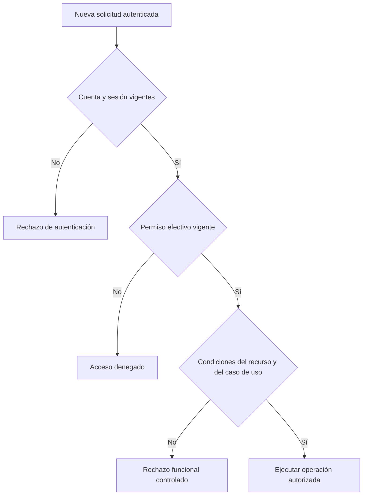

# Autorización y control de acceso

La autorización determina **qué operación y qué información puede utilizar una cuenta habilitada**. Solo existen permisos efectivos sobre capacidades funcionales previstas; un permiso no crea operaciones adicionales sobre una entidad. Es independiente del mecanismo por el que ingresó la solicitud y se aplica sobre permisos efectivos, recursos involucrados y restricciones funcionales. Autenticarse, ser administrador o poder consultar un reporte no suprime las reglas de integridad académica.

## 1. Modelo de roles y permisos

- Una cuenta puede tener **varios roles simultáneos**. Sus permisos efectivos son la **unión de los permisos vigentes** que aportan esos roles, no una selección excluyente de perfil.
- El catálogo de permisos es **establecido por el sistema** y expresa capacidades reconocibles. Los roles agrupan permisos; no crean capacidades técnicas nuevas mediante cadenas arbitrarias.
- Los roles institucionales **`ADMIN`**, **`SECRETARY`**, **`ACADEMIC_COORDINATOR`** y **`REPORT_VIEWER`** son roles base protegidos. Se administran sus asignaciones conforme a autorización, pero no se reescribe arbitrariamente su definición.
- Se permiten **roles personalizados** compuestos exclusivamente por permisos del catálogo existente. La administración de roles no permite cambiar el significado de un permiso ni otorgarlo mediante nombres especiales no reconocidos.
- Las comprobaciones se realizan al ejercer una capacidad; ni el rol declarado en un JWT ni un permiso obtenido anteriormente constituye autorización permanente.

`users` conserva cuentas y sesiones; `authorization` gobierna permisos, roles y asignaciones. Los módulos funcionales aplican sus restricciones propias a través de contratos autorizados. La distinción impide distribuir excepciones por nombres de rol entre servicios académicos.

## 2. Derechos institucionales de los roles base

| Capacidad                                                             | `ADMIN` | `SECRETARY` |       `ACADEMIC_COORDINATOR`       | `REPORT_VIEWER` |
| --------------------------------------------------------------------- | :-----: | :---------: | :--------------------------------: | :-------------: |
| Administrar cuentas y asignaciones de roles                           |   Sí    |     No      |                 No                 |       No        |
| Administrar estructura académica, docentes, periodos y ofertas        |   Sí    |     No      |                 Sí                 |       No        |
| Mantener personas y estudiantes                                       |   Sí    |     Sí      | Solo consulta académica autorizada |       No        |
| Importar estudiantes y consultar el detalle de sus importaciones      |   Sí    |     Sí      |                 No                 |       No        |
| Registrar, cancelar, retirar o cambiar sección de una inscripción     |   Sí    |     Sí      |                 No                 |       No        |
| Consultar información académica e inscripciones nominales autorizadas |   Sí    |     Sí      |                 Sí                 |       No        |
| Ejecutar correcciones extraordinarias de inscripciones                |   Sí    |     No      |                 No                 |       No        |
| Consultar reportes institucionales predefinidos                       |   Sí    |     Sí      |                 Sí                 |       Sí        |
| Consultar eventos de auditoría y seguridad                            |   Sí    |     No      |                 No                 |       No        |

La lectura de información académica de coordinación no implica permiso de modificar personas, estudiantes o inscripciones. El permiso de reportes tampoco confiere acceso a recursos nominales, archivos de importación, observaciones por fila o auditoría. Una cuenta que reúna varios roles obtiene la unión real de sus permisos, no una excepción implícita al alcance institucional de cada operación.

Las facultades exclusivas de **corrección extraordinaria**, **administración de cuentas y autorizaciones** y **consulta transversal de auditoría** requieren el rol protegido `ADMIN` y el permiso efectivo correspondiente. Los roles personalizados no sirven para eludir estas restricciones; una asignación que las infringiera se rechaza incluso si utiliza un identificador de permiso reconocido.

Los permisos son **institucionales**: no se introduce una jerarquía automática de autorización por facultad, departamento o programa académico. Las asociaciones académicas y los filtros de consulta siguen siendo necesarios para decidir si una operación tiene sentido, pero no constituyen por sí mismos restricciones RBAC territoriales.

## 3. Aplicación por operación y recurso

La autorización funciona en dos niveles complementarios:

1. **Capacidad solicitada:** el contexto autenticado necesita el permiso de lectura, modificación, operación sensible o consulta correspondiente.
2. **Condiciones de la intención y del recurso:** la operación debe formar parte del alcance admitido y el caso de uso comprueba las restricciones que la hacen válida, como vigencia, titularidad de estado, ventanas académicas, curso elegible, cupos o motivo obligatorio.

El acceso al adaptador externo no reemplaza el control del caso de uso. Un worker o un adaptador alternativo tampoco ejecuta una operación privilegiada porque omita un controlador HTTP. La aplicación utiliza un contexto de actuación fiable; los identificadores de usuario aportados arbitrariamente por clientes no sustituyen al actor autenticado.

La denegación no revela datos protegidos. Un recurso fuera de la visibilidad del actor puede expresarse como inexistente dentro de su ámbito de acceso, sin distinguir públicamente entre ausencia y falta de visibilidad.

## 4. Facultades sensibles y separación de funciones

- **Correcciones extraordinarias:** requieren la autorización administrativa específica, un tipo de corrección admitido, justificación y conservación íntegra de los antecedentes. No equivalen a un permiso para editar directamente cualquier atributo de inscripción.
- **Roles y permisos:** una cuenta no puede alterar **sus propias asignaciones** mediante ninguna operación administrativa. Una petición indirecta, masiva o coordinada entre recursos sigue sujeta a la misma prohibición.
- **Contraseñas:** cada persona puede cambiar su propia contraseña autenticada; el restablecimiento de otra cuenta es una facultad administrativa distinta y no concede lectura de su secreto.
- **Auditoría:** la lectura de evidencias exige autorización explícita; no se ofrecen operaciones ordinarias para editar o eliminar eventos.
- **Consultas y reportes:** `reports.read` permite las consultas institucionales definidas y agregados de importación, pero no seguimiento individual, originales ni errores por fila. `students.imports.read` controla ese detalle de importación sin sustituir otras autorizaciones.

La asignación de un rol personalizado no concede por sí sola facultades que no formen parte del catálogo. Todas las operaciones de administración de acceso conservan la identidad de quien actuó y su efecto auditado.

## 5. Modificaciones de autorización y continuidad

Los cambios de asignación se aplican al **estado autorizado vigente**. Una cuenta pierde de inmediato el alcance de un permiso retirado en sus siguientes operaciones, aunque su access token no haya expirado. Una cuenta deshabilitada no puede operar por acumular roles adicionales.

La administración de roles no ejecuta efectos académicos retroactivos: retirar a un operador un permiso no borra inscripciones anteriores ni cambia quién quedó registrado como responsable. Las autorizaciones de los procesos ya admitidos y sus resultados se interpretan mediante el contexto de origen conservado y las garantías funcionales del trabajo, sin convertir al worker en una identidad humana privilegiada.
