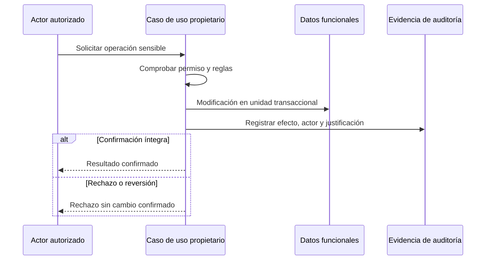

# Auditoría y eventos de seguridad

La auditoría es la **evidencia institucional atribuible** de decisiones administrativas, operaciones académicas sensibles y sucesos relevantes de seguridad. Su propósito es reconstruir quién actuó, sobre qué capacidad, cuándo, con qué resultado y con qué motivo cuando corresponde. No sustituye el historial funcional de una inscripción ni los logs operativos utilizados para diagnosticar fallos.

Las modificaciones de cuentas y asignaciones privilegiadas, los intentos de eludir restricciones institucionales y las tentativas de autoelevación generan evidencia de seguridad con actor, destinatario, operación, resultado y motivo cuando corresponda. La evidencia no expone contraseñas, tokens ni credenciales temporales.

## 1. Tres tipos de información con finalidades distintas

| Información                   | Propósito                                                                                                      | Regla de conservación                                                                     |
| ----------------------------- | -------------------------------------------------------------------------------------------------------------- | ----------------------------------------------------------------------------------------- |
| **Movimiento de inscripción** | Reconstruir la trayectoria académica de una inscripción: creación, cancelación, retiro, traslado o corrección. | Se incorpora al historial de la inscripción y no se modifica mediante edición ordinaria.  |
| **Evento de auditoría**       | Atribuir una decisión o cambio sensible a una identidad, operación y resultado.                                | Evidencia de solo incorporación, consultable únicamente bajo autorización administrativa. |
| **Registro operativo**        | Diagnosticar fallas, latencia, fallos de integración o estado de procesos.                                     | Es telemetría técnica, no fuente de verdad del hecho administrativo.                      |

Una misma operación puede generar un movimiento funcional y un evento de auditoría porque responden a preguntas diferentes. Un evento de mensajería publicado posteriormente tampoco reemplaza la evidencia que debe quedar confirmada con la operación original.

## 2. Contenido y atribución de la evidencia

Un evento de auditoría identifica, según corresponda:

- **Actor:** cuenta responsable autenticada, o identidad técnica diferenciada cuando se registra un suceso puramente interno; no se atribuye el cambio a un estudiante o docente afectado que no lo realizó.
- **Acción y objeto:** capacidad utilizada, tipo de operación, recurso funcional e identificadores suficientes para reconstruir su alcance.
- **Momento y resultado:** instante servidor, operación aceptada, rechazada o suceso de seguridad observado, distinguiendo hechos confirmados de intentos sin efectos.
- **Contexto:** correlación de solicitud o trabajo y datos mínimos de origen necesarios para la atribución; sin incorporar credenciales, contraseñas, tokens ni archivos enteros.
- **Justificación y diferencias:** motivo exigible y estado anterior/posterior relevantes cuando una modificación administrativa lo requiere; no se registra indiscriminadamente información personal ajena al cambio.

La auditoría utiliza identidades duraderas: deshabilitar una cuenta no borra su participación histórica. En operaciones diferidas se distingue **quién admitió el trabajo** de **qué proceso ejecutó sus unidades**, sin presentar al worker como nuevo actor humano.

## 3. Acciones y sucesos cubiertos

| Grupo                            | Evidencia registrada                                                                                                                 | Consideración                                                                                                                               |
| -------------------------------- | ------------------------------------------------------------------------------------------------------------------------------------ | ------------------------------------------------------------------------------------------------------------------------------------------- |
| **Inscripciones y correcciones** | Altas, cancelaciones, retiros, cambios de sección y rectificaciones extraordinarias.                                                 | Su hecho confirmado conserva también movimiento funcional y motivo cuando es obligatorio.                                                   |
| **Administración académica**     | Cambios relevantes de estructura y periodos; estados de docentes; reasignaciones de ofertas y modificaciones de sección o capacidad. | La evidencia conserva los valores relevantes anteriores y nuevos, así como la decisión administrativa; no todo acceso de lectura rutinaria. |
| **Usuarios y autorizaciones**    | Creación, habilitación, deshabilitación y bloqueo de cuentas, sus motivos, restablecimientos y asignaciones de roles o permisos.     | Registra transiciones y revocaciones, sin conservar contraseñas ni secretos anteriores o nuevos.                                            |
| **Identidad personal**           | Registro de personas y modificaciones autorizadas de datos no documentales.                                                          | La auditoría atribuye actuaciones relevantes sin autorizar cambios del tipo o número de documento registrado.                               |
| **Importaciones**                | Admisión, identidad del responsable, resultado global y sucesos funcionales relevantes.                                              | El detalle de filas permanece bajo la capacidad de importaciones; no se copia cada archivo ni cada fila al registro transversal.            |
| **Autenticación y sesiones**     | Accesos logrados y fallidos relevantes, renovaciones, cierre, revocaciones y reutilización detectada de credenciales.                | Los intentos y situaciones de seguridad se diferencian de cambios académicos confirmados.                                                   |
| **Rechazos de protección**       | Intentos significativos de violar permisos, procedencia o límites de autenticación.                                                  | Se registra contexto suficiente sin convertir el rechazo en una operación de negocio aceptada.                                              |

Los eventos de seguridad permiten analizar intentos fallidos sin registrar cada solicitud HTTP ordinaria como auditoría institucional. La telemetría puede agrupar datos diagnósticos; esa agrupación no debe destruir evidencia administrativa requerida.

## 4. Confirmación, preservación y rectificación

Las operaciones académicas sensibles y sus evidencias obligatorias se confirman **dentro de una misma frontera transaccional**, sin introducir una transacción independiente para la evidencia. Si la operación se revierte, no se incorpora un evento que afirme falsamente que el cambio se completó. Los sucesos independientes, como un intento fallido de acceso, generan evidencia de su resultado real sin depender de una modificación académica inexistente.

Los eventos son **de solo incorporación**: no existe una operación ordinaria para sobrescribirlos, suprimirlos o rectificar silenciosamente hechos previos. Cuando es necesaria una aclaración administrativa, se agrega nueva evidencia que identifica el antecedente y explica la rectificación, preservando la atribución original.

El diagrama representa las **operaciones que exigen evidencia atómica**. Los rechazos de autenticación y otros sucesos de seguridad se documentan como hechos de intento, no como modificaciones académicas confirmadas.

## 5. Consulta restringida y protección de la evidencia

La consulta transversal de auditoría es una capacidad administrativa protegida. **`ADMIN`** dispone de la consulta autorizada; los roles de secretaría, coordinación y reportes no la obtienen de sus permisos académicos ni de `reports.read`.

Las consultas se filtran y paginan mediante criterios controlados y exponen exclusivamente la información que el actor puede examinar. No hay endpoints ordinarios para editar o borrar registros. Ni la exportación de reportes ni la lectura de una importación individual otorgan acceso indirecto al historial transversal de seguridad.

El almacenamiento y la recuperación preservan los eventos junto con las identidades y hechos que sustentan. Los logs técnicos pueden tener políticas operativas propias, pero su rotación no elimina el registro de auditoría necesario para interpretar una operación confirmada.
