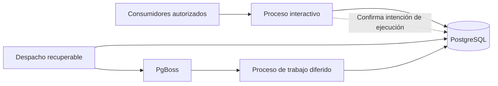

# Ejecución y ciclo de vida de procesos

El backend se ejecuta como un **monolito modular con procesos independientes**. La composición de cada proceso activa las capacidades y los adaptadores necesarios para su trabajo; las operaciones académicas conservan las mismas reglas y la misma autoridad funcional con independencia de dónde se invoquen.

## 1. Procesos y responsabilidades operativas

| Responsabilidad de ejecución | Servicio que presta                                                                            | Dependencias necesarias                                       | Límite operativo                                                                                                      |
| ---------------------------- | ---------------------------------------------------------------------------------------------- | ------------------------------------------------------------- | --------------------------------------------------------------------------------------------------------------------- |
| Atención interactiva         | Recibe solicitudes REST, autentica, autoriza y entrega resultados o admisiones durables.       | PostgreSQL, composición NestJS y adaptadores requeridos.      | No ejecuta importaciones completas durante la solicitud ni confía en memoria local para una decisión confirmada.      |
| Trabajo diferido             | Consume encargos aceptados, activa sus casos de uso y conserva progreso confirmado.            | PostgreSQL, PgBoss y adaptadores de los módulos consumidores. | No decide permisos propios de la identidad humana ni expone identificadores internos de jobs como contratos públicos. |
| Despacho recuperable         | Localiza intenciones persistidas y las entrega a la mensajería, registrando su reconocimiento. | PostgreSQL y PgBoss.                                          | No presenta una entrega como si fuera una ejecución funcional finalizada.                                             |

La función de despacho puede ejecutarse junto a una composición de trabajo técnico; es una responsabilidad identificable, **no una exigencia de desplegar un tercer servicio**. Cada instancia que aloja una de estas responsabilidades administra sus conexiones, recursos y cierre. Varias instancias no dependen de estado de memoria compartido.

El diagrama refleja **procesos y mecanismos operativos**, no una transferencia del control de negocio desde el API al worker. Una admisión diferida se confirma en PostgreSQL antes de ser comunicada como aceptada; el despacho y la ejecución prosiguen de forma recuperable.

## 2. Arranque y admisión de trabajo

El arranque establece configuración válida, conexión a recursos, composición NestJS y habilitación de mecanismos de recepción. Un proceso no se declara apto para aceptar trabajo si no puede ejecutar las dependencias esenciales de su responsabilidad.

1. **Configuración:** validar las variables y secretos exigidos para el proceso antes de habilitar sus entradas.
2. **Persistencia:** comprobar acceso a la base de datos y compatibilidad de la versión de esquema, sin iniciar migraciones desde cada réplica.
3. **Infraestructura de ejecución:** inicializar los adaptadores requeridos y, en los consumidores, PgBoss y los procesadores registrados.
4. **Admisión:** habilitar solicitudes o recepción de trabajos solo después de completar las comprobaciones correspondientes.
5. **Diagnóstico:** comunicar fallas de inicialización como errores accionables; no simular disponibilidad cuando falta una dependencia esencial.

Las comprobaciones de **vida** y **preparación** tienen propósitos distintos. La primera determina si el proceso sigue operativo y evita interpretar una caída temporal de dependencias externas como una falla que requiera reiniciarlo. La segunda determina si puede atender las responsabilidades esenciales que tiene asignadas; si no puede hacerlo, deja de declararse preparado para recibir trabajo.

La preparación se verifica **por responsabilidad**, con comprobaciones ligeras, acotadas en tiempo y sin efectos de negocio. La atención interactiva requiere las capacidades de persistencia indispensables para sus operaciones; una indisponibilidad de la mensajería no la declara automáticamente no preparada cuando puede seguir admitiendo operaciones y conservando sus intenciones durables. El consumo de trabajo diferido requiere además el mecanismo de entrega de encargos; el despacho recuperable comprueba las dependencias necesarias para publicar pendientes. No se exige a todos los procesos comprobar las mismas dependencias ni ejecutar trabajos artificiales como prueba de disponibilidad.

## 3. Apagado controlado y reinicio

Al recibir una orden de cierre, el proceso deja de admitir nuevo trabajo y concede a las operaciones en curso un cierre ordenado dentro del margen configurado por su entorno de ejecución.

- La API deja de admitir nuevas solicitudes, permite concluir las confirmaciones en curso y libera recursos.
- El consumidor deja de tomar encargos nuevos; el trabajo confirmado permanece concluido y cualquier trabajo interrumpido conserva su posibilidad de recuperación e idempotencia.
- El despachador no descarta intenciones persistidas por carecer de un reconocimiento de entrega.
- Las conexiones y recursos se cierran después de concluir o interrumpir de forma segura la actividad; la interrupción forzada no se interpreta como éxito funcional.

Una interrupción inesperada tiene las mismas obligaciones de recuperación que un reinicio planificado. El retorno del proceso no transforma automáticamente jobs pendientes en concluidos ni descarta evidencia histórica.

## 4. Escalado y aislamiento

El escalado agrega instancias de atención o de trabajo sin crear un nuevo propietario de datos. Las solicitudes interactivas no requieren afinidad con una instancia concreta: la validez de la sesión se consulta en el estado persistente. Los consumidores coordinan la recepción mediante la mensajería y confirman efectos idempotentes.

La carga diferida no debe bloquear la capacidad de la API para admitir y confirmar operaciones. La saturación de conexiones a PostgreSQL, el agotamiento de memoria o una cola creciente son problemas compartidos que requieren limitar admisión o concurrencia según la capacidad real del entorno, no eludir transacciones ni controles de negocio.

No se establece un número fijo de réplicas, workers o trabajos simultáneos sin medición de capacidad. La separación operativa permanece válida aunque se amplíen los mecanismos de entrada o se especialice la composición de procesos.
