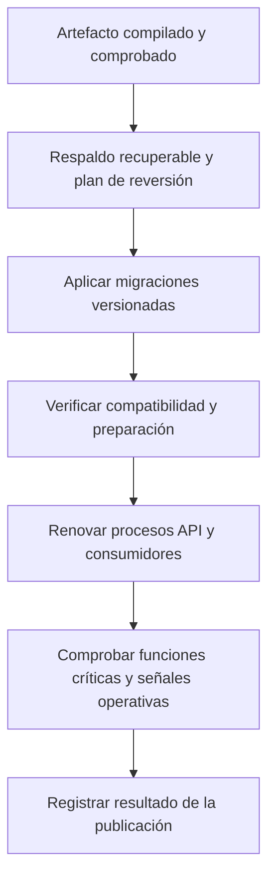

# Desarrollo local y entrega de versiones

La ejecución local y la publicación de versiones reproducen el mismo diseño de aplicación mediante **pnpm, Node.js, NestJS, PostgreSQL y PgBoss**. Los comandos operativos preparan, compilan y ejecutan procesos; no constituyen una segunda definición de los contratos de dominio ni de los permisos.

## 1. Preparación de un entorno local aislado

El desarrollo requiere Node.js compatible con el proyecto, pnpm, una base PostgreSQL accesible y la configuración de servidor válida. PgBoss utiliza PostgreSQL como infraestructura de mensajería persistente; no se instala un broker externo adicional para suplirlo.

Secuencia de preparación:

1. Obtener el código y restaurar las dependencias de forma reproducible mediante `pnpm install --frozen-lockfile`.
2. Proporcionar configuración local de conectividad y credenciales de prueba fuera del control de versiones.
3. Preparar el esquema local mediante las migraciones versionadas de Prisma y generar su cliente.
4. Iniciar por separado la atención interactiva y la composición de consumidores, verificando sus dependencias.
5. Utilizar identidades y registros de prueba acordes con las restricciones académicas; no usar datos personales reales como conjunto de pruebas.

| Comando | Uso previsto |
| --- | --- |
| `pnpm exec prisma migrate dev` | Aplicar y desarrollar migraciones **solo en la base de desarrollo**. |
| `pnpm exec prisma generate` | Generar el cliente de acceso a datos correspondiente al esquema. |
| `pnpm run start:dev` | Ejecutar la API en modo de desarrollo con recarga. |
| `pnpm run start:worker` | Ejecutar la composición de trabajo diferido. |
| `pnpm run build` | Construir los artefactos del backend. |
| `pnpm exec prisma studio` | Inspección local controlada de datos, sin emplearla como vía para cambios administrativos institucionales. |

**pnpm es el único gestor de paquetes y ejecutor oficial del proyecto.** Los comandos Prisma se invocan mediante `pnpm exec`. El comando de reinicio destructivo o reconstrucción directa del esquema no forma parte de la operación institucional.

## 2. Cambios de código y compatibilidad

Una versión reúne código de aplicación, adaptadores y migraciones compatibles con el estado persistente. La secuencia de entrega debe proteger las operaciones que continúan ejecutándose mientras cambian las instancias.

- El artefacto se compila y verifica antes de reemplazar instancias de ejecución.
- Los cambios de esquema se preparan como migraciones revisables, reproducibles y compatibles con los procesos que coexisten durante una transición.
- El contrato público de la API mantiene sus garantías y se transforma de manera controlada cuando requiere evolución.
- La composición API y la composición worker usan contratos de mensajes compatibles. Una versión nueva no invalida encargos durables ya admitidos.
- Los cambios que necesitan una transición incompatible se coordinan entre esquema, productores y consumidores; no se aplican como modificación unilateral de una sola instancia.

Los scripts exactos de arranque del artefacto compilado pertenecen al empaquetado ejecutable de la versión. La operación exige **procesos diferenciados de atención y consumo**, sin presuponer rutas de salida del compilador ni nombres de archivos generados en esta especificación.

## 3. Aplicación controlada de migraciones

En los entornos institucionales las migraciones se aplican con **`pnpm exec prisma migrate deploy`**, dentro de la fase de publicación y **una sola vez por versión de esquema**. No se ejecuta `migrate dev`, `db push` ni una operación de reseteo contra la base de producción.

Una migración fallida detiene la publicación de componentes que dependan de ese esquema. No se ejecutan rectificaciones improvisadas de datos mediante acceso directo a tablas funcionales. El plan de reversión distingue **volver al artefacto anterior compatible** de **restaurar datos**; ninguna migración irreversible se deshace mediante supuestos sobre su reversibilidad.

## 4. Reinicios, sustituciones y continuidad

Las instancias en sustitución dejan de aceptar nuevo trabajo antes de apagarse. Los consumers no deben perder el reconocimiento durable de una operación por un reinicio; un job interrumpido conserva su identidad y posibilidad de reintento. La API solo informa éxito cuando la confirmación crítica ha concluido.

Después de la publicación se comprueba como mínimo: inicio de sesión autorizado y revocación efectiva, una lectura institucional protegida, una operación transaccional representativa en entorno controlado, aceptación diferida y progreso recuperable. Las comprobaciones con mutación evitan generar inscripciones reales sin necesidad operativa y no utilizan cuentas ajenas para diagnosticar.

El despliegue no depende de una plataforma de contenedores, proveedor de nube o número de réplicas determinado; la operación conserva las mismas obligaciones de aislamiento, configuración y durabilidad en cualquier entorno que aloje los procesos definidos.
