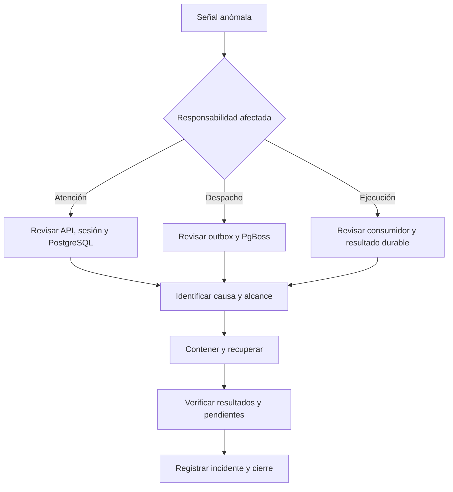

# Observabilidad y tratamiento de incidentes

La observabilidad facilita detectar deterioro, localizar causas y demostrar la recuperación del servicio sin convertir los registros técnicos en historial académico o auditoría administrativa. Las señales operativas describen **procesos, dependencias y resultados técnicos**, con el contexto mínimo necesario para diagnosticar una falla.

## 1. Señales de servicio

| Área observada         | Señales relevantes                                                                            | Interpretación operativa                                                                             |
| ---------------------- | --------------------------------------------------------------------------------------------- | ---------------------------------------------------------------------------------------------------- |
| Atención interactiva   | Disponibilidad de aceptación, volumen y distribución de fallos, tiempos de respuesta.         | Diferenciar rechazos funcionales esperados de fallos técnicos o saturación.                          |
| PostgreSQL             | Accesibilidad, conexiones, duración de transacciones, conflictos y fallos de confirmación.    | Detectar degradación que pueda afectar varias capacidades simultáneamente.                           |
| Procesamiento diferido | Encargos pendientes, en ejecución, reintentados, fallidos y antigüedad del trabajo pendiente. | Diferenciar una operación aceptada aún pendiente de una operación fallida.                           |
| Despacho recuperable   | Intenciones no despachadas, antigüedad y fallos de entrega a PgBoss.                          | Identificar una interrupción entre confirmación y envío, sin declarar perdida la admisión funcional. |
| Identidad y acceso     | Rechazos reiterados, fallos de renovación y anomalías de revocación.                          | Detectar problemas de configuración, abuso o falta de vigencia de sesiones sin exponer credenciales. |
| Recursos de proceso    | Consumo de memoria, CPU, conexiones y cierres no controlados.                                 | Relacionar agotamiento de capacidad con degradación real del servicio.                               |

La salud de la API, del procesamiento y del despacho se evalúa **por separado**. Una API accesible no acredita que los trabajos admitidos estén avanzando. Del mismo modo, un worker disponible no prueba que los usuarios puedan autenticarse o consultar inscripciones.

## 2. Registros técnicos útiles

Los registros usan una estructura que permita asociar un evento a proceso, operación y causa sin incluir datos sensibles. Se distinguen severidad, instante, contexto técnico pertinente, identificador de correlación y resultado.

- **Emitir:** fallos de arranque, pérdida de dependencia, reintentos agotados, excepciones imprevistas, reversión transaccional inesperada y transición significativa de degradación o recuperación.
- **Correlacionar:** solicitudes, intención persistente, despacho y ejecución mediante identificadores opacos; nunca utilizar la contraseña, el JWT o los bytes de un archivo como identificador diagnóstico.
- **Evitar:** volcado rutinario de cuerpos de petición, cookies, secretos, archivos originales, datos personales completos, repetición por cada fila correcta y mensajes triviales de funcionamiento normal.
- **Conservar evidencia funcional:** la auditoría institucional y el resultado por fila viven en sus almacenes autorizados; su ausencia en logs técnicos no implica pérdida de trazabilidad.

Las alertas agrupan ocurrencias repetidas del mismo problema. La supresión de ruido no oculta una nueva causa ni elimina el primer diagnóstico útil o el resultado de recuperación.

## 3. Diagnóstico orientado a causas

El orden de evaluación ante una degradación evita reinicios ciegos que encubran el defecto:

1. Establecer **qué responsabilidad** está afectada: interacción, persistencia, despacho, consumo, autenticación o lectura.
2. Comprobar estado y alcance de las dependencias correspondientes; verificar si hay operaciones confirmadas cuyo resultado técnico está retrasado.
3. Correlacionar errores, confirmaciones, intentos y versión desplegada. Distinguir un rechazo por regla de negocio de un fallo de infraestructura.
4. Contener el impacto: limitar nuevas admisiones de un mecanismo degradado cuando no se puede cumplir su garantía, conservando el acceso que siga siendo seguro y correcto.
5. Recuperar el mecanismo sin alterar manualmente estados de negocio ni duplicar efectos ya confirmados.
6. Comprobar funcionamiento, pendientes residuales y trazabilidad antes de declarar el incidente resuelto.

El diagnóstico depende de hechos persistidos y señales verificables. El reinicio de un worker no equivale a reprocesar indiscriminadamente cada registro académico ni a confirmar trabajos por la mera desaparición de mensajes pendientes.

## 4. Respuesta ante incidentes habituales

| Incidente                             | Contención y recuperación                                                                                                 | Comprobación de cierre                                                                          |
| ------------------------------------- | ------------------------------------------------------------------------------------------------------------------------- | ----------------------------------------------------------------------------------------------- |
| PostgreSQL inaccesible                | Suspender nuevas confirmaciones que dependen de la base; restablecer conectividad e integridad antes de reabrir admisión. | Transacciones y consultas vuelven a funcionar; no hay éxitos ficticios durante la interrupción. |
| Despacho detenido                     | Mantener las intenciones de outbox, restaurar el relay y reanudar entrega con identidad estable.                          | Disminuye el atraso y ninguna intención confirmada queda descartada.                            |
| Consumidor interrumpido               | Restablecer composición y PgBoss, recuperar encargos vencidos o pendientes sin duplicar efectos.                          | El seguimiento refleja incorporaciones ya confirmadas y trabajo restante.                       |
| Aumento de conflictos de concurrencia | Revisar contención y reintentos transaccionales acotados; no desactivar control de cupos.                                 | No aparecen sobrecupos ni inscripciones activas duplicadas.                                     |
| Fallos de identidad o procedencia     | Contrastar configuración segura, vigencia de sesiones y origen permitido; no abrir acceso indiscriminado.                 | Las solicitudes autorizadas funcionan y las no autorizadas siguen rechazadas.                   |
| Publicación incompatible              | Detener promoción, restaurar componentes compatibles y evaluar migraciones y datos por separado.                          | La versión en servicio interpreta correctamente estado, mensajes y sesiones vigentes.           |

## 5. Evidencia y revisión del incidente

Cada incidente operativo relevante conserva momento de detección, componente, efecto observado, causa identificada, medidas de contención, resultado verificado y acciones correctivas. La información se registra sin secretos ni datos personales no indispensables.

La revisión busca eliminar causas recurrentes: no se acepta como solución permanente reducir la visibilidad, aumentar reintentos sin límite o reiniciar procesos para ocultar errores persistentes. Los cambios de código y configuración siguen el control ordinario de versiones y verificación.
