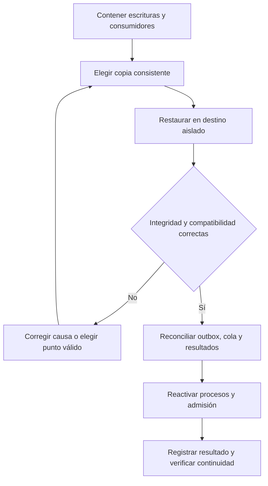

# Respaldos, restauración y reconciliación operativa

La recuperación operacional restaura **un conjunto consistente de datos y obligaciones pendientes**, no únicamente la disponibilidad de un proceso. PostgreSQL conserva el estado funcional, la identidad y las sesiones, los archivos originales de importación, la evidencia histórica, el outbox y los datos persistidos que utiliza PgBoss. La restauración debe respetar las relaciones entre esos elementos.

## 1. Alcance de los respaldos

Los respaldos cubren el conjunto transaccional necesario para interpretar y continuar las operaciones confirmadas. No se considera suficiente un respaldo aislado de tablas académicas si excluye evidencia, registros de importación, intenciones de despacho o estados de ejecución.

| Información                         | Garantía de restauración                                                                                    |
| ----------------------------------- | ----------------------------------------------------------------------------------------------------------- |
| Estructura y registros académicos   | Preservar identidades, asociaciones, vigencia e inscripciones confirmadas.                                  |
| Movimientos y auditoría             | Conservar atribución, razones y secuencias históricas sin sobreescritura.                                   |
| Identidades, cuentas y sesiones     | Recuperar el estado de acceso de forma coherente y aplicar revocación administrativa cuando corresponda.    |
| Importaciones y archivos originales | Mantener juntos admisión, contenido binario, huella, resultados por fila y estado de ejecución.             |
| Outbox y mensajería persistente     | Mantener las intenciones confirmadas y el estado técnico suficiente para reconciliar entregas y reintentos. |

Las copias se protegen con controles de acceso, cifrado y custodia adecuados a información personal y secretos persistidos; se aíslan de modificaciones ordinarias del servicio. Su calendario de generación, retención y objetivos temporales responden a una política institucional explícita y a la capacidad de recuperación probada, **sin inventar cifras en esta especificación**.

## 2. Procedimiento de restauración

Una restauración se realiza en una base de destino aislada y se verifica antes de habilitar procesos productivos. La operación no mezcla una base restaurada con workers o instancias conectadas a un estado de otra versión.

1. **Contener:** impedir nuevas escrituras y consumo de trabajos sobre el destino que será reemplazado; conservar la evidencia del incidente.
2. **Seleccionar:** identificar un punto de recuperación consistente y la versión de esquema y aplicación que puede interpretarlo. Registrar el alcance temporal de los datos recuperables.
3. **Restaurar:** recuperar conjuntamente las estructuras y registros necesarios, incluidos archivos binarios, evidencia y obligaciones de despacho.
4. **Validar:** comprobar integridad referencial, estados académicos, inscripciones que ocupan cupo, integridad histórica, admisiones de importación y compatibilidad del esquema.
5. **Reconciliar:** identificar trabajos confirmados, no despachados, en ejecución interrumpida o ya concluidos. Reiniciar su flujo con identidades durables, sin repetir efectos confirmados.
6. **Reabrir:** iniciar dependencias y procesos en orden controlado, verificar salud y permitir admisión solo después de las comprobaciones correspondientes.
7. **Documentar:** registrar punto restaurado, posible ventana de pérdida respecto de la operación anterior, validaciones y restricciones restantes.

## 3. Recuperación de trabajos y efectos

El trabajo diferido se recupera a partir de su **registro funcional persistente**, no de la suposición de que cada mensaje representa un encargo nuevo. El despacho puede repetir una publicación y el consumidor puede recibir un trabajo más de una vez.

- Una intención sin reconocimiento se publica o se vuelve a publicar con identidad estable, sin duplicar la aceptación funcional.
- Un mensaje reconocido por el broker no se marca como operación concluida hasta que el caso de uso confirme sus resultados.
- Una fila de importación con resultado definitivo no se reincorpora ni modifica; las filas no procesadas conservan su condición hasta su examen real.
- Un trabajo que termina con error conserva la evidencia de éxitos parciales y la causa conocida, sin declararse completado.
- Una restauración a un punto anterior puede no contener transacciones confirmadas después de ese punto: no se afirma recuperarlas sin evidencia ni se reconstruyen arbitrariamente a partir de logs.

La reconciliación no realiza escrituras directas a inscripciones para compensar un mensaje. Las correcciones académicas extraordinarias siguen el procedimiento autorizado, con justificación y auditoría, y no se convierten en mantenimiento silencioso de base de datos.

## 4. Ensayo de recuperación y controles de mantenimiento

La existencia de una copia no equivale a una recuperación válida. Se ejecutan **restauraciones de prueba en un entorno aislado**, con controles sobre integridad del esquema, autenticación, inscripciones, importaciones, evidencia, cola y procesamiento recuperable. Los resultados incluyen defectos encontrados y medidas de corrección.

Los trabajos de mantenimiento preservan las garantías del sistema:

- Los cambios de esquema siguen migraciones versionadas y verificadas; no se reconstruye la base de producción desde cero.
- La limpieza de almacenamiento temporal no elimina originales persistidos ni resultados funcionales.
- La rotación de logs operativos no borra movimientos históricos ni eventos de auditoría.
- La compactación o mantenimiento técnico de PgBoss no suprime obligaciones de outbox ni resultados pendientes de reconciliación.
- Las operaciones administrativas de mantenimiento utilizan identidades técnicas restringidas y dejan evidencia de su ejecución.

La reapertura del servicio exige confirmar que los datos restaurados son **interpretables, seguros y suficientes para continuar**. Reiniciar los procesos sin comprobar esas propiedades no constituye una restauración concluida.
