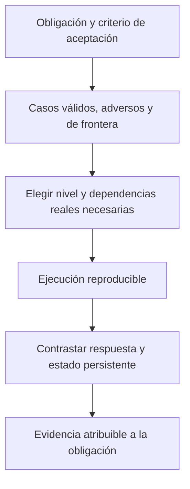

# Estrategia de verificación

La verificación demuestra el cumplimiento de **comportamientos y garantías observables** del sistema. Una operación que devuelve el estado HTTP esperado, pero deja datos inconsistentes, carece de autorización efectiva o pierde una obligación durable, **no supera la verificación**. La evidencia comprende respuestas, efectos confirmados, rechazos controlados y continuidad después de fallos.

## 1. Principios y niveles de prueba

| Nivel | Qué se comprueba | Evidencia adecuada | Límite de la evidencia |
| --- | --- | --- | --- |
| Unidad de dominio | Reglas, elegibilidad, estados, motivos y cálculos independientes de adaptadores. | Resultados deterministas sobre entradas válidas, límites e inválidas. | Un doble de repositorio no demuestra restricciones SQL ni seguridad bajo concurrencia. |
| Aplicación | Coordinación de casos de uso, contexto de actuación, contratos funcionales y efectos requeridos. | Resultado del comando o consulta y colaboraciones permitidas. | Un mock de mensajería no demuestra entrega durable ni recuperación. |
| Integración | Repositorios, mapeos, transacciones, restricciones de PostgreSQL, adaptadores y procesadores. | Estado real de dependencias en un entorno aislado y controlado. | Una operación secuencial no prueba carreras concurrentes. |
| Contrato HTTP | Autenticación de entrada, validación, respuestas, errores, cookies, filtros y OpenAPI. | Solicitudes reales a la aplicación instrumentada con Supertest. | Una respuesta correcta por sí sola no prueba la totalidad de efectos persistentes. |
| Sistema y recuperación | Interacción entre procesos, almacenamiento persistente, PgBoss, outbox y restauración. | Secuencias completas, interrupciones controladas y reconciliación de estados. | La ausencia de excepción en logs no constituye evidencia de integridad. |

Las pruebas automatizadas utilizan **Jest** como ejecutor y **Supertest** para ejercitar las interfaces HTTP. Las pruebas de integración que afirman garantías de PostgreSQL o PgBoss utilizan esos componentes reales; las pruebas unitarias emplean dobles únicamente para aislar decisiones cuyo comportamiento no depende del mecanismo sustituido.

La selección del nivel sigue la propiedad por demostrar, no una preferencia fija por pruebas unitarias o pruebas de extremo a extremo. Una misma obligación puede necesitar más de un nivel cuando incluye tanto una regla pura como una garantía de almacenamiento o transporte.

## 2. Diseño reproducible de escenarios

Todo escenario de aceptación contiene **precondición, actor o contexto, estímulo, resultado observable y estado final esperado**. Los escenarios adversos identifican además el efecto que debe estar ausente. Una prueba que solo comprueba el código de respuesta sin observar los cambios exigidos resulta insuficiente para una operación mutable.

- Los datos de prueba emplean identidades ficticias, claves institucionales controladas y relaciones académicas coherentes; no se incorporan datos personales reales.
- Las pruebas fijan explícitamente fechas y momentos relevantes mediante una fuente temporal controlada cuando se evalúan ventanas académicas o expiración de credenciales.
- Cada ejecución inicia con aislamiento respecto de otras pruebas: datos y sesiones no se heredan involuntariamente entre casos.
- Los escenarios concurrentes coordinan solicitudes verdaderamente solapadas y contrastan el resultado final persistido; repetir llamadas secuenciales no equivale a provocar una carrera.
- Los errores inyectados identifican un punto de interrupción definido y mantienen operativas las dependencias necesarias para examinar la recuperación.
- La aleatoriedad, la latencia de procesos y la replanificación del scheduler no pueden ser la única explicación de un resultado; se prefieren condiciones sincronizadas y verificaciones de estado con límite temporal controlado.

No se confunde *reproducibilidad* con una base de datos vacía sin restricciones: los escenarios conservan las relaciones y condiciones del dominio que hacen significativa la prueba.

## 3. Trazabilidad de cobertura

La cobertura funcional se organiza contra los identificadores **`RF-001` a `RF-054`** y la cobertura transversal contra **`RNF-001` a `RNF-020`**. Cada obligación conserva al menos un caso de aceptación identificable; las que contienen condiciones independientes se dividen en escenarios suficientes para demostrar cada condición.

| Relación de cobertura | Regla de revisión |
| --- | --- |
| Requerimiento → escenario | Cada capacidad y restricción tiene una comprobación positiva o negativa según corresponda. |
| Escenario → nivel y entorno | La selección de dependencias permite probar realmente la propiedad afirmada. |
| Escenario → resultado | El criterio diferencia aceptación, rechazo funcional y fallo técnico. |
| Escenario → evidencia | El resultado se puede reproducir y atribuir a un contrato o garantía. |
| Cambio → regresión | Toda alteración semántica actualiza los escenarios que ejercitan la regla afectada. |

Un caso puede cubrir varias obligaciones cuando prueba una misma propiedad observable, pero **una etiqueta de cobertura no sustituye la comprobación específica**. La cobertura de código, por sí sola, tampoco demuestra que se hayan ejercitado las transiciones prohibidas, las autorizaciones negativas o los conflictos concurrentes.

La cobertura transversal exige evidencia en los siguientes grupos, sin reducirlos a una sola prueba por rango:

| Requerimientos de calidad | Verificación principal |
| --- | --- |
| `RNF-001`–`RNF-004` | Referencias, atomicidad, ocupación derivada y ausencia de escrituras incompletas. |
| `RNF-005`–`RNF-009` | Credenciales, sesiones y permisos vigentes, procedencia de solicitudes y confidencialidad. |
| `RNF-010`–`RNF-012` | Integridad de movimientos, auditoría distinguible y evidencia recuperable de importaciones. |
| `RNF-013`–`RNF-014` | Aceptación asíncrona, continuidad y aislamiento de resultados parciales. |
| `RNF-015`–`RNF-016` | Contratos HTTP, validación, filtros, orden determinista y paginación. |
| `RNF-017`–`RNF-018` | Pruebas de dominio independientes de adaptadores y revisión automatizable de fronteras y dependencias. |
| `RNF-019`–`RNF-020` | Diagnóstico seguro, ausencia de ruido innecesario y escenarios críticos automatizados y reproducibles. |

## 4. Condiciones generales de conformidad

Una verificación es conforme cuando el comportamiento esperado se observa con evidencia repetible y sin efectos secundarios prohibidos. Las fallas se clasifican por su causa: contrato, dominio, autorización, integridad, recuperación, configuración del entorno o defecto de la propia prueba. Un resultado intermitente se investiga y no se descarta como éxito.

Las pruebas no reescriben reglas académicas para acomodar una implementación; sus criterios provienen de las obligaciones aprobadas. No se fijan objetivos de cobertura porcentual, rendimiento o disponibilidad arbitrarios: las propiedades críticas exigen pruebas explícitas, y los umbrales cuantitativos solo se convierten en criterios cuando cuentan con una decisión y una base medible.
