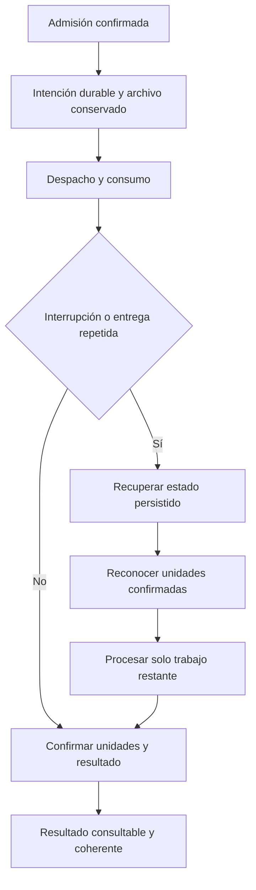

# Verificación de integridad, concurrencia y recuperación

Las garantías de persistencia se comprueban **sobre dependencias reales y estados confirmados**, no únicamente mediante respuestas de adaptadores. La prueba distingue tres preguntas: qué cambios se vuelven indivisibles, cómo se resuelven decisiones simultáneas y cómo se recuperan obligaciones que sobreviven a la interrupción de un proceso.

## 1. Integridad y atomicidad

Las pruebas de integración utilizan PostgreSQL con las restricciones y migraciones del sistema. Las comprobaciones finales consultan el estado persistido desde una transacción o sesión independiente de la operación ejercitada, para evitar confundir datos en memoria con commits reales.

| Propiedad                | Escenario adverso                                                                                                                | Evidencia exigida                                                                                                                                                                                                                     |
| ------------------------ | -------------------------------------------------------------------------------------------------------------------------------- | ------------------------------------------------------------------------------------------------------------------------------------------------------------------------------------------------------------------------------------- |
| Relaciones y unicidad    | Alta con identidad permanente, sigla, código, nombre o referencia incompatible; reutilización de valor liberado por baja lógica. | Se rechazan duplicidades de atributos sujetos a unicidad entre registros vigentes; se admite reutilizar valores de registros dados de baja en entidades que admiten esa operación, conservando UUID y FK históricos.                  |
| Inscripción y movimiento | Fallo antes del commit de una modificación académica                                                                             | Ni la inscripción ni su historial o auditoría obligatoria quedan parcialmente confirmados.                                                                                                                                            |
| Cambio de sección        | Conflicto o fallo al ocupar la sección de destino                                                                                | La inscripción conserva sección y ocupación de origen; no aparecen dos ocupaciones.                                                                                                                                                   |
| Cupos derivados          | Alternar altas, cancelaciones, retiros y movimientos                                                                             | La ocupación deriva de inscripciones `ENROLLED` y la disponibilidad permanece consistente.                                                                                                                                            |
| Conservación histórica   | Dar de baja un registro con dependencias vigentes o históricas                                                                   | La operación se rechaza ante dependencias vigentes incompatibles, se permite cuando solo permanecen dependencias dadas de baja y no protegidas operativamente, y nunca destruye ni reinterpreta referencias o movimientos históricos. |
| Fila importada           | Falla durante la incorporación de una persona y su perfil estudiantil                                                            | No quedan altas parciales de esa fila; los resultados confirmados de otras filas permanecen.                                                                                                                                          |

La verificación compara tanto el conjunto de registros existentes como **la ausencia de efectos prohibidos**. No basta con que una transacción haya generado una excepción; se examina qué ocurrió realmente antes y después del fallo.

## 2. Decisiones concurrentes

Las operaciones críticas se ejecutan con aislamiento **`SERIALIZABLE`**, gestionando conflictos transitorios mediante reintentos acotados y una reevaluación de condiciones. Las pruebas provocan solapamiento efectivo entre transacciones y comprueban un resultado serializable confirmado.

- **Último cupo:** dos o más estudiantes intentan ocupar la última plaza de una oferta. Solo se confirma la cantidad de inscripciones permitida por la capacidad; el resto obtiene un rechazo o conflicto interpretable.
- **Mismo estudiante, dos secciones:** dos solicitudes intentan inscribir al mismo estudiante en un mismo curso y periodo. Como máximo una queda vigente, aun cuando exista cupo en ambas ofertas.
- **Traslado cruzado y ocupación simultánea:** un cambio de sección compite con una inscripción o cambio hacia el mismo destino. La ocupación final de todas las secciones permanece válida y el historial corresponde a los movimientos efectivamente confirmados.
- **Baja y alta de relaciones:** dar de baja un padre compite con crear un dependiente que exige su vigencia; no pueden confirmarse simultáneamente una baja válida y un nuevo dependiente vigente incompatible.
- **Reutilización concurrente:** dos altas compiten por un código, sigla, nombre o combinación liberados por una baja lógica; solo se confirma un registro vigente por cada valor sujeto a unicidad, preservando los UUID y vínculos de los registros históricos.
- **Elegibilidad que cambia:** una modificación autorizada de estado de estudiante, oferta o periodo compite con una inscripción. La transacción confirmada es coherente con el orden serial resultante; no acepta condiciones que quedaron inválidas en su punto de decisión.
- **Misma importación admitida dos veces:** dos solicitudes del mismo usuario y mismo SHA-256 llegan simultáneamente. Se confirma una identidad funcional de importación, sin dos obligaciones independientes.
- **Sesión única y rotación:** inicios de sesión o renovaciones simultáneas no dejan dos sesiones activas ni dos credenciales de renovación sucesoras válidas.

La prueba no exige un orden artificial de victoria entre contendientes: exige un conjunto de resultados permitido y **un estado final único y consistente**. Si la ejecución termina por conflicto transitorio, comprueba que el resultado externo no se comunica falsamente como operación confirmada.

## 3. Durabilidad de encargos y procesamiento reanudable

Una operación diferida admitida conserva su identidad y obligación de ejecución en almacenamiento duradero. El broker y el consumidor transportan esa obligación; la evidencia funcional se mantiene bajo su capacidad propietaria.

Las pruebas controlan interrupciones **antes y después** de confirmar las diferentes unidades de trabajo:

| Punto de interrupción                          | Comportamiento comprobado                                                                         |
| ---------------------------------------------- | ------------------------------------------------------------------------------------------------- |
| Antes del commit de admisión                   | No existe una importación aceptada ni una obligación durable comunicada como válida.              |
| Después de la admisión, antes del despacho     | El outbox conserva la intención y permite su publicación al reanudar el relay.                    |
| Después del despacho, antes del reconocimiento | La entrega repetida no duplica incorporaciones ni resultados confirmados.                         |
| Antes de confirmar una fila                    | Esa fila permanece no confirmada, sin persona o perfil estudiantil parcial.                       |
| Después de confirmar varias filas              | Las incorporaciones y resultados existentes se conservan; se continúa con las unidades restantes. |
| Antes del resultado final                      | La consulta no presenta una ejecución incompleta como finalizada correctamente.                   |

Para CSV y XLSX se verifica equivalencia de las reglas de interpretación; se distinguen archivo ilegible, fila inválida, código de programa académico desconocido, identidad duplicada y registros correctos. Cada fila confirmada tiene un único resultado duradero por importación y posición; los efectos se escriben de forma atómica con ese resultado. Las cantidades finales se obtienen de esos resultados, sin clasificar trabajo no examinado como rechazo ni crear dobles confirmaciones ante reintentos. El archivo original permanece recuperable bajo autorización.

La ejecución técnica puede repetirse; **no se exige entrega exactamente una vez**. Lo exigido es que los efectos confirmados sean idempotentes y que el resultado funcional pueda reconciliarse con los hechos persistidos.

## 4. Restauración y reconciliación

La prueba de recuperación restaura conjuntamente el estado de PostgreSQL, las obligaciones diferidas persistidas y los archivos necesarios para interpretarlas. Comprueba la coherencia de referencias, sesiones, antecedentes académicos y resultados de importación tras el restablecimiento.

La reconciliación examina intenciones de outbox no publicadas, encargos en progreso y resultados funcionales confirmados. No vuelve a ejecutar efectos históricos ni descarta trabajo admitido por carecer de un reconocimiento técnico previo. Un restablecimiento correcto se acredita mediante consultas y nuevas operaciones controladas, no únicamente porque la base de datos o los procesos vuelvan a arrancar.
