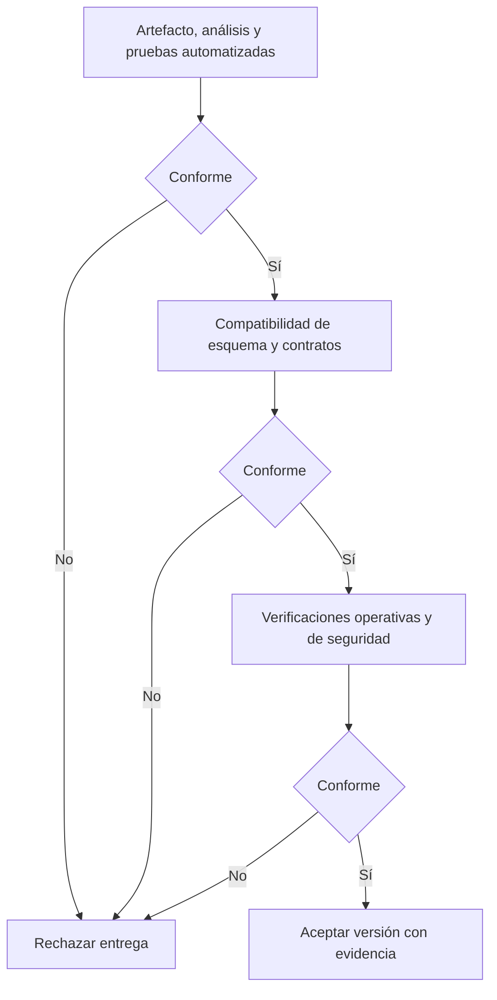

# Aceptación operativa y evidencias de entrega

La aceptación de una versión integra pruebas funcionales, seguridad, integridad y continuidad con las condiciones necesarias para ejecutarla de manera controlada. **Una compilación satisfactoria no sustituye las verificaciones del sistema**, ni el arranque de un proceso acredita que las obligaciones durables estén siendo procesadas.

## 1. Verificaciones de una entrega

| Control | Evidencia de aceptación |
| --- | --- |
| Calidad técnica | Compilación reproducible, análisis estático y conjunto automatizado de pruebas correspondientes a las responsabilidades afectadas. |
| Contratos públicos | Comportamiento de API y OpenAPI coherentes, sin cambios incompatibles inadvertidos de la versión expuesta. |
| Esquema persistente | Migraciones versionadas aplicables de forma controlada y compatibles con datos y procesos participantes. |
| Composición de procesos | API y consumidores inician con configuración válida, conectividad necesaria y dependencias satisfechas. |
| Seguridad del entorno | Las credenciales y configuraciones sensibles no se filtran en artefactos, respuestas ni registros; las cookies aplican su política de entorno. |
| Servicio funcional | Autenticación autorizada, consulta protegida, operación académica transaccional representativa y admisión de importación con seguimiento recuperable. |
| Operación diferida | El relay de outbox y PgBoss transportan encargos durables; la repetición de entregas no produce duplicación funcional. |
| Observabilidad | Se distingue error de acceso, fallo funcional, atraso de trabajo y defecto de infraestructura mediante señales correlacionables, sin ruido ni secretos. |
| Recuperación | Respaldo, restauración y reconciliación preservan datos confirmados y trabajo admitido. |

Las comprobaciones que alteran datos se realizan en entornos controlados y con registros de prueba; ninguna prueba de publicación exige crear o modificar inscripciones reales de la institución para demostrar su validez.

## 2. Orden de los controles y criterios de bloqueo

Se bloquea la aceptación ante cualquiera de estas condiciones: una regla crítica no satisfecha, pérdida de integridad, ausencia de autorización efectiva, divergencia contractual incompatible, migración insegura, obligación diferida perdida, exposición de secretos o imposibilidad de recuperar datos y trabajos según las garantías definidas.

Una prueba que falla de forma intermitente no se clasifica como conforme por reejecutarse hasta obtener un resultado favorable. Se identifica el defecto o la condición de entorno y se vuelve a verificar la propiedad afectada. El control de regresión incluye las capacidades indirectamente afectadas por cambios de infraestructura, permisos, transacciones o contratos compartidos.

## 3. Evidencia mínima de resultado

La evidencia de cada ejecución de verificación identifica:

1. **Versión o revisión examinada** y alcance de cambios.
2. **Entorno y dependencias significativas** empleados, sin exponer secretos.
3. **Escenarios y obligaciones cubiertas**, incluidos los resultados adversos exigidos.
4. **Resultado obtenido**, con distinción entre fallo de prueba, rechazo funcional correcto y error de infraestructura.
5. **Estado persistido observado** cuando se evalúan escrituras, concurrencia, recuperación o auditoría.
6. **Incidencias y decisión de aceptación**, atribuible a la revisión examinada.

La evidencia se conserva en los mecanismos de pruebas y entrega correspondientes, sin duplicar reportes de ejecución dentro de la especificación normativa. El código, las migraciones y el contrato OpenAPI generado son fuentes ejecutables que se comparan con las obligaciones, no sustitutos de ellas.

## 4. Revisión ante cambios

Un cambio en el dominio exige revisar pruebas de reglas y transiciones. Un cambio en repositorios, migraciones o aislamiento exige reevaluar integridad y concurrencia. Un cambio en credenciales, cookies o permisos exige reevaluar autorización y revocación. Un cambio en productores, outbox, consumidores o restauración exige reevaluar durabilidad e idempotencia. Los cambios de API afectan contrato y compatibilidad aunque preserven el mismo resultado interno.

Las pruebas operativas verifican efectos y observabilidad sin imponer un proveedor de alojamiento, un número fijo de réplicas o un objetivo porcentual no aprobado. Los riesgos se analizan por capacidad y garantía, no solo por el número de archivos modificados.
